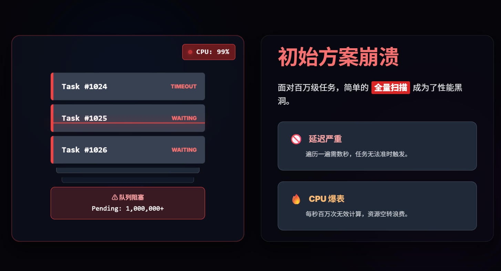
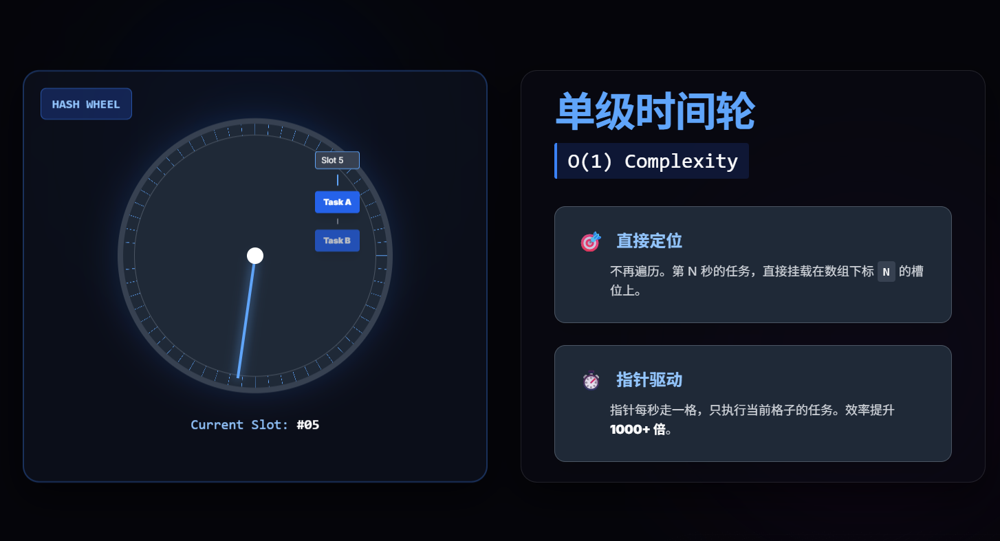
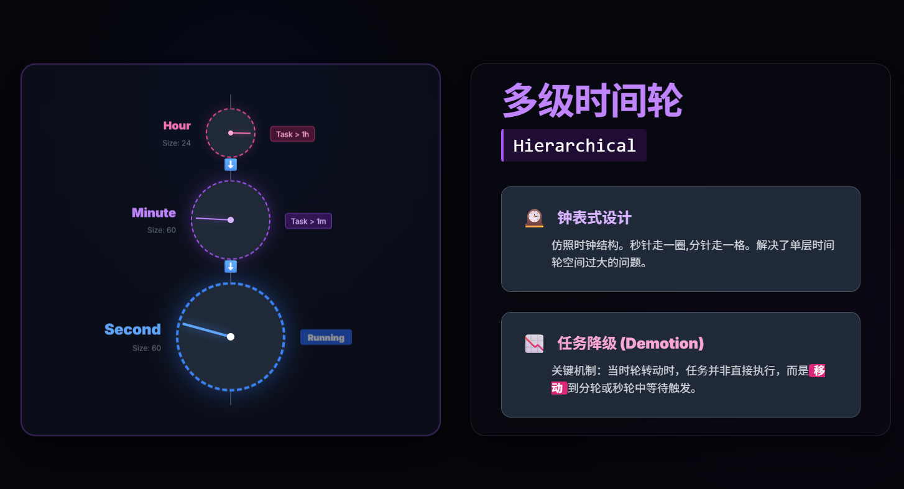
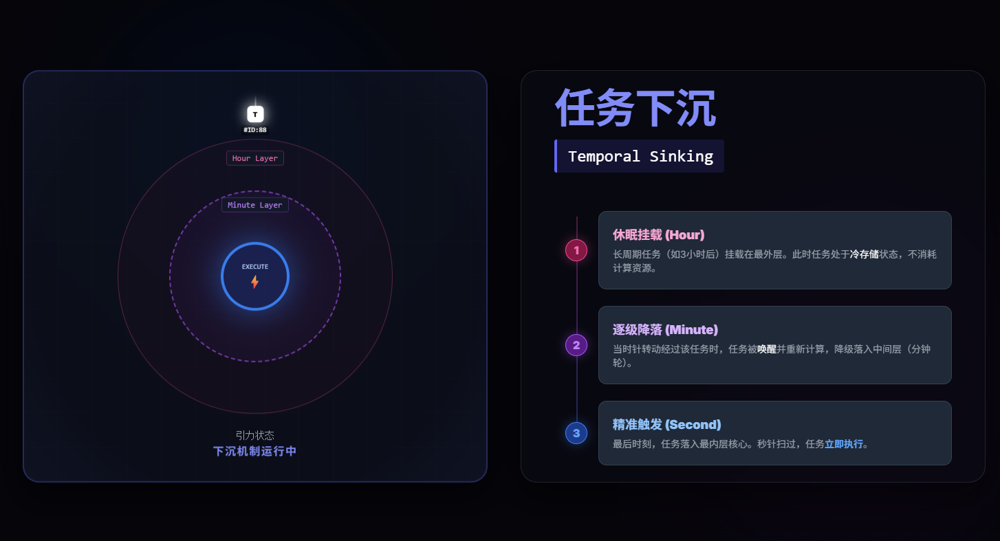

# 亿级任务调度：时间轮算法的革命性重构

在分布式系统中，定时任务调度是一个极其基础却又容易成为瓶颈的环节。当任务数量从几千上升到百万、亿级时，传统的调度模型会迅速崩溃。

本文将结合可视化演示，带你深入理解**时间轮（Timing Wheel）**算法是如何将时间复杂度从 **O(N)** 降维至 **O(1)**的。

***

### 一、 传统方案的崩溃点

如上图所示，当面对海量延时任务时，我们最直观的反应是使用“优先队列”（PriorityQueue）或“最小堆”（Min-Heap）。这些数据结构在任务量较小时表现良好，但在亿级规模下，它们存在致命缺陷：

1. **时间复杂度瓶颈**：最小堆的插入和删除操作复杂度为 **O(log N)**。虽然看起来不慢，但当** N **达到千万级，且每秒有数万次触发时，CPU 会将大量时间消耗在调整堆结构（Sift Up/Down）上，而非执行任务。
2. **全量扫描的代价**：如果使用简单的链表或数据库轮询，每次检查都需要遍历整个任务集（**O(N)**），这不仅导致严重的触发延迟（图中的 "TIMEOUT"），更会让 CPU 陷入无效的空转计算（图中的 "CPU: 99%"）。

我们需要一种不再依赖任务数量** N **的算法。

***

### 二、 破局：单级时间轮的 O(1) 魔法

时间轮的核心思想来源于我们墙上的挂钟。它利用了**哈希表**的思想，将线性时间“卷”成了一个环。

* **槽位（Slot）与哈希**：我们将时间切分为一个个刻度（Slot），本质上是一个循环数组。任务根据其触发时间，通过取模运算 <code>index = (timestamp % size)</code> 直接映射到对应的数组下标中。
* **指针驱动（Tick）**：指针（Current Time）每秒移动一格。它不需要遍历所有任务，**只关注当前指向的槽位**。

**为什么是 O(1)？** 无论任务队列中有 10 个还是 1 亿个任务，指针移动一次的操作是固定的：取出当前槽位的链表，执行所有任务。插入任务也是直接计算下标放入，与总任务数无关。

**局限性：** 单级时间轮面临“空间与精度”的权衡。如果我们要支持跨度为 1 年、精度为 1 秒的调度，需要 **365 \times 24 \times 3600 \approx 3153** 万个槽位，这将消耗巨大的内存空间。

***

### 三、 进阶：多级时间轮的层级结构

为了解决单级时间轮的空间膨胀问题，我们引入了**层级（Hierarchy）**概念，这与水表的读数机制或时钟的时分秒针完全一致。

* **多轮协作**：我们不再使用一个巨大的数组，而是创建多个小的时间轮（如上图的 Hour, Minute, Second）。
* **任务分流**：
  * **10秒后**的任务，直接挂在**秒轮**（最内层）。
  * **40分钟后**的任务，挂在**分轮**（中间层）。
  * **5小时后**的任务，挂在**时轮**（最外层）。

通过这种方式，我们用极小的空间（**60+60+24 = 144** 个槽位）就能表示一整天的时间跨度。

***

### 四、 核心机制：任务下沉（Temporal Sinking）

这是多级时间轮最精妙的设计，也是很多开发者容易困惑的地方：**外层轮的任务是如何被执行的？**

如上图的可视化所示，任务并不是一直静止不动的，它存在一个**“降级”或“下沉”**的过程：

1. **冷存储（Cold Storage）**：一个需要在 3 小时 5 分 10 秒后执行的任务，最初只会被挂载在**时轮**的“第3格”中。此时，分轮和秒轮中并没有这个任务的踪影。
2. **唤醒与重算（Re-insert）**：当时轮的指针走过了 3 个小时，指向了该任务所在的槽位，任务被“弹出”。但此时还没到执行时间（还差 5 分 10 秒）。
3. **降级（Demotion）**：系统重新计算该任务的剩余时间，发现剩余 5 分钟，于是将其**下沉**并注册到**分轮**的“第5格”。
4. **最终触发**：同理，当分轮走过 5 分钟，任务再次下沉到**秒轮**。最后，秒轮指针扫过，任务被执行。

这种机制确保了只有即将执行的任务才会占用高精度的计算资源，极大地优化了内存与 CPU 效率。

***

### 五、 总结：核心价值与应用

****

时间轮算法（Timing Wheel）通过空间换时间的设计，彻底改变了定时任务的调度范式：

1. **极速响应**：将插入和取消操作的时间复杂度稳定在 **O(1)**，消除了任务堆积带来的延迟风险。
2. **负载骤降**：CPU 仅在“滴答”时刻工作，其余时间休眠，资源消耗不再随任务量线性增长。
3. **无限扩展**：通过多级结构，理论上可以支持任意时间跨度的任务调度。

目前，这一算法广泛应用于 **Netty** 的 <code>HashedWheelTimer</code>、**Kafka** 的延时操作处理以及 **Dubbo** 的超时重试机制中，是构建高性能分布式系统的基石。

> 更新: 2025-11-21 21:38:10  
> 原文: <https://www.yuque.com/tulingzhouyu/db22bv/daozwvz77rfdfv3o>