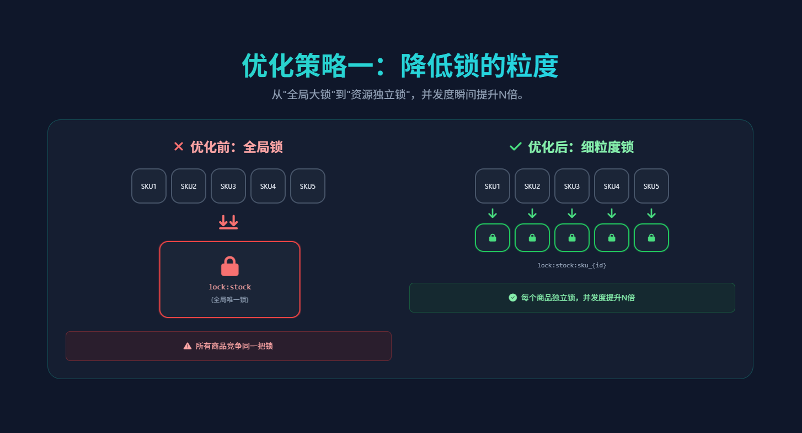
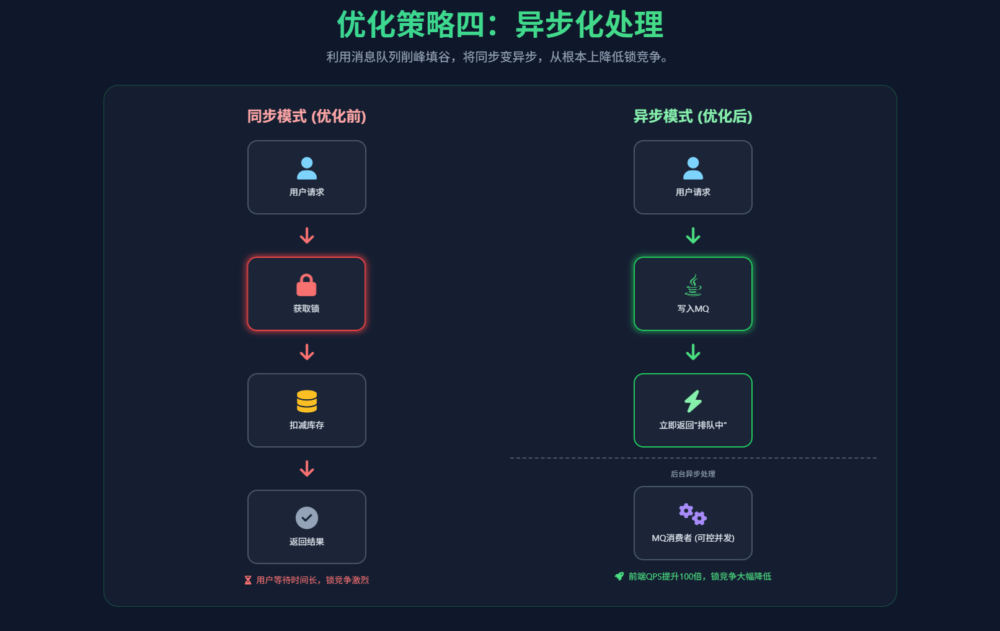
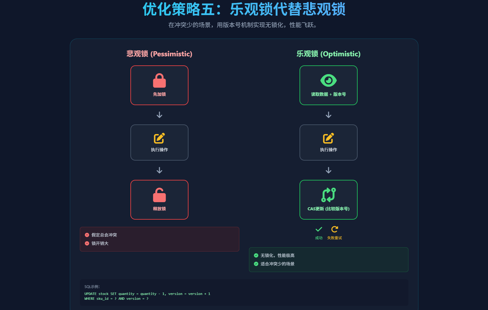
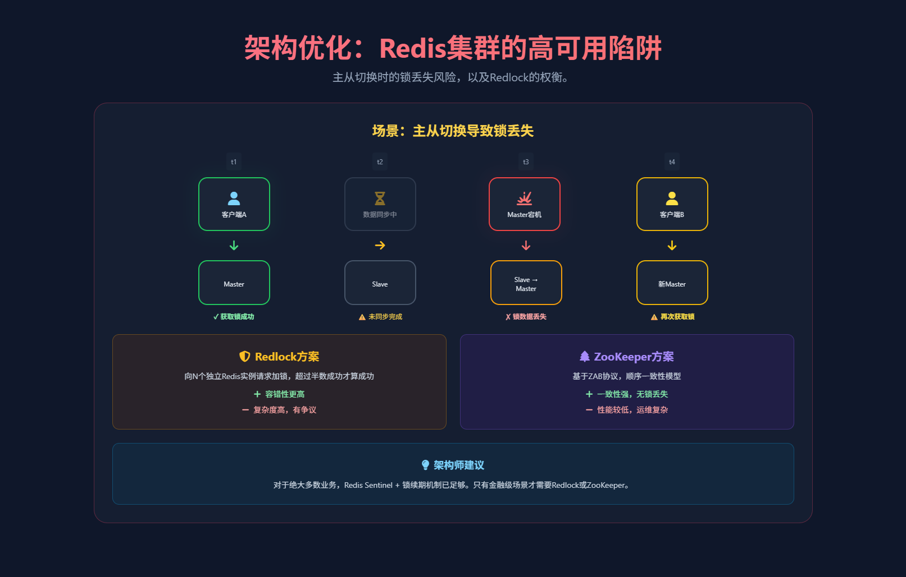

# 分布式锁在高并发场景下应该如何优化？

<font style="color:rgb(38, 38, 38);">在高并发的分布式系统中，锁（Lock）既是保证数据一致性的守护神，也常常是导致性能瓶颈的罪魁祸首。当成千上万的请求涌向一个被锁保护的资源时，系统吞吐量会急剧下降，用户体验变得糟糕。本文将结合一系列视觉化看板，从五个核心层面深入探讨如何系统性地优化分布式锁，实现从“竞争瓶颈”到“并发自由”的架构演进。</font>

#### <font style="color:rgb(38, 38, 38);">1. 问题的表象：高并发下的三大挑战</font>


<font style="color:rgb(38, 38, 38);">在深入技术细节之前，我们首先要明确在高并发场景下，一个设计不佳的分布式锁会带来哪三个核心问题：</font>

* **<font style="color:rgb(38, 38, 38);">锁竞争 (Contention)</font>**<font style="color:rgb(38, 38, 38);">：海量请求争抢同一把锁，导致大量线程阻塞和上下文切换，CPU资源被白白消耗。</font>
* **<font style="color:rgb(38, 38, 38);">热点压力 (Hotspot)</font>**<font style="color:rgb(38, 38, 38);">：如果锁本身（例如Redis实例）成为瓶颈，其性能上限将决定整个系统的吞吐量天花板。</font>
* **<font style="color:rgb(38, 38, 38);">可用性风险 (Availability)</font>**<font style="color:rgb(38, 38, 38);">：锁服务一旦宕机，所有依赖该锁的业务流程将全部停滞，引发雪崩效应。</font>

<font style="color:rgb(38, 38, 38);">我们的优化之旅，正是为了逐一攻克这三大挑战。</font>

#### <font style="color:rgb(38, 38, 38);">2. 问题的本质：从内存到网络的代价鸿沟</font>


<font style="color:rgb(38, 38, 38);">问题的根源在于分布式系统打破了单机环境的假设。在单个JVM内，我们谈论的锁（如</font><code><font style="color:rgb(38, 38, 38);background-color:rgba(175, 184, 193, 0.2);">synchronized</font></code><font style="color:rgb(38, 38, 38);">）是基于内存的，其开销在纳秒或微秒级别，性能极高。然而，一旦进入分布式环境，我们需要一个所有服务节点都能访问的“中央锁服务”（通常由Redis或ZooKeeper扮演）。这意味着，每一次加锁和解锁都从内存操作退化为至少一次网络往返（RTT）。在繁忙的网络中，这可能是几十毫秒的延迟，性能下降了数万倍。</font>

#### <font style="color:rgb(38, 38, 38);">3. 核心矛盾：吞吐量杀手“漏斗效应”</font>


<font style="color:rgb(38, 38, 38);">网络开销与竞争加剧两者叠加，形成了一个恐怖的“漏斗效应”。如图所示，无论你将系统横向扩展到多少台机器，所有请求最终都会被阻塞在同一个分布式锁上。10,000个并发请求，只有一个能通过，其余9,999个要么在原地空耗资源等待，要么在超时后失败。这不仅造成了巨大的资源浪费，更让整个系统的并发能力被这把锁的性能上限死死钳制。打破这个漏斗，是我们优化的首要目标。</font>

***

#### <font style="color:rgb(38, 38, 38);">4. 优化策略一：降低锁的粒度 (Granularity)</font>



<font style="color:rgb(38, 38, 38);">这是最直接、最有效的优化手段。其核心思想是：</font>**<font style="color:rgb(38, 38, 38);">锁应该保护的是正在被修改的资源，而不是整个业务操作。</font>**<font style="color:rgb(38, 38, 38);"> 以电商扣减库存为例，一个全局的</font><code><font style="color:rgb(38, 38, 38);background-color:rgba(175, 184, 193, 0.2);">lock:stock</font></code><font style="color:rgb(38, 38, 38);">锁显然粒度过大。正确的做法是为每一个商品（SKU）设置独立的锁。这样，对商品A的锁定将完全不影响对商品B的操作，系统的并发能力理论上可以提升N倍（N为SKU的数量）。</font>

**<font style="color:rgb(38, 38, 38);">实现要点：</font>**<font style="color:rgb(38, 38, 38);"> 在设计锁的Key时，将资源的唯一标识符包含进去。</font>

```java
// 优化前
String lockKey = "lock:stock";

// 优化后
String lockKey = "lock:stock:sku_" + skuId;
```

#### <font style="color:rgb(38, 38, 38);">5. 优化策略二：锁分段 (Segmented Lock)</font>


<font style="color:rgb(38, 38, 38);">降低锁粒度虽然有效，但如果遇到“热点商品”（如秒杀），所有请求依然会集中在同一个Key上。锁分段的思想借鉴自Java的</font><code><font style="color:rgb(38, 38, 38);background-color:rgba(175, 184, 193, 0.2);">ConcurrentHashMap</font></code><font style="color:rgb(38, 38, 38);">，它将一个热点锁虚拟地拆分成多个“段”（Segments）。当请求到来时，通过一个哈希算法（例如，根据用户ID哈希）将请求路由到不同的锁分段上。这样，对同一个热点商品的并发请求就被分散到了多个不同的锁上，从而将压力均摊。</font>

**<font style="color:rgb(38, 38, 38);">实现要点与权衡</font>**<font style="color:rgb(38, 38, 38);">：</font>

```java
// 将一个热点SKU的锁分为16个段
int segment = Math.abs(userId.hashCode()) % 16;
String lockKey = "lock:stock:" + skuId + ":seg_" + segment;
```

<font style="color:rgb(38, 38, 38);">此策略以牺牲单品库存的严格原子性为代价（可能导致少量超卖），换取吞吐量的巨大提升。因此，它需要业务层面有后续的库存校验和补偿机制，适用于允许少量误差的场景。</font>

#### <font style="color:rgb(38, 38, 38);">6. 优化策略三：精简临界区 (Critical Section)</font>


**<font style="color:rgb(38, 38, 38);">锁的持有时间 = 性能的倒数。</font>**<font style="color:rgb(38, 38, 38);"> 持有时间越长，其他线程等待的时间就越长，系统的吞吐量就越低。务必保证锁定的“临界区”内只包含绝对必要的核心写操作。所有可以在锁外执行的代码都应该被移出，例如：参数校验、数据准备、发送消息通知、记录日志等。定期审视临界区代码，是每个架构师的必修课。</font>

#### <font style="color:rgb(38, 38, 38);">7. 优化策略四：异步化处理</font>



<font style="color:rgb(38, 38, 38);">这是对“缩短锁持有时间”思想的极致升华，它直接将锁从用户请求的主流程中剥离。其核心是</font>**<font style="color:rgb(38, 38, 38);">将同步阻塞操作变为异步非阻塞任务</font>**<font style="color:rgb(38, 38, 38);">。当用户的下单请求到达时，系统不再直接尝试获取锁，而是将“扣减库存”任务封装成消息发往消息队列（MQ），并立即向用户返回“排队中”。后台的MQ消费者则可以按照自己的节奏，以一个可控的并发度去处理任务。这种方式通过MQ实现了流量的“削峰填谷”，从根本上避免了高并发对锁资源的直接冲击。</font>

**<font style="color:rgb(38, 38, 38);">权衡</font>**<font style="color:rgb(38, 38, 38);">：此方案引入了系统的复杂性（需维护MQ），且用户无法立即得知最终结果，即数据达到的是</font>**<font style="color:rgb(38, 38, 38);">最终一致性</font>**<font style="color:rgb(38, 38, 38);">。它适用于对延迟不敏感、允许异步确认的业务场景。</font>

#### <font style="color:rgb(38, 38, 38);">8. 优化策略五：乐观锁 (Optimistic Locking)</font>



<font style="color:rgb(38, 38, 38);">之前的策略都属于“悲观锁”，即假定冲突总会发生。而乐观锁则假定冲突很少发生，因此不加锁，而是在更新时去检查数据是否被他人修改过。最常见的实现方式是</font>**<font style="color:rgb(38, 38, 38);">版本号（version）机制</font>**<font style="color:rgb(38, 38, 38);">。更新数据时，只有当数据库中的</font><code><font style="color:rgb(38, 38, 38);background-color:rgba(175, 184, 193, 0.2);">version</font></code><font style="color:rgb(38, 38, 38);">与之前读取的一致时，更新才会成功。</font>

**<font style="color:rgb(38, 38, 38);">实现要点（SQL）与适用场景</font>**<font style="color:rgb(38, 38, 38);">：</font>

```plsql
UPDATE stock 
SET quantity = quantity - 1, version = version + 1 
WHERE sku_id = ? AND version = ?;
```

<font style="color:rgb(38, 38, 38);">乐观锁在“读多写少”的场景下性能极高，因为它完全避免了加锁的开销。但在冲突频繁的“写多”场景下，不断地重试反而会降低性能。</font>

#### <font style="color:rgb(38, 38, 38);">9. 架构优化：确保锁服务自身的高可用</font>



<font style="color:rgb(38, 38, 38);">当我们依赖Redis作为锁服务时，必须考虑其自身的可用性。在Redis主从架构中，如果Master节点在持有锁后，数据还未同步到Slave时就宕机，此时新的Master上没有锁的数据，会导致锁的安全性被破坏。</font>

**<font style="color:rgb(38, 38, 38);">解决方案与权衡</font>**<font style="color:rgb(38, 38, 38);">：</font>

* **<font style="color:rgb(38, 38, 38);">Redlock</font>**<font style="color:rgb(38, 38, 38);">：客户端向N个独立的Redis实例请求加锁，多数成功才算成功。容错性更高，但因其复杂性和时钟依赖性而备受争议。</font>
* **<font style="color:rgb(38, 38, 38);">ZooKeeper/Etcd</font>**<font style="color:rgb(38, 38, 38);">：基于一致性协议（ZAB/Raft），能保证严格的顺序一致性，无锁丢失风险，但性能通常低于Redis。</font>

**<font style="color:rgb(38, 38, 38);">架构师建议</font>**<font style="color:rgb(38, 38, 38);">：对于绝大多数业务，Redis Sentinel/Cluster配合合理的锁续期机制已足够。只有在金融级场景，才需要考虑引入Redlock或ZooKeeper。</font>

***

#### <font style="color:rgb(38, 38, 38);">10. 总结：构建你的优化知识金字塔</font>


<font style="color:rgb(38, 38, 38);">面对分布式锁的性能问题，我们不应盲目地寻找“银弹”。这个“优化金字塔”模型为我们提供了清晰的指引，它强调了优化的层次性：从最根本的业务架构重构，到服务层的高可用保障，再到具体的技术手段（锁模式、时空维度优化）。</font>

<font style="color:rgb(38, 38, 38);">请牢记优化的黄金三原则：</font>

1. **<font style="color:rgb(38, 38, 38);">能不加锁就不加锁。</font>**
2. **<font style="color:rgb(38, 38, 38);">必须加锁时，让它“又小又快”。</font>**
3. **<font style="color:rgb(38, 38, 38);">架构优化优先于技术调优。</font>**


> 更新: 2025-11-20 14:32:19  
> 原文: <https://www.yuque.com/tulingzhouyu/db22bv/laixkqv39oprn68i>