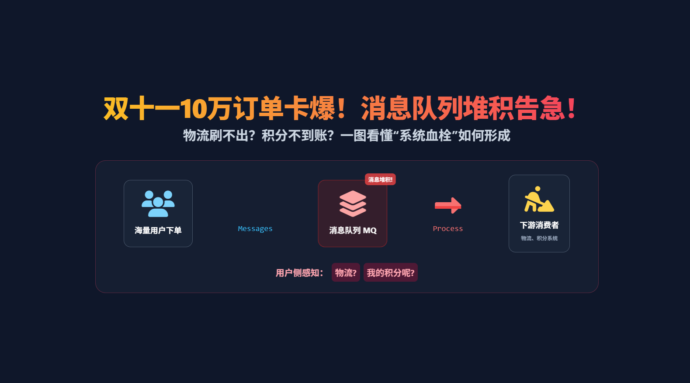
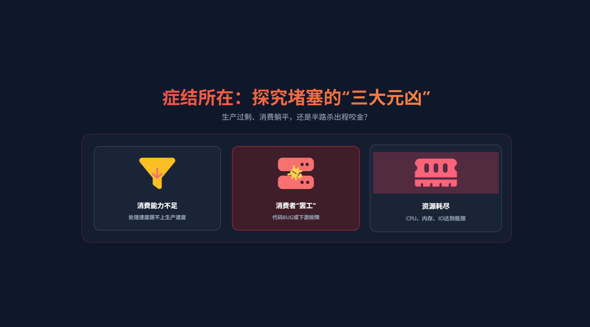
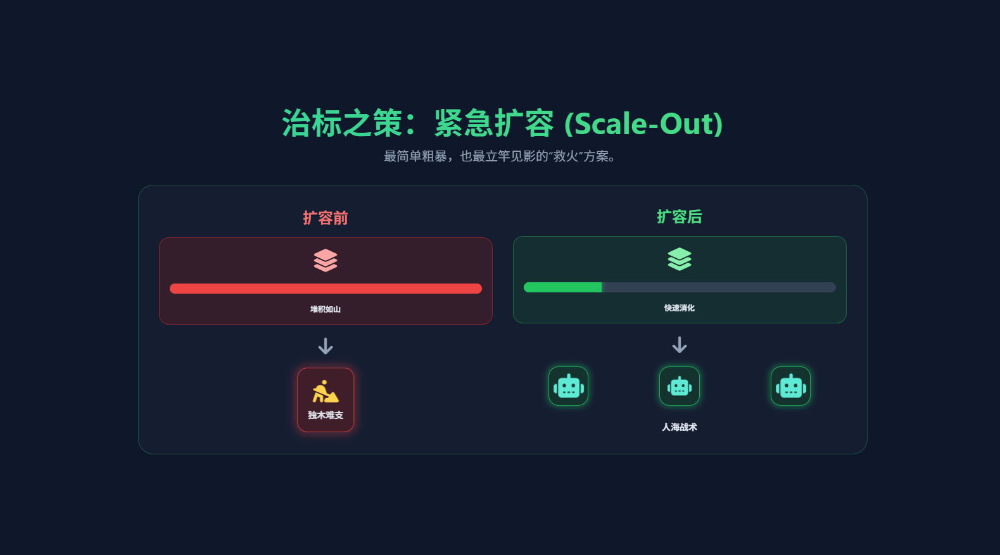
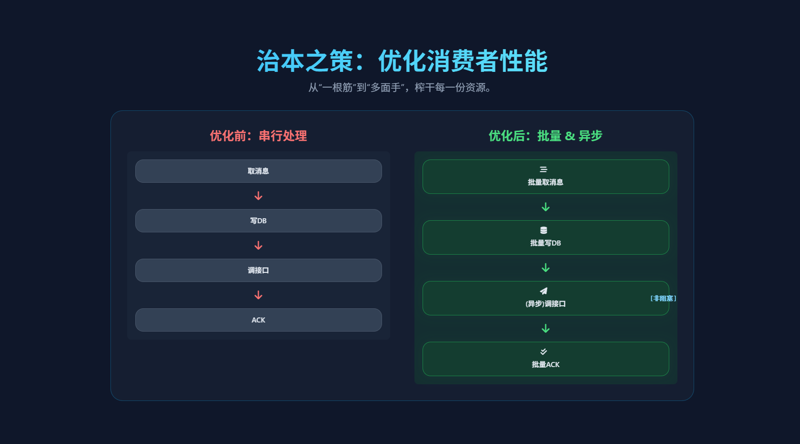
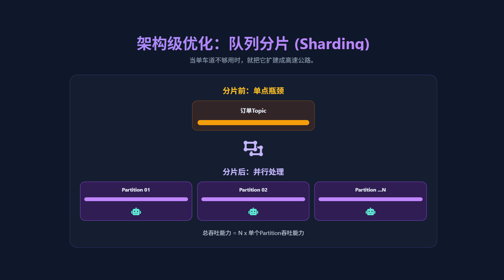
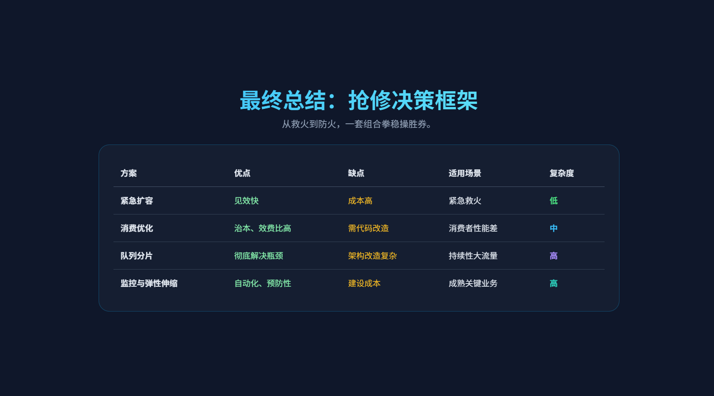

# 双十一10万用户订单消息卡爆！查不到物流，怎么快速处理不引发退单？

## 一、是什么：消息队列堆积的“惊魂一刻”
想象一下双十一零点的抢购洪峰，数以万计的订单在瞬间生成。用户的“下单”操作，会作为一个“创建订单”消息被发送到消息队列（Message Queue, MQ）中，等待下游的“物流系统”、“积分系统”等消费者（Consumer）来处理。

**消息队列堆積 (Message Backlog)**，顾名思义，就是消息的生产速度远大于消费速度，导致大量消息滞留在队列中无法被及时处理的现象。就像高速公路在节假日变成了巨大的停车场，车辆（消息）源源不断地涌入，但出口（消费者）却通行缓慢，最终导致整个路网瘫痪。

用户侧的直观感受就是：付了款，订单状态却迟迟不变；刷新无数次，物流信息就是“揽收中”；参与了活动，积分和优惠券却不见踪影。

## 二、为什么：探究堵车的“三大元凶”

消息队列的堵塞并非偶然，其背后往往隐藏着深刻的系统设计和资源问题。主要原因可以归结为三类：

1. **消费能力不足 (Insufficient Consumer Capacity):** 这是最常见的原因。
    - **业务洪峰:** 如双十一、秒杀活动，生产端的流量在短时间内飙升百倍，而消费端的处理能力没有相应扩展。
    - **消费者性能瓶颈:** 消费者自身逻辑复杂、执行耗时过长（例如，包含多次数据库读写、调用外部接口），导致单条消息处理时间（RT）过长。
2. **消费者“罢工” (Consumer Failure):**
    - **代码缺陷:** 消费者代码存在bug，处理特定消息时会抛出异常并不断重试，形成“毒丸消息”，阻塞整个队列。
    - **下游依赖故障:** 消费者依赖的数据库、缓存或外部API出现故障或高延迟，导致消费者自身被“拖垮”，处理停滞。
3. **资源耗尽 (Resource Exhaustion):**
    - **消费者侧:** 消费者所在服务器的CPU、内存、网络IO或线程池资源达到瓶颈，无法再接收和处理更多消息。
    - **MQ服务端:** MQ Broker自身的磁盘空间、内存或连接数达到上限，也会导致系统整体性能下降。

## 三、怎么做：从“治标”到“治本”的快速抢修手册
面对消息堆积，我们需要一套组合拳，先快速恢复业务（治标），再从根源上解决问题（治本）。

### 第一阶段：紧急响应 (治标)
目标是**立刻恢复消费能力，消化堆积**。

1. **核心策略：紧急扩容 (Scale-Out)** 这是最直接、最有效的“大力出奇迹”方案。立即水平扩展消费者实例的数量。如果原本有5个消费者实例，迅速增加到50个甚至100个。通过并行处理，消费能力会得到线性甚至超线性的增长，快速“吃掉”堆积的消息。
    - **操作前提:** 你的应用必须是无状态的，且消费逻辑是幂等的（即同一条消息处理多次和处理一次的结果相同），这是任何分布式系统的基本要求。

2. **辅助策略：降级与熔断** 如果扩容后发现消费者的瓶颈在于下游依赖（如数据库压力过大），则需要对消费逻辑进行降级。
    - **非核心业务降级:** 暂时关闭一些非核心的消费逻辑，如“订单完成后增加积分”。
    - **日志记录:** 将失败或降级的消息内容记录到日志或“死信队列”(Dead-Letter Queue, DLQ)中，待系统恢复后再进行补偿处理。

### 第二阶段：根源治理 (治本)
目标是**优化系统，防止未来再次发生大规模堆积**。

1. **优化消费者性能 (Optimize Consumer)** 深入分析消费逻辑，找到性能瓶ger颈。
    - **批量处理 (Batch Processing):** 将“处理1条消息”改为“一次性处理一批（如100条）消息”。这能极大减少网络交互和数据库连接的开销。
    - **异步化:** 将消费逻辑中的非关键、耗时的操作（如调用外部通知接口）异步化，主流程只负责核心任务。

2. **架构级优化：队列分片 (Sharding/Partitioning)** 当单一队列的吞吐量达到物理上限时，就需要对队列本身进行“分而治之”。类似于数据库的分库分表，将一个大的Topic拆分成多个小的Partition（分区）。
    - **原理:** 每个Partition都是一个独立的子队列，可以被专属的消费者组消费。这样，整个Topic的总吞吐能力就等于所有Partition的吞吐能力之和。例如，RocketMQ的Topic和Queue，Kafka的Topic和Partition都是这种思想的体现。

3. **建立监控与预警 (Monitoring & Auto-Scaling)**
    - **核心指标监控:** 对消息队列的“消息堆积数 (Lag)”、"消息年龄 (Message Age)"、“消费者RT”等核心指标设置监控和告警。
    - **弹性伸缩:** 基于监控指标，建立自动化或半自动化的弹性伸缩机制。例如，当消息堆积数超过阈值时，自动触发消费者的扩容流程。

## 四、方案对比与总结
| 方案 | 优点 | 缺点 | 适用场景 | 复杂度 |
| :--- | :--- | :--- | :--- | :--- |
| **紧急扩容** | 见效快、操作简单 | 成本高（临时增加资源）、治标不治本 | 应对突发流量洪峰、紧急救火 | 低 |
| **消费优化** | 提升系统根本性能、成本效益高 | 需要深入代码和业务进行分析改造 | 消费者RT过长、处理逻辑复杂 | 中 |
| **队列分片** | 彻底解决单队列吞吐瓶颈、水平扩展能力强 | 架构改造复杂、对MQ中间件有要求 | 持续性的大流量、可预见的业务增长 | 高 |
| **监控与弹性伸缩** | 自动化、预防性强 | 建设和维护有一定成本 | 成熟的、业务关键的系统 | 高 |

**结论：** 处理消息堆积问题，绝不是单一方案能完美解决的。一个成熟的架构应该是一个组合策略：

+ 以**监控预警**为“哨兵”；
+ 以**弹性伸缩**为“快速反应部队”；
+ 以**持续的消费端优化**为“内功”；
+ 以**队列分片**等架构级方案为“终极武器”。

面试时，能够清晰地阐述这套从“紧急响应”到“根源治理”的立体化解决方案，才能真正体现出你处理复杂线上问题的综合能力。

> 更新: 2025-09-28 18:56:29  
> 原文: <https://www.yuque.com/tulingzhouyu/db22bv/zc71tq2mei3pc590>