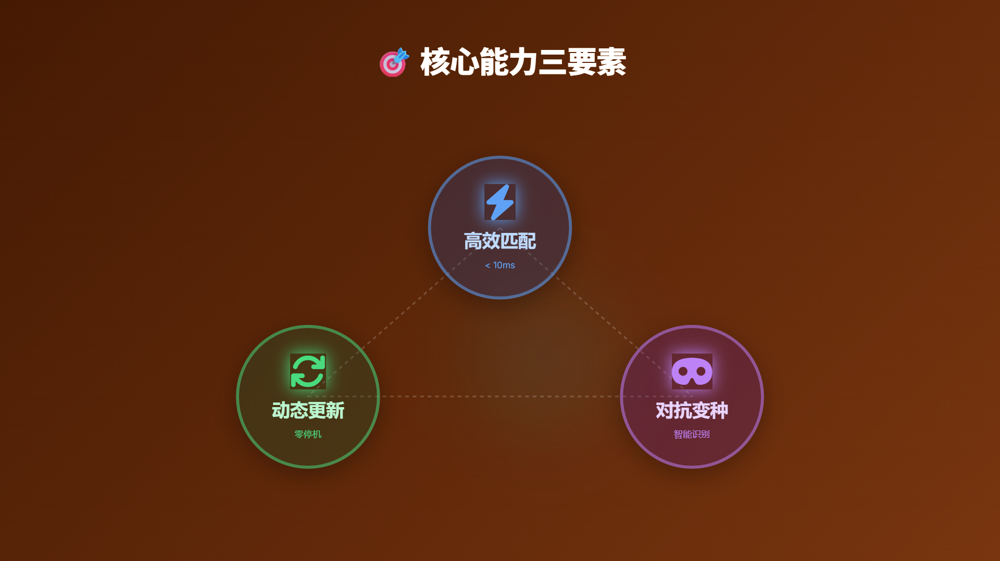
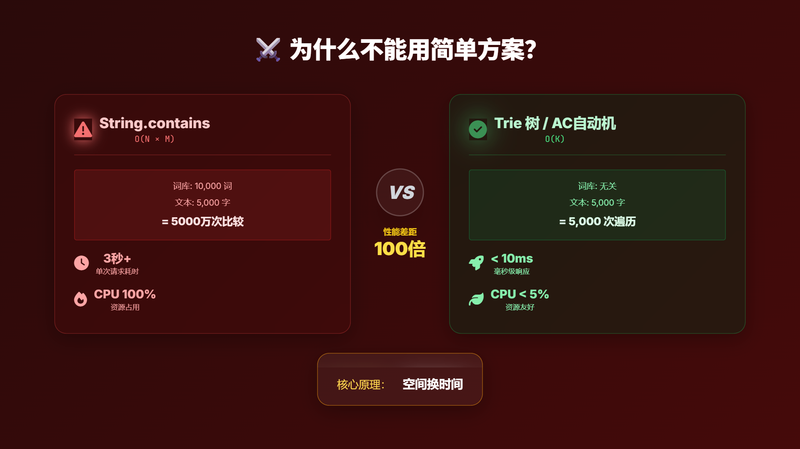
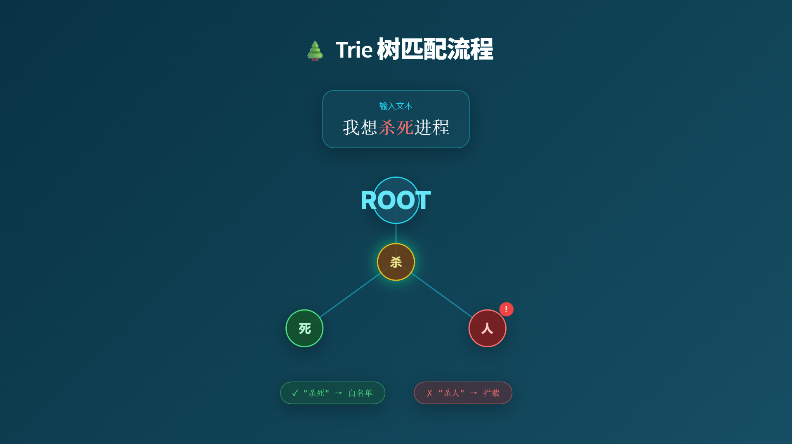
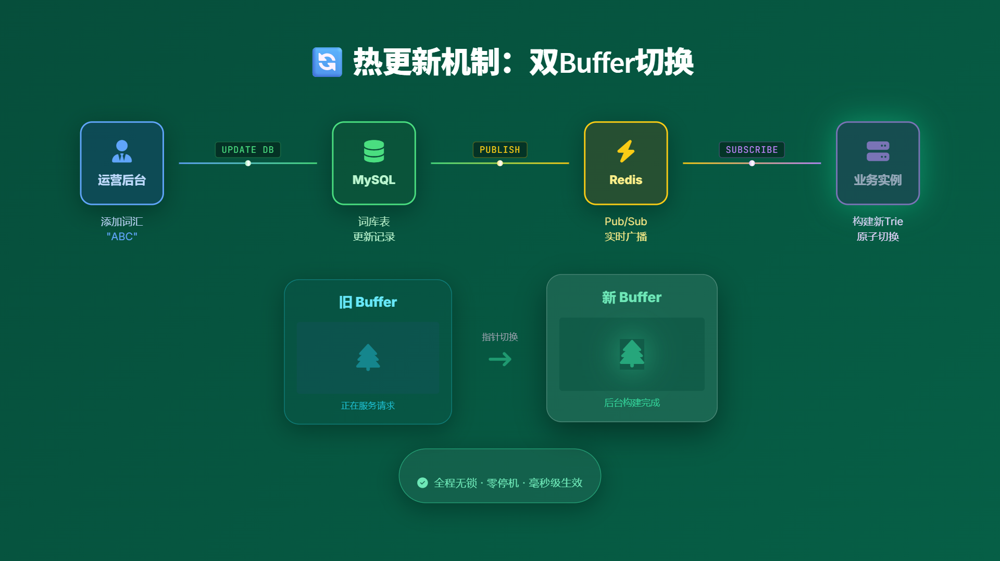
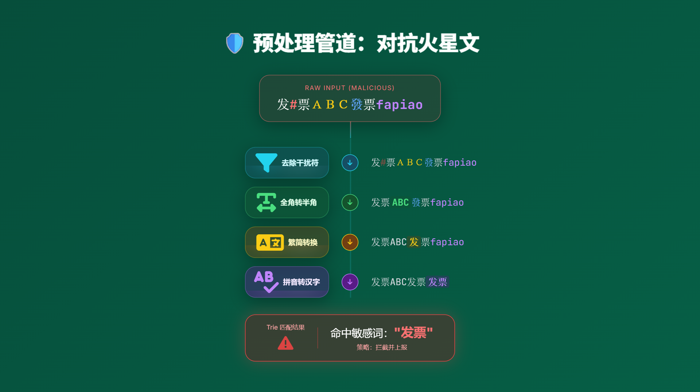

# 如何设计一个敏感词过滤系统？

在当今的互联网环境下，内容安全（Content Security）已经成为各大平台不可忽视的生命线。无论是社交媒体、直播弹幕，还是电商评论，海量的用户生成内容（UGC）中往往夹杂着违规信息。

设计一个生产级的敏感词过滤系统，我们面临着三个核心挑战：

1. **高效匹配**：在亿级流量冲击下，如何保证毫秒级的低延迟响应？
2. **动态更新**：如何在不重启服务、不中断业务的情况下，实时生效最新的违规词库？
3. **对抗变种**：面对“火星文”、拼音拆解等恶意规避手段，系统如何保持健壮性？

本文将围绕这三个目标，从最基础的算法选型开始，一步步演进到支撑亿级流量的分布式智能架构。

## 一、 算法选型：从 O(N\*M) 到 O(K) 的性能跃迁

在系统初期，很多开发者会习惯性地使用数据库模糊查询（<code>LIKE %keyword%</code>）或者正则表达式（Regex）来解决问题。在数据量极少时，这确实有效。但在生产环境中，这种方案是致命的。

假设我们有一个包含 10,000 个敏感词的词库，需要检测一段 5,000 字的文章。 如果使用简单的字符串包含匹配（<code>String.contains</code>），系统需要进行 <code>10,000 × 5,000</code> 次扫描。随着词库的膨胀，计算量呈线性甚至指数级增长，CPU 会瞬间被耗尽。

我们需要的是一种**时间复杂度与词库大小无关**的算法。

如上图所示，引入 **Trie 树（字典树）** 或 **AC 自动机（Aho-Corasick Automaton）** 后，性能发生了质的飞跃。无论词库里有 1 万个词还是 100 万个词，检测耗时只与**被检测文本的长度**（K）有关。这种“空间换时间”的策略，将响应时间从秒级压缩到了毫秒级。

## 二、 核心数据结构：基于 Trie 树的状态机实现

Trie 树的核心思想是利用字符串的**公共前缀**来减少查询时间。我们将所有的敏感词构建成一棵树状结构，根节点为空，每个节点代表一个字符。

当文本流进入系统时，我们像查字典一样逐字匹配：

1. **指针游走**：读取文本中的字符，在树上寻找对应的子节点。
2. **状态判定**：如果路径断开，说明不匹配；如果路径走到了标记为“结束”的节点，说明命中了敏感词。
3. **白名单溯源**：为了防止误杀（例如“杀毒软件”包含“杀毒”），我们可以在树的特定路径上标记“白名单”属性，实现更细粒度的控制。

## 三、 动态配置：基于双缓冲（Double Buffering）的热加载机制

算法解决了匹配效率问题，但工程落地时会遇到一个棘手的痛点：**词库更新**。 运营人员在后台新增了一个突发敏感词，技术部门不可能为此重启所有服务。我们需要实现**热加载（Hot Reload）**。

在多线程高并发环境下，直接修改正在使用的 Trie 树是非常危险的，极易导致并发冲突或服务崩溃。这里我们引入了并发编程中常用的**Copy-On-Write** 思想与 **双 Buffer 机制**。

**设计方案如下：**

1. **版本控制**：运营在后台修改词库后，数据存入 MySQL，并更新版本号。
2. **事件广播**：通过 Redis 的 Pub/Sub（发布订阅）机制，向所有业务节点发送“词库变更”信号。
3. **异步构建**：业务节点收到信号后，不影响当前服务，而是在内存中开辟一块新区域，构建一棵全新的 Trie 树（New Buffer）。
4. **原子切换**：新树构建完毕后，利用 Java 的 <code>AtomicReference</code> 或 <code>volatile</code> 关键字，将全局指针瞬间指向新树。
5. **GC 回收**：旧树失去引用，由垃圾回收器（GC）自然清理。

这种设计实现了**全程无锁（Lock-free）**，无论词库多大，更新过程对业务流量完全透明，真正做到了“毫秒级生效，零业务感知”。

## 四、 存储架构：多级缓存（Multi-Level Caching）策略

在亿级流量的场景下，仅仅依赖 Redis 也是不够的。每一次网络 I/O 都是成本。为了追求极致性能，我们采用了**三级存储架构**。

* **L1 (In-Process Cache)**：这是性能的关键。我们将构建好的 Trie 树对象直接驻留在应用服务的堆内存（Heap）中。命中 L1 意味着**零网络开销**，检测耗时通常在微秒级别。
* **L2 (Distributed Cache)**：使用 Redis 存储全量的词库数据、黑名单配置以及版本信息，作为各个服务节点之间的数据同步源。
* **L3 (Persistent Storage)**：MySQL 作为数据的最终来源（Source of Truth），负责归档、审计和管理后台的增删改查。

这种架构确保了 99.9% 的请求都在本地内存中完成，只有在服务启动或缓存失效时才会访问远程存储。

## 五、 对抗策略：文本预处理管道（Preprocessing Pipeline）

道高一尺，魔高一丈。为了绕过审查，恶意用户发明了各种“火星文”：

* 插入干扰符：<code>发#票</code>
* 全角字符：<code>ＦＡＰＩＡＯ</code>
* 拼音/拆字：<code>fa piao</code>

如果把这些变种都加入词库，词库会无限膨胀且难以维护。更优雅的解法是建立一个**标准化管道（Normalization Pipeline）**。

在文本进入 Trie 树匹配之前，先经过一系列标准化清洗：

1. **降噪（Noise Reduction）**：正则剔除 <code>*</code>、<code>#</code>、空格等无意义字符。
2. **归一化（Normalization）**：将全角转半角，大写转小写。
3. **繁简转换（Transliteration）**：统一转换为简体中文。
4. **拼音还原（Pinyin-to-Hanzi）**：利用 NLP 工具将拼音还原为可能的汉字。

经过这条管道，原本复杂的<code>发#票</code>就被还原成了标准的<code>发票</code>，从而被 Trie 树精准捕获。

## 六、 纵深防御：规则引擎与 NLP 模型的协同

Trie 树虽然快，但它不懂上下文。比如“他在**吸毒**气”和“他在**吸毒**”，前者可能是无害的描述，后者是违规的。

为了解决“误杀”和“漏杀”的矛盾，现代内容安全系统通常采用**分层防御体系（Layered Defense）**。

1. **第一道防线（规则引擎）**：利用 Trie 树快速拦截 90% 的明显违规词。计算成本最低，响应速度最快。
2. **第二道防线（AI 模型）**：对于规则引擎放行但存在嫌疑的文本，送入 NLP 模型（如 BERT、TextCNN）进行语义分析。
3. **第三道防线（人工复审）**：对于 AI 判定置信度较低的内容（例如 0.6-0.8 分），进入人工审核队列。

同时，人工审核的结果会反馈给 AI 模型进行再训练，形成**数据闭环（Data Loop）**，持续提升模型的准确率（Precision）和召回率（Recall）。

## 结语

敏感词过滤系统的演进，本质上是**架构复杂度随业务规模增长**的缩影。从简单的代码内嵌，到引入热更新、多级缓存，再到结合 AI 的智能化防御，每一步都是为了解决特定的工程痛点。

对于架构师而言，没有最好的方案，只有最适合当下的方案。但理解这些演进背后的设计思路，能帮助我们在面对未来更复杂的挑战时，从容不迫。

> 更新: 2025-12-22 17:09:20  
> 原文: <https://www.yuque.com/tulingzhouyu/db22bv/lnd8ulmpkxlm7b2t>