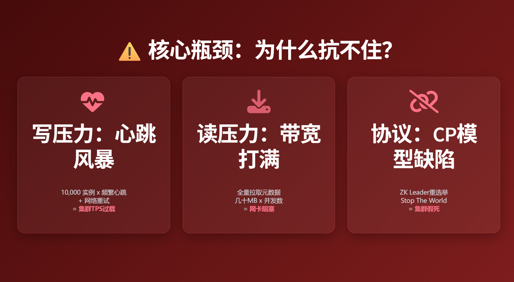
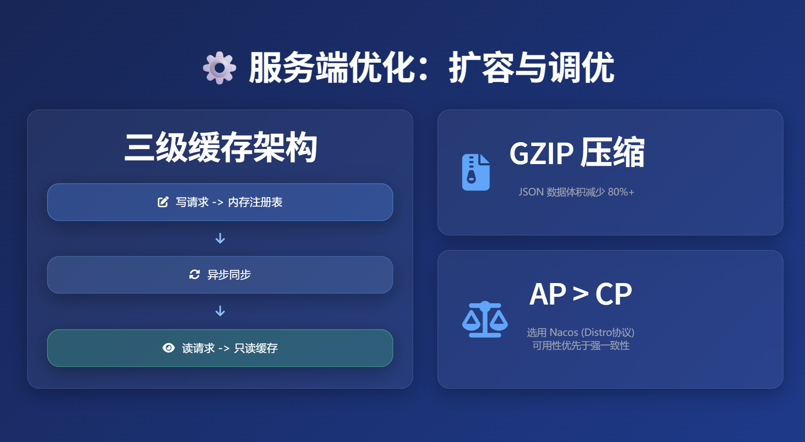
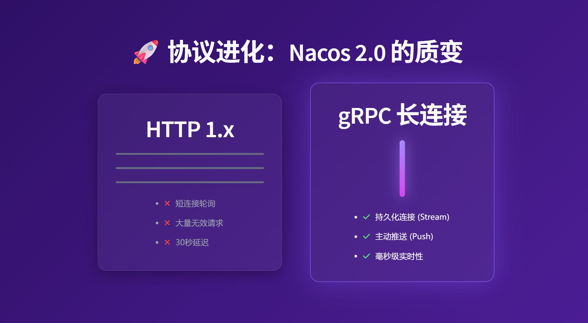

# 如果需要部署上万服务实例，现有的服务注册中心能否抗住？如何优化？

**一、 引言：10,000+ 实例的极限挑战**

在微服务架构演进中，服务实例数量的增长通常被视为业务繁荣的勋章。然而，对于基础架构团队来说，当实例规模突破“万级”大关时，这枚勋章往往会瞬间变成一枚定时炸弹。

很多团队在初期使用默认配置的注册中心（无论是 Zookeeper 还是 Nacos 1.x）时岁月静好，但一旦扩容至上万实例，作为微服务“心脏”的注册中心往往会突然骤停。

面对这种量级的挑战，简单的堆机器配置往往无济于事。本文将复盘一次真实的性能调优实战，提供一套从客户端到服务端、再到架构层面的全链路优化方案。

**二、 核心瓶颈分析：为什么默认配置抗不住？**

要解决问题，首先要理解问题。在万级实例场景下，注册中心主要面临三大维度的“风暴”冲击：

1. **写压力：心跳风暴 (Heartbeat Storm)** 默认情况下，每个服务实例每隔几秒（通常是 5秒）就会向注册中心发送一次心跳保活请求。
   * **计算**： <code>10,000 个实例 * (1次/5秒) = 2,000 TPS</code>。
   * **隐患**： 这看起来不高，但考虑到网络抖动引发的重试机制，以及注册中心内部需要将这些心跳状态同步给集群内的其他节点（Raft/Distro协议开销），实际写压力会成倍增加，导致 CPU 飙升。
2. **读压力：查询与订阅风暴 (Fetch/Subscribe Storm)** 服务发现的核心是“感知变化”。
   * **全量拉取的代价**： 1万个实例的元数据（IP、端口、Tags、配置信息）体积巨大，可能达到几十 MB。如果几千个消费者同时发起全量拉取，网卡带宽会瞬间被打满，导致网络阻塞。
   * **推送风暴**： 当一个服务上下线时，注册中心需要将变更推送到所有订阅者。万级规模下的广播风暴足以拖垮整个集群。
3. **协议开销：CP 模型的天然缺陷** 如果使用 Zookeeper（CP 模型），万级实例意味着大量的临时节点（Ephemeral Nodes）。
   * **ZAB 协议瓶颈**： 一旦发生网络抖动导致 Leader 重选举，或者大量客户端重连，ZK 需要进行全量数据同步，期间集群不可用（Stop The World），这对于高可用要求的微服务是致命的。

**三、 优化策略：从减负到质变**

针对上述瓶颈，我们将优化方案拆解为三个阶段，层层递进。

### 第一阶段：客户端侧优化 —— “减负”

客户端是压力的源头，优化客户端行为性价比最高。

* **开启增量同步 (Delta Fetch)**：
  * **原理**： 客户端不再每次拉取全量注册表，而是只拉取“变化”的部分（Hash比对）。
  * **效果**： 网络流量可降低 **90% 以上**。
* **调整拉取与心跳频率**： 适当增大 <code>registry-fetch-interval</code>（如从 30s 调至 60s）和心跳间隔。在万级规模下，牺牲秒级的实时性换取系统的稳定性是必要的权衡。
* **本地缓存容灾 (Local Cache)**：
  * **兜底机制**： 即使注册中心完全宕机，客户端也必须能读取本地缓存的旧数据发起调用，确保业务不中断。

### 第二阶段：服务端侧优化 —— “扩容与调优”

在服务端，我们需要构建更高效的数据处理流水线，避免线程阻塞：

* **三级缓存架构（读写分离）**： 参考 Nacos 或 Eureka 的设计，服务端应实现读写分离。写请求更新内存注册表，读请求走只读缓存（Response Cache）。
  * **L1 写缓存**：使用 ConcurrentHashMap 快速响应注册请求。
  * **L2/L3 读缓存**：通过异步任务将数据同步至只读缓存（利用 Copy-On-Write 机制），确保读请求永远不会阻塞写请求。
* **数据压缩 (GZIP)**： 对于服务列表这种文本数据，开启 GZIP 压缩通常能获得 5-10 倍的压缩率，显著降低带宽压力。
* **AP 模型优于 CP 模型**： 在服务发现场景，**可用性（Availability） > 一致性（Consistency）**。推荐使用 Nacos（AP模式）替代 Zookeeper。AP 模式下，节点间采用弱一致性同步（如 Distro 协议），节点数扩展不会导致写入性能急剧下降。

### 第三阶段：通信协议与内核进化 —— “质变”

这也是 Nacos 2.0 相比 1.x 性能提升 10 倍的核心秘密，本质是通信模型的代际升级：

* **告别轮询，拥抱流式推送**：
  * **左侧（旧模式）**：HTTP 短轮询不仅产生大量无效请求，还存在 30秒 级的数据延迟。
  * **右侧（新模式）**：基于 gRPC 的长连接（Stream）。服务端一旦感知到服务变更，可以通过长连接**毫秒级主动推送**给客户端。这彻底消除了“查询风暴”，实现了真正的实时服务发现。

**四、 架构级演进：由点到面**

如果实例数继续增长到 5万、10万甚至更高，单集群优化已达极限，必须进行架构层面的隔离。

* **逻辑隔离 (Namespace)**：按交易、物流、用户等业务域进行逻辑拆分，避免非核心业务拖垮核心业务。
* **物理隔离 (Cluster Group)**： 不要把鸡蛋放在一个篮子里。按业务域拆分 Namespace，甚至部署物理上独立的注册中心集群。
* **单元化部署 (Set/Unit)**： 超大规模场景下（如阿里、美团），采用单元化架构。注册中心只服务本单元内的实例，跨单元调用走联邦模式或网关。

**五、 总结**

回到最初的问题：现有的服务注册中心能否抗住上万实例？ 答案是：默认配置抗不住，但经过优化完全可以。

最后，我们将整套优化方案浓缩为这张路线图，建议保存备用：

* **Phase 1 选型层**：弃用 ZK，拥抱支持 AP + gRPC 的 Nacos 2.x。
* **Phase 2 配置层**：开启增量同步、压缩与读写分离。
* **Phase 3 架构层**：做好 Namespace 隔离，控制故障爆炸半径。

> 更新: 2025-11-23 22:24:28  
> 原文: <https://www.yuque.com/tulingzhouyu/db22bv/angcs6ww4o0wzr9i>