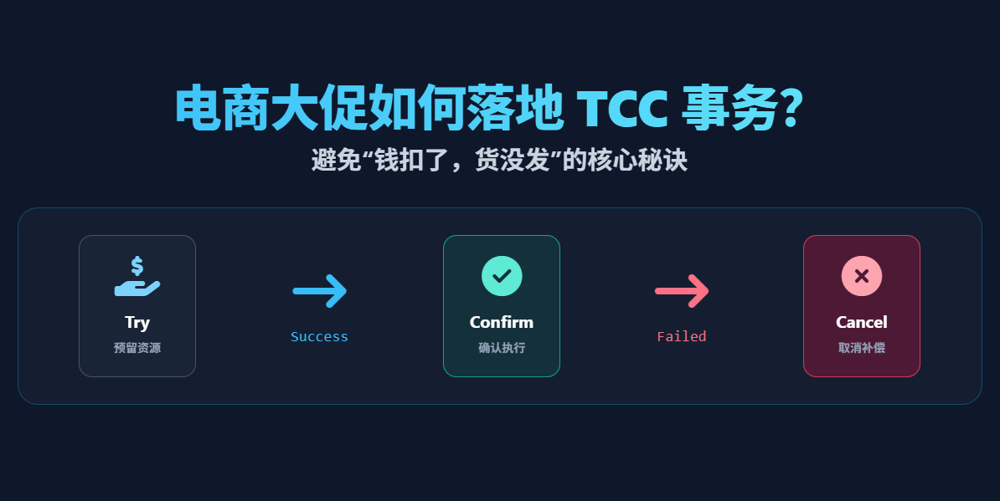
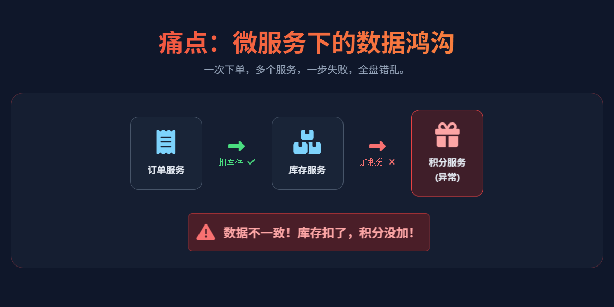
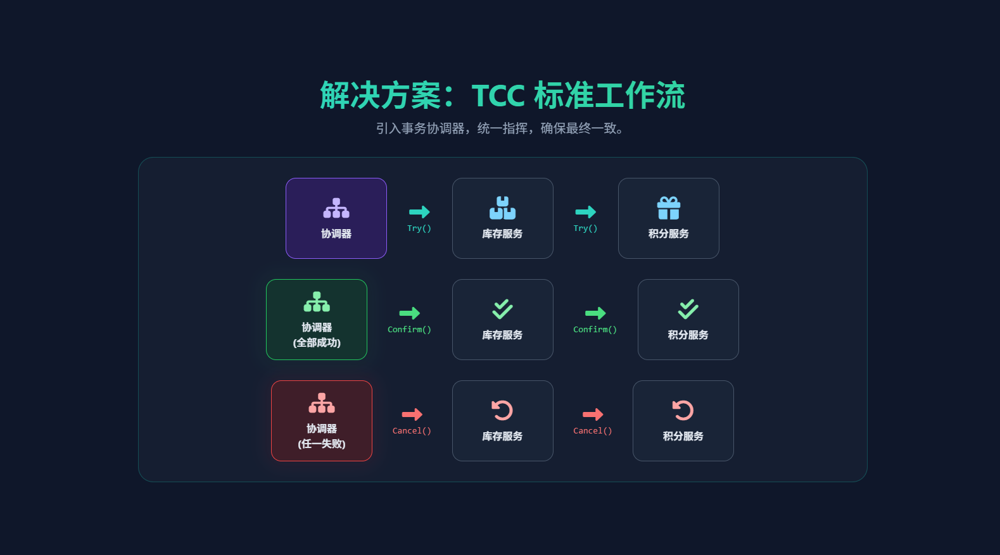
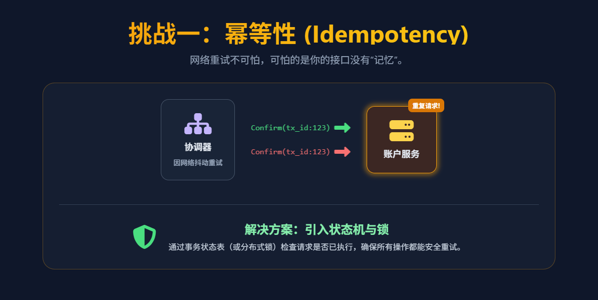
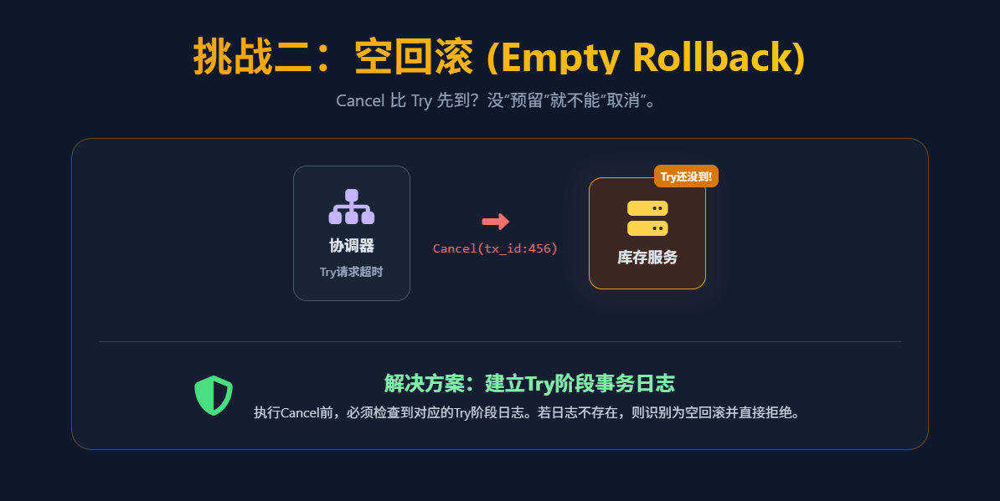
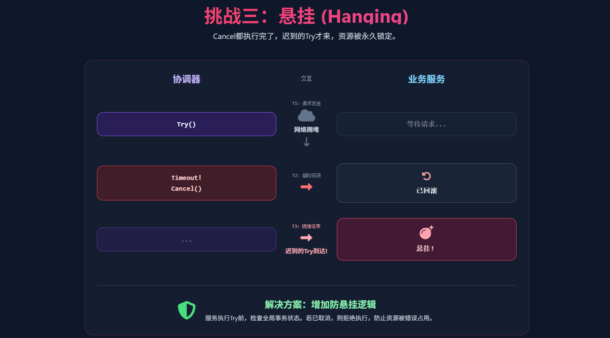

# 电商大促如何落地 TCC 事务，避免“钱扣了，货没发”？



## **<font style="color:rgb(38, 38, 38);">引言：微服务时代的“数据鸿沟”</font>**



<font style="color:rgb(38, 38, 38);">在电商大促的洪峰流量下，订单创建、库存扣减、积分发放、优惠券核销等一系列操作被拆分到不同的微服务中。这种架构带来了高度的灵活性和可扩展性，但也埋下了一颗危险的“地雷”：</font>**<font style="color:rgb(38, 38, 38);">数据一致性问题</font>**<font style="color:rgb(38, 38, 38);">。</font>

<font style="color:rgb(38, 38, 38);">想象一个典型的场景：用户下单后，库存服务成功扣减了库存，但积分服务因为网络抖动或瞬时高负载而调用失败。结果是什么？库存扣了，积分没加上。对用户而言，这是糟糕的体验；对平台而言，这可能意味着客诉、品牌受损，甚至是资损。</font>

<font style="color:rgb(38, 38, 38);">传统的单体应用中，我们可以依赖数据库的ACID事务来保证“要么全部成功，要么全部失败”。但在分布式环境下，跨多个服务的操作无法被单个数据库事务覆盖。这，就是TCC（Try-Confirm-Cancel）分布式事务模式大显身手的舞台。</font>

## **<font style="color:rgb(38, 38, 38);">第一章：TCC 标准工作流：三步走的优雅之舞</font>**

<font style="color:rgb(38, 38, 38);">TCC的核心思想是将一个大的业务操作，拆分为三个由“事务协调器”统一指挥的独立步骤：</font>

1. **<font style="color:rgb(38, 38, 38);">Try阶段</font>**<font style="color:rgb(38, 38, 38);">：</font>**<font style="color:rgb(38, 38, 38);">预留资源</font>**<font style="color:rgb(38, 38, 38);">。对各个服务的资源进行预处理或锁定。例如，冻结用户账户的相应金额、预扣减商品库存。此阶段只做预留，不做实际变更。</font>
2. **<font style="color:rgb(38, 38, 38);">Confirm阶段</font>**<font style="color:rgb(38, 38, 38);">：</font>**<font style="color:rgb(38, 38, 38);">确认执行</font>**<font style="color:rgb(38, 38, 38);">。如果所有服务的</font><code><font style="color:rgb(38, 38, 38);background-color:rgba(175, 184, 193, 0.2);">Try</font></code><font style="color:rgb(38, 38, 38);">阶段都成功，事务协调器会向所有服务发送</font><code><font style="color:rgb(38, 38, 38);background-color:rgba(175, 184, 193, 0.2);">Confirm</font></code><font style="color:rgb(38, 38, 38);">指令，完成实际的业务操作。例如，将冻结的金额实际扣除、将预扣减的库存变为实际扣减。</font>
3. **<font style="color:rgb(38, 38, 38);">Cancel阶段</font>**<font style="color:rgb(38, 38, 38);">：</font>**<font style="color:rgb(38, 38, 38);">取消补偿</font>**<font style="color:rgb(38, 38, 38);">。如果</font><code><font style="color:rgb(38, 38, 38);background-color:rgba(175, 184, 193, 0.2);">Try</font></code><font style="color:rgb(38, 38, 38);">阶段有任何一个服务失败，协调器会向所有</font>**<font style="color:rgb(38, 38, 38);">已成功执行Try</font>**<font style="color:rgb(38, 38, 38);">的服务发送</font><code><font style="color:rgb(38, 38, 38);background-color:rgba(175, 184, 193, 0.2);">Cancel</font></code><font style="color:rgb(38, 38, 38);">指令，要求它们释放或补偿已预留的资源。例如，解冻被冻结的金额、恢复预扣减的库存。</font>

<font style="color:rgb(38, 38, 38);">这个流程可以用下图清晰地表示：</font>



<font style="color:rgb(38, 38, 38);">理论看似简单，但在真实的生产环境中，网络延迟、程序Bug、进程崩溃等异常情况，会给这个标准流程带来三大严峻挑战。</font>

## **<font style="color:rgb(38, 38, 38);">第二章：TCC 落地的三大核心挑战与破解之道</font>**

<font style="color:rgb(38, 38, 38);">要让TCC在生产环境中稳如磐石，我们必须直面并解决幂等、空回滚、悬挂这三大问题。</font>

### **<font style="color:rgb(38, 38, 38);">2.1 挑战一：幂等性 (Idempotency)</font>**

**<font style="color:rgb(38, 38, 38);">问题描述：</font>**<font style="color:rgb(38, 38, 38);"> 由于网络重试、协调器故障恢复等原因，</font><code><font style="color:rgb(38, 38, 38);background-color:rgba(175, 184, 193, 0.2);">Confirm</font></code><font style="color:rgb(38, 38, 38);">或</font><code><font style="color:rgb(38, 38, 38);background-color:rgba(175, 184, 193, 0.2);">Cancel</font></code><font style="color:rgb(38, 38, 38);">指令可能会被重复发送。如果业务接口没有做幂等性设计，就会导致灾难性后果，例如，用户的钱被重复扣除，或者一次失败的订单补偿了双倍库存。</font>



**<font style="color:rgb(38, 38, 38);">解决方案：</font>\*\*\*\*<font style="color:rgb(38, 38, 38);">为所有阶段设计状态机，利用事务状态防止重复执行。</font>**

<font style="color:rgb(38, 38, 38);">核心思路是为每一笔分布式事务创建一个全局唯一的事务ID（</font><code><font style="color:rgb(38, 38, 38);background-color:rgba(175, 184, 193, 0.2);">tx_id</font></code><font style="color:rgb(38, 38, 38);">），并建立一张“事务状态表”。</font>

| <font style="color:rgb(38, 38, 38);">字段名</font> | <font style="color:rgb(38, 38, 38);">类型</font> | <font style="color:rgb(38, 38, 38);">描述</font> |
| :--- | :--- | :--- |
| <code><font style="color:rgb(38, 38, 38);background-color:rgba(175, 184, 193, 0.2);">tx_id</font></code> | <code><font style="color:rgb(38, 38, 38);background-color:rgba(175, 184, 193, 0.2);">varchar(128)</font></code> | <font style="color:rgb(38, 38, 38);">全局事务ID (主键)</font> |
| <code><font style="color:rgb(38, 38, 38);background-color:rgba(175, 184, 193, 0.2);">branch_id</font></code> | <code><font style="color:rgb(38, 38, 38);background-color:rgba(175, 184, 193, 0.2);">varchar(128)</font></code> | <font style="color:rgb(38, 38, 38);">分支事务ID</font> |
| <code><font style="color:rgb(38, 38, 38);background-color:rgba(175, 184, 193, 0.2);">status</font></code> | <code><font style="color:rgb(38, 38, 38);background-color:rgba(175, 184, 193, 0.2);">tinyint</font></code> | <font style="color:rgb(38, 38, 38);">事务状态 (1:Tried, 2:Confirmed, 3:Canceled)</font> |
| <code><font style="color:rgb(38, 38, 38);background-color:rgba(175, 184, 193, 0.2);">create_time</font></code> | <code><font style="color:rgb(38, 38, 38);background-color:rgba(175, 184, 193, 0.2);">datetime</font></code> | <font style="color:rgb(38, 38, 38);">创建时间</font> |
| <code><font style="color:rgb(38, 38, 38);background-color:rgba(175, 184, 193, 0.2);">update_time</font></code> | <code><font style="color:rgb(38, 38, 38);background-color:rgba(175, 184, 193, 0.2);">datetime</font></code> | <font style="color:rgb(38, 38, 38);">更新时间</font> |

<font style="color:rgb(38, 38, 38);">在执行</font><code><font style="color:rgb(38, 38, 38);background-color:rgba(175, 184, 193, 0.2);">Confirm</font></code><font style="color:rgb(38, 38, 38);">或</font><code><font style="color:rgb(38, 38, 38);background-color:rgba(175, 184, 193, 0.2);">Cancel</font></code><font style="color:rgb(38, 38, 38);">操作前，先检查该事务的状态。</font>

**<font style="color:rgb(38, 38, 38);">伪代码示例 (Confirm接口):</font>**

```java
public void confirm(String tx_id) {
    // 1. 检查事务状态
    TransactionState state = transactionDao.getState(tx_id);

    // 2. 如果状态已经是 Confirmed，则直接返回成功，不再执行业务逻辑
    if (state == TransactionState.CONFIRMED) {
        log.info("事务 {} 已被Confirm，幂等处理，直接返回。", tx_id);
        return;
    }

    // 3. 如果状态不是 Tried，说明流程异常（可能是空回滚或悬挂的前兆），拒绝执行
    if (state != TransactionState.TRIED) {
        throw new IllegalStateException("事务 " + tx_id + " 状态异常，无法Confirm");
    }

    // 4. 执行实际的业务逻辑（例如，将冻结金额变为实际扣款）
    accountService.doConfirmBusiness(tx_id);

    // 5. 更新事务状态为 Confirmed
    transactionDao.updateState(tx_id, TransactionState.CONFIRMED);
}
```

### **<font style="color:rgb(38, 38, 38);">2.2 挑战二：空回滚 (Empty Rollback)</font>**

**<font style="color:rgb(38, 38, 38);">问题描述：</font>**<font style="color:rgb(38, 38, 38);"> 在极端情况下，协调器调用某个服务的</font><code><font style="color:rgb(38, 38, 38);background-color:rgba(175, 184, 193, 0.2);">Try</font></code><font style="color:rgb(38, 38, 38);">请求因为网络拥堵而超时。协调器判定该分支失败，于是发起了</font><code><font style="color:rgb(38, 38, 38);background-color:rgba(175, 184, 193, 0.2);">Cancel</font></code><font style="color:rgb(38, 38, 38);">请求。但</font><code><font style="color:rgb(38, 38, 38);background-color:rgba(175, 184, 193, 0.2);">Cancel</font></code><font style="color:rgb(38, 38, 38);">请求却比拥堵的</font><code><font style="color:rgb(38, 38, 38);background-color:rgba(175, 184, 193, 0.2);">Try</font></code><font style="color:rgb(38, 38, 38);">请求更早到达了业务服务。此时，服务根本没有执行过</font><code><font style="color:rgb(38, 38, 38);background-color:rgba(175, 184, 193, 0.2);">Try</font></code><font style="color:rgb(38, 38, 38);">，业务资源也未被预留。如果不加处理，</font><code><font style="color:rgb(38, 38, 38);background-color:rgba(175, 184, 193, 0.2);">Cancel</font></code><font style="color:rgb(38, 38, 38);">操作可能会错误地修改了业务数据（例如，为一个从未预留过的账户增加了余额）。</font>



**<font style="color:rgb(38, 38, 38);">解决方案：</font>\*\*\*\*<font style="color:rgb(38, 38, 38);">阻止没有</font>**<code>**<font style="color:rgb(38, 38, 38);background-color:rgba(175, 184, 193, 0.2);">Try</font>**</code>**<font style="color:rgb(38, 38, 38);">的</font>**<code>**<font style="color:rgb(38, 38, 38);background-color:rgba(175, 184, 193, 0.2);">Cancel</font>**</code>**<font style="color:rgb(38, 38, 38);">。</font>**

<font style="color:rgb(38, 38, 38);">核心思路是在执行</font><code><font style="color:rgb(38, 38, 38);background-color:rgba(175, 184, 193, 0.2);">Cancel</font></code><font style="color:rgb(38, 38, 38);">前，必须检查到对应的</font><code><font style="color:rgb(38, 38, 38);background-color:rgba(175, 184, 193, 0.2);">Try</font></code><font style="color:rgb(38, 38, 38);">阶段事务日志。如果找不到</font><code><font style="color:rgb(38, 38, 38);background-color:rgba(175, 184, 193, 0.2);">Try</font></code><font style="color:rgb(38, 38, 38);">的记录，就证明这是一个空回滚，应直接拒绝执行。</font>

**<font style="color:rgb(38, 38, 38);">伪代码示例 (Cancel接口):</font>**

```java
public void cancel(String tx_id) {
    // 1. 检查是否存在对应的Try阶段事务日志
    TransactionState state = transactionDao.getState(tx_id);

    // 2. 如果日志不存在，说明Try还没执行到，识别为空回滚，直接返回成功
    if (state == null) {
        log.info("事务 {} Try阶段日志不存在，识别为空回滚，直接返回。", tx_id);
        // 为防止悬挂，可以额外插入一条Cancel状态的记录
        transactionDao.insertState(tx_id, TransactionState.CANCELED);
        return;
    }

    // 3. 幂等性检查：如果事务已是Canceled状态，直接返回
    if (state == TransactionState.CANCELED) {
        log.info("事务 {} 已被Cancel，幂等处理，直接返回。", tx_id);
        return;
    }

    // 4. 执行补偿逻辑
    accountService.doCancelBusiness(tx_id);

    // 5. 更新事务状态为 Canceled
    transactionDao.updateState(tx_id, TransactionState.CANCELED);
}
```

### **<font style="color:rgb(38, 38, 38);">2.3 挑战三：悬挂 (Hanging)</font>**

**<font style="color:rgb(38, 38, 38);">问题描述：</font>**<font style="color:rgb(38, 38, 38);"> 这是空回滚的“孪生兄弟”。</font><code><font style="color:rgb(38, 38, 38);background-color:rgba(175, 184, 193, 0.2);">Try</font></code><font style="color:rgb(38, 38, 38);">请求因为网络拥堵长时间未到达服务端。协调器超时后发起</font><code><font style="color:rgb(38, 38, 38);background-color:rgba(175, 184, 193, 0.2);">Cancel</font></code><font style="color:rgb(38, 38, 38);">，并且</font><code><font style="color:rgb(38, 38, 38);background-color:rgba(175, 184, 193, 0.2);">Cancel</font></code><font style="color:rgb(38, 38, 38);">已经成功执行（在上一步“防空回滚”逻辑下，</font><code><font style="color:rgb(38, 38, 38);background-color:rgba(175, 184, 193, 0.2);">Cancel</font></code><font style="color:rgb(38, 38, 38);">可能只是记录了一条“已取消”的日志）。在这之后，那个“迟到”的</font><code><font style="color:rgb(38, 38, 38);background-color:rgba(175, 184, 193, 0.2);">Try</font></code><font style="color:rgb(38, 38, 38);">请求终于到达了服务端。此时，全局事务已经结束，但这个</font><code><font style="color:rgb(38, 38, 38);background-color:rgba(175, 184, 193, 0.2);">Try</font></code><font style="color:rgb(38, 38, 38);">请求却在不知情的情况下预留了业务资源，导致这部分资源被</font>**<font style="color:rgb(38, 38, 38);">永久悬挂</font>**<font style="color:rgb(38, 38, 38);">，无法被释放。</font>



**<font style="color:rgb(38, 38, 38);">解决方案：</font>\*\*\*\*<font style="color:rgb(38, 38, 38);">拒绝迟到的</font>**<code>**<font style="color:rgb(38, 38, 38);background-color:rgba(175, 184, 193, 0.2);">Try</font>**</code>**<font style="color:rgb(38, 38, 38);">请求。</font>**

<font style="color:rgb(38, 38, 38);">核心思路是在执行</font><code><font style="color:rgb(38, 38, 38);background-color:rgba(175, 184, 193, 0.2);">Try</font></code><font style="color:rgb(38, 38, 38);">逻辑前，先检查该事务ID是否已经有了</font><code><font style="color:rgb(38, 38, 38);background-color:rgba(175, 184, 193, 0.2);">Cancel</font></code><font style="color:rgb(38, 38, 38);">记录。如果发现事务已经被标记为</font><code><font style="color:rgb(38, 38, 38);background-color:rgba(175, 184, 193, 0.2);">Canceled</font></code><font style="color:rgb(38, 38, 38);">，则证明这是一个迟到的</font><code><font style="color:rgb(38, 38, 38);background-color:rgba(175, 184, 193, 0.2);">Try</font></code><font style="color:rgb(38, 38, 38);">请求，应立即拒绝执行。</font>

**<font style="color:rgb(38, 38, 38);">伪代码示例 (Try接口):</font>**

```java
public void try(String tx_id, BusinessData data) {
    // 1. 检查该事务是否已经被Cancel
    TransactionState state = transactionDao.getState(tx_id);
    if (state != null && state == TransactionState.CANCELED) {
        log.error("事务 {} 已被取消，Try请求为悬挂操作，拒绝执行！", tx_id);
        throw new HangingTryException("事务已被取消，拒绝悬挂的Try请求");
    }

    // 2. 执行资源预留（Try）的业务逻辑
    accountService.doTryBusiness(tx_id, data);

    // 3. 插入Try阶段的事务日志
    transactionDao.insertState(tx_id, TransactionState.TRIED);
}
```

## **<font style="color:rgb(38, 38, 38);">第三章：总结：拥抱框架，但精通原理</font>**

<font style="color:rgb(38, 38, 38);">通过解决幂等、空回滚、悬挂这三大挑战，我们才能构筑起一套金融级高可用的TCC分布式事务体系。</font>

<font style="color:rgb(38, 38, 38);">在真实的生产环境中，我们强烈推荐使用</font>**<font style="color:rgb(38, 38, 38);">Seata</font>**<font style="color:rgb(38, 38, 38);">、</font>**<font style="color:rgb(38, 38, 38);">Hmily</font>**<font style="color:rgb(38, 38, 38);">等成熟的开源分布式事务框架。它们已经在内部封装好了上述三大挑战的解决方案，并提供了优雅的API和近乎无侵入的接入方式，能极大提升开发效率和系统的健壮性。</font>

<font style="color:rgb(38, 38, 38);">然而，工具能为我们铺平道路，但不能替代我们对脚下土地的认知。深刻理解TCC的这些核心原理，才是您真正的“底气”所在。当遇到复杂的线上问题时，当需要进行关键的架构选型时，正是这份对原理的精通，能让您拨开云雾，直达问题本质，做出最专业、最可靠的决策。</font>

**<font style="color:rgb(38, 38, 38);">黄金法则：拥抱框架，但精通原理。</font>**


> 更新: 2025-10-07 22:05:23  
> 原文: <https://www.yuque.com/tulingzhouyu/db22bv/fd68ztyku4etr57v>