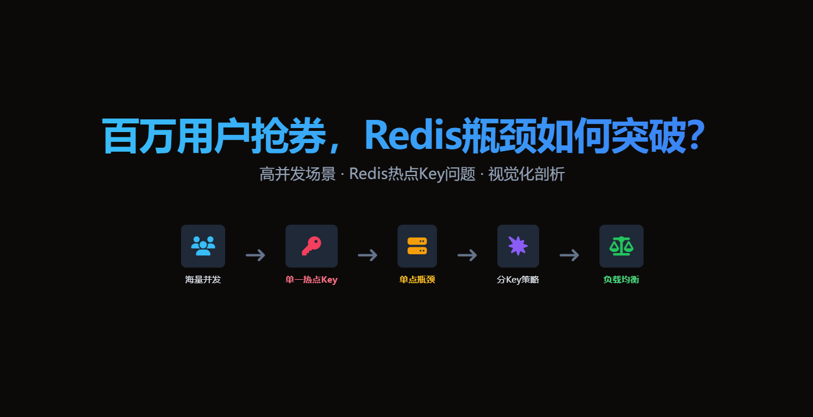
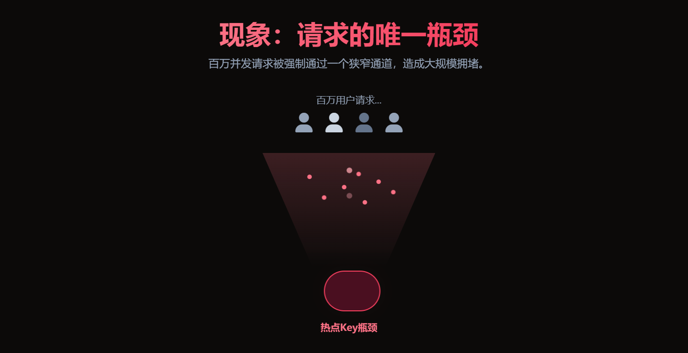
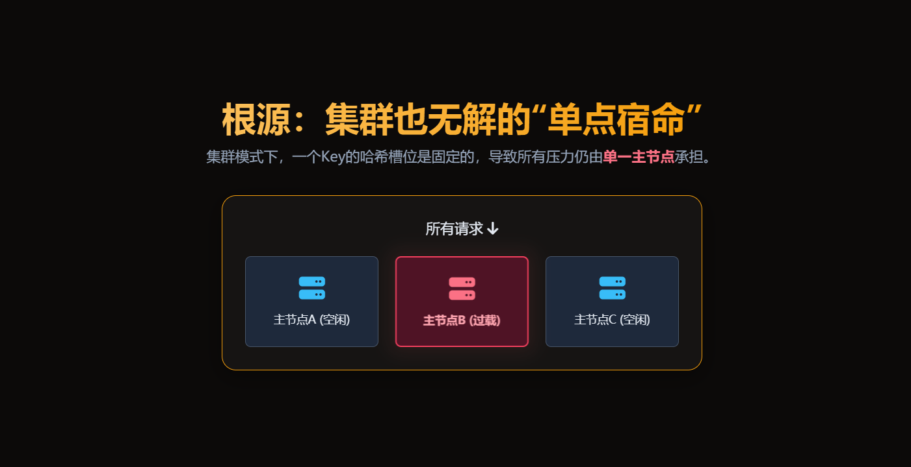
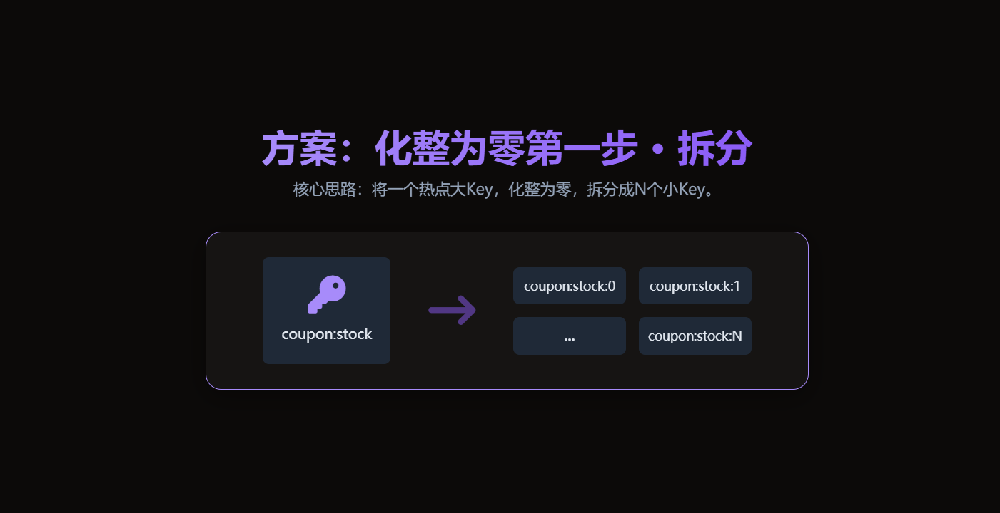
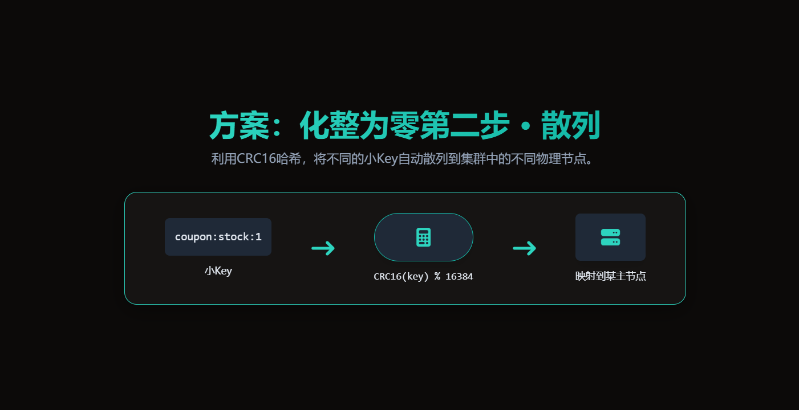
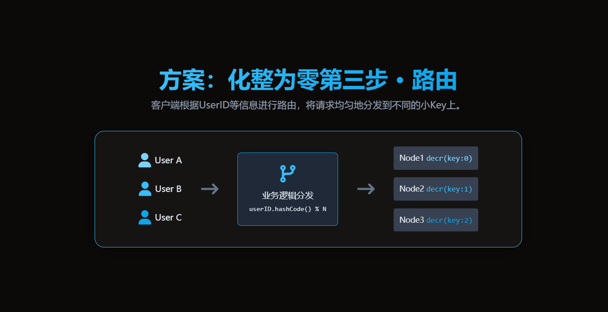
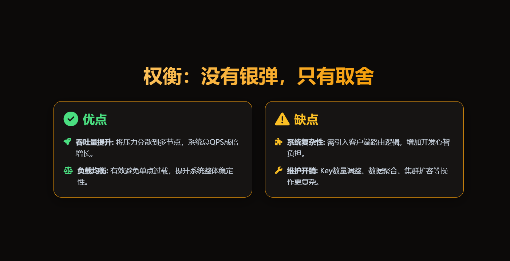
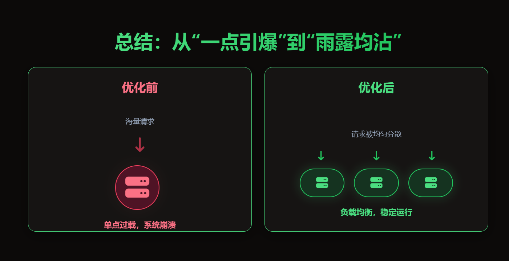

# 百万用户同时抢券，Redis热点key性能瓶颈怎么突破？



<font style="color:rgba(0, 0, 0, 0.96);">在高并发的世界里，系统的“阿喀琉斯之踵”往往隐藏在最意想不到的细节中。我们今天要探讨的，就是这样一个经典难题：当百万用户如潮水般涌入，试图抢购同一批次的1万张优惠券时，被寄予厚望的Redis集群为何会瞬间“熔断”？答案直指一个核心概念——</font>**<font style="color:rgba(0, 0, 0, 0.96);">热点Key (Hot Key)</font>**<font style="color:rgba(0, 0, 0, 0.96);">。</font>

<font style="color:rgba(0, 0, 0, 0.96);">本文将遵循“是什么 -> 为什么 -> 怎么做”的黄金逻辑，带你层层深入，彻底搞懂Redis热点Key问题的本质、瓶颈、解决方案与实践智慧。</font>

## <font style="color:rgba(0, 0, 0, 0.96);">一、是什么：压垮骆驼的“那根稻草”——热点Key现象</font>

<font style="color:rgba(0, 0, 0, 0.96);">所谓“热点Key”，指的是在极短时间内，被海量请求集火访问的单个Redis Key。在我们的场景中，这1万张优惠券的库存信息，如果存储在一个单一的Key（例如</font><code><font style="color:rgba(0, 0, 0, 0.96);background-color:rgba(175, 184, 193, 0.2);">coupon:stock</font></code><font style="color:rgba(0, 0, 0, 0.96);">）中，那么这个Key就成为了一个典型的热点Key。</font>



<font style="color:rgba(0, 0, 0, 0.96);">所有用户的抢购请求，无论是查询库存还是扣减库存，都将命中这同一个Key。</font>**<font style="color:rgba(0, 0, 0, 0.96);">这就形成了一个典型的性能瓶颈，如同一个巨大的漏斗，无论入口有多宽（百万用户），其处理能力的上限都被狭窄的出口（单一Key）死死卡住。</font>**

## <font style="color:rgba(0, 0, 0, 0.96);">二、为什么：集群也救不了？热点Key瓶颈的根源</font>

<font style="color:rgba(0, 0, 0, 0.96);">许多开发者会下意识地认为：“没关系，我们有Redis集群，可以水平扩展。” 但这是一个致命的误区。标准的Redis集群虽然通过分片（Sharding）将数据分散到多个节点，但其分片策略是针对</font>**<font style="color:rgba(0, 0, 0, 0.96);">Key</font>**<font style="color:rgba(0, 0, 0, 0.96);">的。</font>

<font style="color:rgba(0, 0, 0, 0.96);">一个Key（无论它多“热”）通过CRC16哈希算法计算后，会被唯一地映射到集群16384个哈希槽中的某一个，而这个槽位又只属于一个主节点（Master Node）。这意味着，</font>**<font style="color:rgba(0, 0, 0, 0.96);">对于一个热点Key的所有写操作，最终都会落到集群中的某一个特定主节点上</font>**<font style="color:rgba(0, 0, 0, 0.96);">。</font>

<font style="color:rgba(0, 0, 0, 0.96);">这个主节点的处理能力就是整个系统的天花板。通常，一个Redis实例的写入QPS（每秒查询率）在2-5万次左右。当百万级的请求涌来时，这个节点会因CPU或网卡不堪重负而崩溃，进而引发主从切换、请求风暴，甚至整个集群的雪崩。</font>



## <font style="color:rgba(0, 0, 0, 0.96);">三、怎么做：化整为零，核心解决方案之“分Key策略”</font>

<font style="color:rgba(0, 0, 0, 0.96);">既然单点是瓶颈，那么核心思路就是将这个“单点”打散，化整为零，让集群的每个节点都能“雨露均沾”。这就是</font>**<font style="color:rgba(0, 0, 0, 0.96);">分Key策略</font>**<font style="color:rgba(0, 0, 0, 0.96);">，也常被称为</font>**<font style="color:rgba(0, 0, 0, 0.96);">Key Sharding</font>**<font style="color:rgba(0, 0, 0, 0.96);">或</font>**<font style="color:rgba(0, 0, 0, 0.96);">键拆分</font>**<font style="color:rgba(0, 0, 0, 0.96);">。</font>

### <font style="color:rgba(0, 0, 0, 0.96);">步骤1：拆分热点Key</font>

<font style="color:rgba(0, 0, 0, 0.96);">我们将原本单一的库存Key，拆分成N个结构相同的小Key。N的取值需要根据预估的并发量和单个节点的处理能力来定，例如，我们可以拆分成100个。</font>

* **<font style="color:rgba(0, 0, 0, 0.96);">原Key</font>**<font style="color:rgba(0, 0, 0, 0.96);">:</font><font style="color:rgba(0, 0, 0, 0.96);"> </font><code><font style="color:rgba(0, 0, 0, 0.96);background-color:rgba(175, 184, 193, 0.2);">coupon:stock</font></code>
* **<font style="color:rgba(0, 0, 0, 0.96);">拆分后</font>**<font style="color:rgba(0, 0, 0, 0.96);">:</font><font style="color:rgba(0, 0, 0, 0.96);"> </font><code><font style="color:rgba(0, 0, 0, 0.96);background-color:rgba(175, 184, 193, 0.2);">coupon:stock:0</font></code><font style="color:rgba(0, 0, 0, 0.96);">,</font><font style="color:rgba(0, 0, 0, 0.96);"> </font><code><font style="color:rgba(0, 0, 0, 0.96);background-color:rgba(175, 184, 193, 0.2);">coupon:stock:1</font></code><font style="color:rgba(0, 0, 0, 0.96);">,</font><font style="color:rgba(0, 0, 0, 0.96);"> </font><code><font style="color:rgba(0, 0, 0, 0.96);background-color:rgba(175, 184, 193, 0.2);">coupon:stock:2</font></code><font style="color:rgba(0, 0, 0, 0.96);">, ...,</font><font style="color:rgba(0, 0, 0, 0.96);"> </font><code><font style="color:rgba(0, 0, 0, 0.96);background-color:rgba(175, 184, 193, 0.2);">coupon:stock:99</font></code>



<font style="color:rgba(0, 0, 0, 0.96);">拆分后，我们将1万张优惠券的库存平均分配到这100个小Key上，每个Key负责100张。</font>

### <font style="color:rgba(0, 0, 0, 0.96);">步骤2：确保小Key均匀散列</font>

<font style="color:rgba(0, 0, 0, 0.96);">仅仅拆分是不够的，我们还需要确保这100个小Key被Redis集群“公平地”分配到不同的主节点上。幸运的是，Redis集群的</font><code><font style="color:rgba(0, 0, 0, 0.96);background-color:rgba(175, 184, 193, 0.2);">CRC16(key) % 16384</font></code><font style="color:rgba(0, 0, 0, 0.96);">哈希策略天生就能很好地完成这个任务。由于</font><code><font style="color:rgba(0, 0, 0, 0.96);background-color:rgba(175, 184, 193, 0.2);">coupon:stock:0</font></code><font style="color:rgba(0, 0, 0, 0.96);">和</font><code><font style="color:rgba(0, 0, 0, 0.96);background-color:rgba(175, 184, 193, 0.2);">coupon:stock:1</font></code><font style="color:rgba(0, 0, 0, 0.96);">的字符串内容不同，它们经过CRC16计算后的哈希值大概率会不同，从而映射到不同的哈希槽，最终落到不同的物理节点上。</font>



### <font style="color:rgba(0, 0, 0, 0.96);">步骤3：客户端请求路由</font>

<font style="color:rgba(0, 0, 0, 0.96);">最后一步，也是至关重要的一步：客户端（或服务端的业务逻辑）需要决定将用户的抢购请求发送到哪个小Key上。最简单有效的方法是</font>**<font style="color:rgba(0, 0, 0, 0.96);">随机路由</font>**<font style="color:rgba(0, 0, 0, 0.96);">或</font>**<font style="color:rgba(0, 0, 0, 0.96);">哈希路由</font>**<font style="color:rgba(0, 0, 0, 0.96);">。</font>

<font style="color:rgba(0, 0, 0, 0.96);">例如，我们可以根据用户的ID进行哈希取模：</font>

```java
// 假设用户ID为 a-long-user-id-string
int index = Math.abs(userId.hashCode()) % 100;
String targetKey = "coupon:stock:" + index;
// 然后将请求发往 targetKey
redis.decr(targetKey);
```

<font style="color:rgba(0, 0, 0, 0.96);">这样，来自不同用户的请求就会被均匀地分散到100个小Key上，进而由集群中的多个主节点并行处理，从根本上解决了单点瓶颈问题。</font>



## <font style="color:rgba(0, 0, 0, 0.96);">四、优缺点分析：没有银弹，只有取舍</font>

<font style="color:rgba(0, 0, 0, 0.96);">分Key策略是应对热点Key问题的“金钥匙”，但它也并非毫无代价。</font>



* **<font style="color:rgba(0, 0, 0, 0.96);">优点</font>**<font style="color:rgba(0, 0, 0, 0.96);">：</font>
  * **<font style="color:rgba(0, 0, 0, 0.96);">负载均衡</font>**<font style="color:rgba(0, 0, 0, 0.96);">：将单点压力有效分散到集群的多个节点。</font>
  * **<font style="color:rgba(0, 0, 0, 0.96);">提升吞吐量</font>**<font style="color:rgba(0, 0, 0, 0.96);">：系统总体的QPS理论上可以提升N倍（N为拆分Key的数量）。</font>
* **<font style="color:rgba(0, 0, 0, 0.96);">缺点</font>**<font style="color:rgba(0, 0, 0, 0.96);">：</font>
  * **<font style="color:rgba(0, 0, 0, 0.96);">增加系统复杂性</font>**<font style="color:rgba(0, 0, 0, 0.96);">：需要客户端或业务层进行额外的路由逻辑改造。</font>
  * **<font style="color:rgba(0, 0, 0, 0.96);">数据聚合难题</font>**<font style="color:rgba(0, 0, 0, 0.96);">：如果需要获取总库存，就需要遍历所有小Key进行聚合，操作相对繁琐。</font>
  * **<font style="color:rgba(0, 0, 0, 0.96);">维护开销</font>**<font style="color:rgba(0, 0, 0, 0.96);">：当Key拆分数量需要调整，或集群需要扩容时，数据迁移和分片逻辑的维护会更复杂。</font>

## <font style="color:rgba(0, 0, 0, 0.96);">五、总结与适用场景</font>

<font style="color:rgba(0, 0, 0, 0.96);">热点Key问题的本质是请求分布的极度不均与Redis集群原生分片机制的错配。通过“分Key策略”，我们能够巧妙地将这种不均“磨平”，让集群的力量得以真正发挥。</font>

<font style="color:rgba(0, 0, 0, 0.96);">这个方案完美地诠释了分布式系统设计的核心思想：</font>**<font style="color:rgba(0, 0, 0, 0.96);">当垂直扩展（提升单点性能）遇到瓶颈时，水平扩展（将负载分散到更多单元）永远是最终的答案。</font>**



**<font style="color:rgba(0, 0, 0, 0.96);">此策略广泛适用于：</font>**

* **<font style="color:rgba(0, 0, 0, 0.96);">高并发抢购/秒杀场景</font>**<font style="color:rgba(0, 0, 0, 0.96);">：如优惠券、商品、门票抢购。</font>
* **<font style="color:rgba(0, 0, 0, 0.96);">实时排行榜</font>**<font style="color:rgba(0, 0, 0, 0.96);">：对热门文章、视频的点赞、投票计数。</font>
* **<font style="color:rgba(0, 0, 0, 0.96);">重大事件直播</font>**<font style="color:rgba(0, 0, 0, 0.96);">：对直播间礼物、评论数的实时统计。</font>

<font style="color:rgba(0, 0, 0, 0.96);">希望通过本文的剖析，您能对Redis热点Key问题有一个更深刻的理解，并在未来的系统设计中游刃有余。</font>


> 更新: 2025-10-14 15:08:17  
> 原文: <https://www.yuque.com/tulingzhouyu/db22bv/qoue83167q5zdoc4>