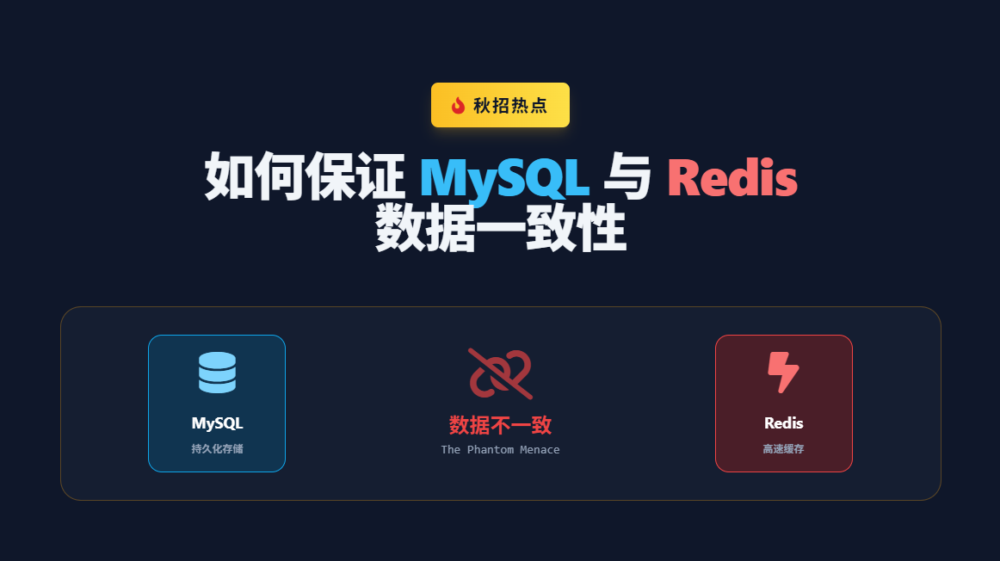
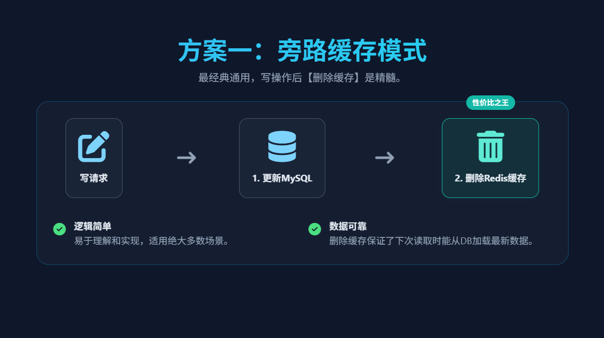
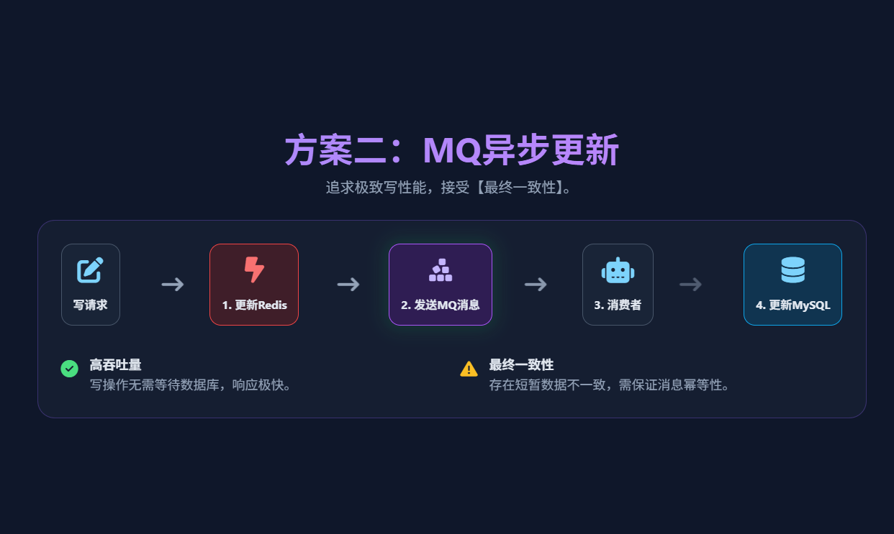
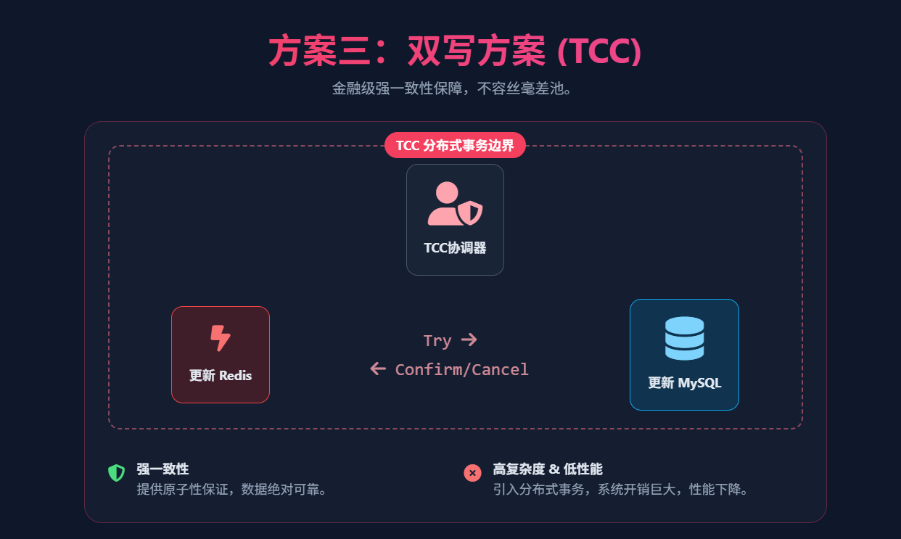
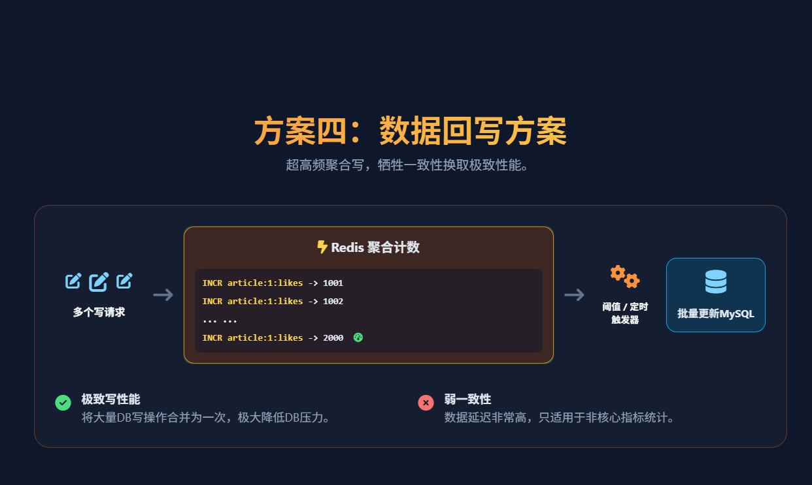
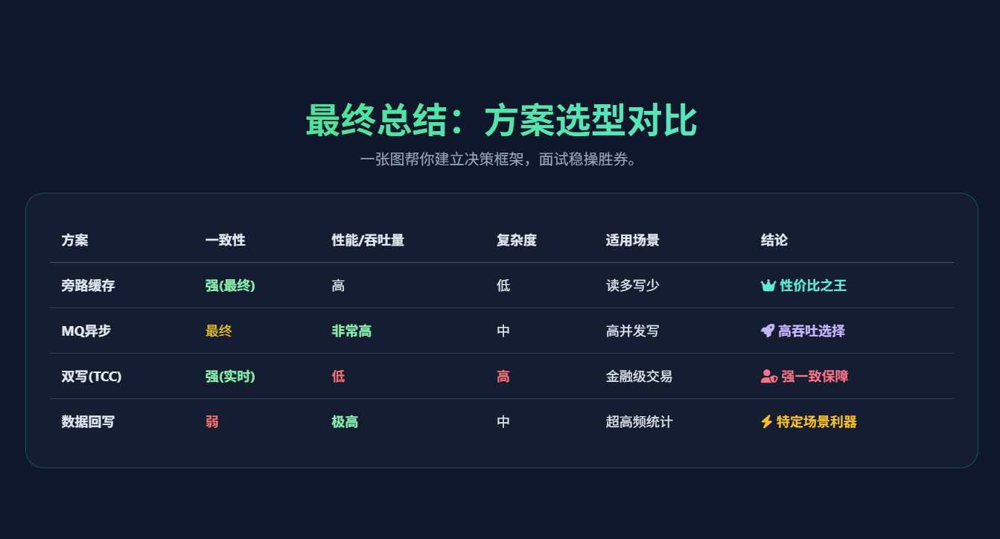

# 秋招热点：如何保证MySQL与Redis数据一致性

<font style="color:rgb(38, 38, 38);">在构建高性能应用时，Redis 作为高速缓存，MySQL 作为持久化存储，是一对黄金搭档。但只要引入了多个数据源，就必然会面对一个经典的分布式难题：</font>**<font style="color:rgb(38, 38, 38);">如何保证它们之间的数据一致性？</font>**

<font style="color:rgb(38, 38, 38);">这不仅仅是一个技术问题，更是对系统设计者在性能、一致性和复杂性之间做权衡（Trade-off）能力的考验。因此，它也成为了各大厂技术面试中的高频考点。</font>



<font style="color:rgb(38, 38, 38);">本文将从最经典的“旁路缓存”模式出发，层层递进，为你剖析四种主流的数据一致性解决方案，并提供一个清晰的决策框架，助你从容应对面试，并在实际工作中做出明智的技术选型。</font>

***

### <font style="color:rgb(38, 38, 38);">方案一：旁路缓存模式 (Cache-Aside Pattern)</font>

<font style="color:rgb(38, 38, 38);">这是最经典、最通用的解决方案，其核心思想是：写操作只操作数据库，然后\*\*删除（delete）\*\*缓存。</font>



<font style="color:rgb(38, 38, 38);">你可能会问，为什么是删除缓存，而不是更新缓存？</font>

<font style="color:rgb(38, 38, 38);">这就是该模式的精髓所在，我们称之为\*\*“懒加载”（Lazy Loading）\*\*。试想，如果一个数据被更新后，在很长一段时间内都没有被再次读取，那么立即更新缓存的操作就成了一种资源浪费。而采用“删除”策略，可以确保只有在下次真正需要读取该数据时，才会从数据库加载最新数据并回填到缓存中，保证了缓存数据的“新鲜度”和系统资源的有效利用。</font>

#### <font style="color:rgb(38, 38, 38);">核心代码逻辑</font>

<font style="color:rgb(38, 38, 38);">为了保证操作的原子性，我们通常会将数据库操作和缓存删除操作放在一个事务块中，或者至少保证缓存删除操作在数据库更新成功后执行。</font>

```java
public void updateUser(User user) {
    // 1. 更新数据库
    db.update(user); 
    
    // 2. 删除缓存
    try {
        redis.del("user:" + user.getId());
    } catch (Exception e) {
        // 记录日志或加入重试队列，确保缓存最终被删除
        log.error("删除缓存失败: user {}", user.getId(), e);
    }
}
```

**<font style="color:rgb(38, 38, 38);">面试要点</font>**<font style="color:rgb(38, 38, 38);">: 在极少数情况下，可能会出现“缓存-数据库”双写不一致的问题（例如，线程A更新了DB，在删除缓存前，线程B读取了旧缓存）。但这发生的概率极低，对于绝大多数应用场景，其带来的性能提升远大于其风险。因此，旁路缓存模式被誉为\*\*“性价比之王”\*\*。</font>

* **<font style="color:rgb(38, 38, 38);">适用场景</font>**<font style="color:rgb(38, 38, 38);">：绝大多数读多写少的业务场景，如商品信息、新闻文章、用户信息展示等。</font>

***

### <font style="color:rgb(38, 38, 38);">方案二：MQ 异步更新</font>

<font style="color:rgb(38, 38, 38);">当写请求的并发量极高，数据库成为瓶颈时，“旁路缓存”模式中同步写数据库的操作会拖慢整个系统的响应速度。为此，我们可以引入消息队列（MQ）进行异步解耦。</font>



<font style="color:rgb(38, 38, 38);">如图所示，此方案将写操作拆分为两部分：</font>

1. **<font style="color:rgb(38, 38, 38);">主流程（同步）</font>**<font style="color:rgb(38, 38, 38);">：极速响应用户，只操作 Redis 并将更新消息发送到 MQ。</font>
2. **<font style="color:rgb(38, 38, 38);">后台流程（异步）</font>**<font style="color:rgb(38, 38, 38);">：由一个独立的消费者服务监听 MQ，将数据变更缓慢地、批量地同步到 MySQL。</font>

<font style="color:rgb(38, 38, 38);">这种设计换来的是\*\*“最终一致性”\*\*。系统在短时间内（通常是毫秒级）会存在数据不一致，但最终会通过消费消息达到一致状态。</font>

#### <font style="color:rgb(38, 38, 38);">核心挑战：保证消费幂等性</font>

<font style="color:rgb(38, 38, 38);">由于网络抖动等原因，MQ 消息可能会被重复投递。消费者必须被设计成</font>**<font style="color:rgb(38, 38, 38);">幂等的（Idempotent）</font>**<font style="color:rgb(38, 38, 38);">，即多次执行同一条消息，结果和执行一次完全相同，否则会导致数据错乱。</font>

```java
// 消费者伪代码
public void onMessage(Message message) {
    String updateId = message.getUpdateId(); // 假设消息中包含唯一ID
    
    // 1. 检查是否已处理过
    if (redis.isProcessed(updateId)) {
        return; // 重复消息，直接丢弃
    }
    
    // 2. 执行数据库更新
    db.update(message.getData());
    
    // 3. 标记为已处理
    redis.markAsProcessed(updateId);
}
```

**<font style="color:rgb(38, 38, 38);">面试要点</font>**<font style="color:rgb(38, 38, 38);">: 此方案的核心是牺牲强一致性换取极致的写性能和高吞吐量。面试官通常会追问如何保证消息的顺序性和如何处理消费失败（引入死信队列）。</font>

* **<font style="color:rgb(38, 38, 38);">适用场景</font>**<font style="color:rgb(38, 38, 38);">：高并发写入场景，如秒杀系统、用户行为日志记录、分布式事务的最终一致性保证等。</font>

***

### <font style="color:rgb(38, 38, 38);">方案三：双写方案 (基于 TCC)</font>

<font style="color:rgb(38, 38, 38);">对于那些不容许丝毫数据差错的场景，如金融交易，我们需要引入分布式事务来保证 Redis 和 MySQL 操作的原子性，要么都成功，要么都失败。TCC（Try-Confirm-Cancel）是一种成熟的分布式事务模型。</font>



<font style="color:rgb(38, 38, 38);">TCC 将一个大的操作拆分为三个独立的阶段：</font>

* **<font style="color:rgb(38, 38, 38);">Try</font>**<font style="color:rgb(38, 38, 38);">: 尝试执行阶段。对 Redis 和 MySQL 的资源进行预留或锁定，检查数据合法性。</font>
* **<font style="color:rgb(38, 38, 38);">Confirm</font>**<font style="color:rgb(38, 38, 38);">: 确认执行阶段。如果所有参与方的</font><font style="color:rgb(38, 38, 38);"> </font><code><font style="color:rgb(38, 38, 38);background-color:rgba(175, 184, 193, 0.2);">Try</font></code><font style="color:rgb(38, 38, 38);"> </font><font style="color:rgb(38, 38, 38);">阶段都成功，则协调器会调用所有</font><font style="color:rgb(38, 38, 38);"> </font><code><font style="color:rgb(38, 38, 38);background-color:rgba(175, 184, 193, 0.2);">Confirm</font></code><font style="color:rgb(38, 38, 38);"> </font><font style="color:rgb(38, 38, 38);">接口，完成实际的业务操作。</font>
* **<font style="color:rgb(38, 38, 38);">Cancel</font>**<font style="color:rgb(38, 38, 38);">: 取消执行阶段。如果任何一方的</font><font style="color:rgb(38, 38, 38);"> </font><code><font style="color:rgb(38, 38, 38);background-color:rgba(175, 184, 193, 0.2);">Try</font></code><font style="color:rgb(38, 38, 38);"> </font><font style="color:rgb(38, 38, 38);">阶段失败，协调器会调用所有已执行</font><font style="color:rgb(38, 38, 38);"> </font><code><font style="color:rgb(38, 38, 38);background-color:rgba(175, 184, 193, 0.2);">Try</font></code><font style="color:rgb(38, 38, 38);"> </font><font style="color:rgb(38, 38, 38);">的参与方的</font><font style="color:rgb(38, 38, 38);"> </font><code><font style="color:rgb(38, 38, 38);background-color:rgba(175, 184, 193, 0.2);">Cancel</font></code><font style="color:rgb(38, 38, 38);"> </font><font style="color:rgb(38, 38, 38);">接口，释放预留的资源，将数据回滚到初始状态。</font>

**<font style="color:rgb(38, 38, 38);">面试要点</font>**<font style="color:rgb(38, 38, 38);">: TCC 方案能提供</font>**<font style="color:rgb(38, 38, 38);">强一致性</font>**<font style="color:rgb(38, 38, 38);">保障，但它的代价是巨大的。系统复杂度急剧增加，需要引入事务协调器，并且每个业务操作都要实现 </font><code><font style="color:rgb(38, 38, 38);background-color:rgba(175, 184, 193, 0.2);">Try-Confirm-Cancel</font></code><font style="color:rgb(38, 38, 38);"> 三个接口。同步阻塞的模式也导致系统性能显著下降。</font>

* **<font style="color:rgb(38, 38, 38);">适用场景</font>**<font style="color:rgb(38, 38, 38);">：金融级核心业务，如支付、下单扣库存、账户余额变更等，任何对数据一致性要求达到原子级别的场景。</font>

***

### <font style="color:rgb(38, 38, 38);">方案四：数据回写方案</font>

<font style="color:rgb(38, 38, 38);">在某些特定场景下，比如统计文章点赞数、视频播放量，写操作的频率可能达到“核弹级”，但数据本身的实时一致性要求不高，甚至可以容忍少量数据丢失。此时，“数据回写”方案便成了特定场景的利器。</font>



<font style="color:rgb(38, 38, 38);">该方案的流程正如我们设计的“漏斗”图所示：</font>

1. **<font style="color:rgb(38, 38, 38);">聚合</font>**<font style="color:rgb(38, 38, 38);">：所有写请求全部打到 Redis，利用其原子性的</font><font style="color:rgb(38, 38, 38);"> </font><code><font style="color:rgb(38, 38, 38);background-color:rgba(175, 184, 193, 0.2);">INCR</font></code><font style="color:rgb(38, 38, 38);"> </font><font style="color:rgb(38, 38, 38);">命令进行高速计数。这一步完全在内存中操作，性能极高。</font>
2. **<font style="color:rgb(38, 38, 38);">触发</font>**<font style="color:rgb(38, 38, 38);">：通过一个独立的触发器（可以是后台定时任务，如每分钟执行一次；也可以是阈值触发，如 Redis 计数值每增加 1000 次）来启动回写流程。</font>
3. **<font style="color:rgb(38, 38, 38);">回写</font>**<font style="color:rgb(38, 38, 38);">：触发器将 Redis 中的最终计数值一次性、批量地更新到 MySQL 数据库中，并可以选择性地重置 Redis 计数器。</font>

#### <font style="color:rgb(38, 38, 38);">核心风险：数据丢失</font>

<font style="color:rgb(38, 38, 38);">这是典型的\*\*“弱一致性”</font>**<font style="color:rgb(38, 38, 38);">方案。其最大的风险在于，如果 Redis 在数据回写到 MySQL 之前发生宕机且数据未持久化，那么这部分在内存中的计数值将会</font>**<font style="color:rgb(38, 38, 38);">永久丢失\*\*。</font>

**<font style="color:rgb(38, 38, 38);">面试要点</font>**<font style="color:rgb(38, 38, 38);">: 面试官会考察你是否理解此方案的本质——用牺牲数据可靠性（允许少量丢失）和实时性的方式，换取无与伦比的写性能。你需要清晰地指出其优点和致命缺点。</font>

* **<font style="color:rgb(38, 38, 38);">适用场景</font>**<font style="color:rgb(38, 38, 38);">：超高频的非核心指标统计，如点赞数、浏览量、转发数等。这些数据允许有微小误差，且对实时性不敏感。</font>

***

### <font style="color:rgb(38, 38, 38);">最终总结：如何选型？</font>

<font style="color:rgb(38, 38, 38);">经过以上分析，我们可以得出一个清晰的决策框架。在面对具体业务需求时，你可以通过以下思路来选择最合适的方案。</font>



1. **<font style="color:rgb(38, 38, 38);">首先问自己：我的业务主要是读还是写？</font>**
   * <font style="color:rgb(38, 38, 38);">如果是典型的“读多写少”，那么</font>**<font style="color:rgb(38, 38, 38);">旁路缓存模式</font>**<font style="color:rgb(38, 38, 38);">无疑是你的首选，它简单、高效，能解决 80% 的问题。</font>
2. **<font style="color:rgb(38, 38, 38);">如果写是瓶颈，再问：我能否接受短暂的数据不一致？</font>**
   * <font style="color:rgb(38, 38, 38);">如果可以，且追求高吞吐量，那么</font>**<font style="color:rgb(38, 38, 38);">MQ 异步更新</font>**<font style="color:rgb(38, 38, 38);">是你的不二之选。</font>
   * <font style="color:rgb(38, 38, 38);">如果不行，数据必须实时强一致，那就必须承担</font>**<font style="color:rgb(38, 38, 38);">TCC双写方案</font>**<font style="color:rgb(38, 38, 38);">带来的复杂度和性能开销。</font>
3. **<font style="color:rgb(38, 38, 38);">最后，考虑特殊场景：我是否在处理海量的、非核心的统计数据？</font>**
   * <font style="color:rgb(38, 38, 38);">如果是，并且可以容忍极端情况下的数据丢失，那么</font>**<font style="color:rgb(38, 38, 38);">数据回写方案</font>**<font style="color:rgb(38, 38, 38);">将为你提供最极致的性能。</font>

<font style="color:rgb(38, 38, 38);">技术的本质是在约束中寻找最优解。没有最好的方案，只有最合适的方案。希望这篇文章能帮助你透彻理解数据一致性的挑战，并在未来的面试和工作中游刃有余。</font>


> 更新: 2025-10-16 16:55:53  
> 原文: <https://www.yuque.com/tulingzhouyu/db22bv/oxayz76xt46szloh>