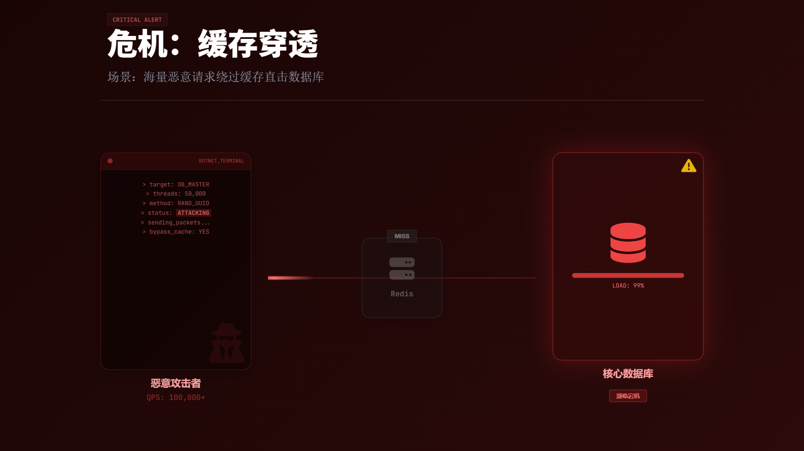
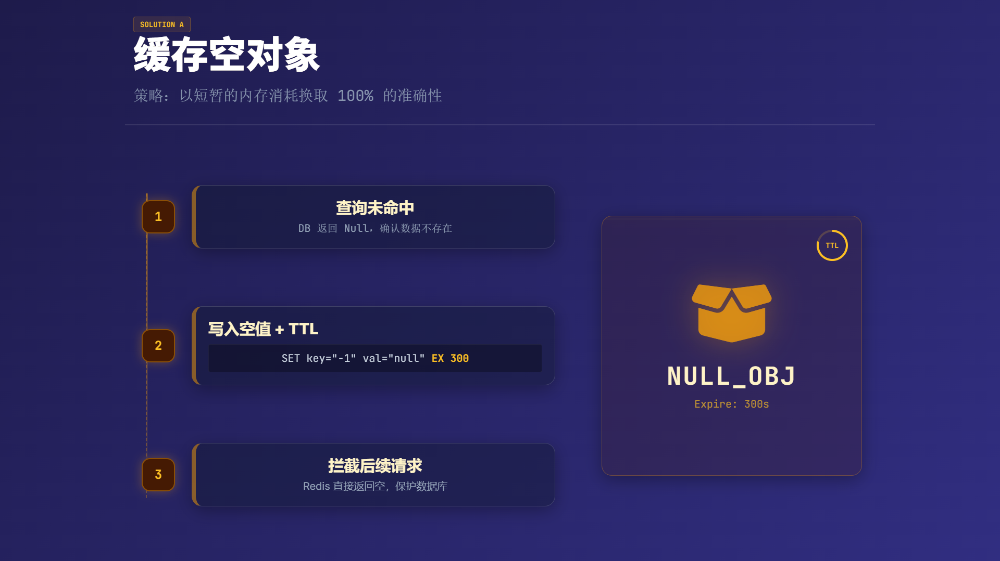
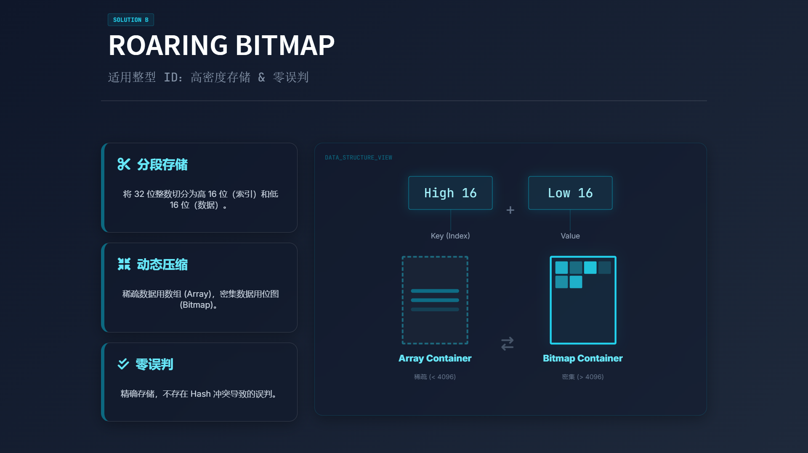
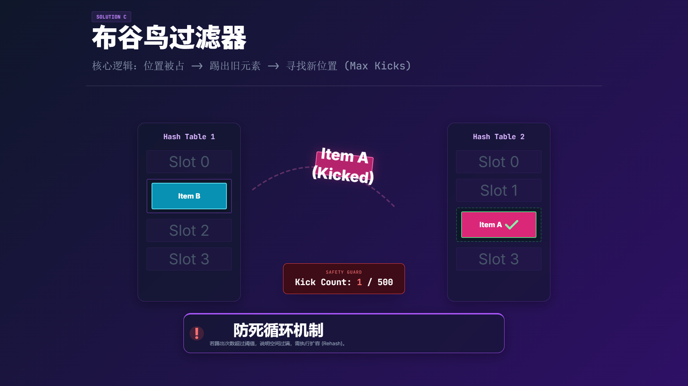

# 缓存穿透：除了布隆过滤器，我们还能怎么“优雅”地防御？

在分布式系统的缓存防御战中，“缓存穿透”是最经典也是最棘手的场景之一。当海量请求查询一个**根本不存在的数据**时，流量会瞬间击穿 Redis，直达脆弱的数据库。

提到防御，大家第一反应往往是“布隆过滤器（Bloom Filter）”。它固然经典，但并非万能银弹（误判率、不可删除等硬伤）。今天我们来探讨几种更符合现代架构的优雅方案。

***

### 一、 危机现场：当流量绕过防线

如上图所示，缓存穿透的可怕之处不在于“流量大”，而在于**“流量无效”。** 

攻击者（或代码 Bug）往往利用随机生成的 Key（如 <code>UUID</code> 或负数 ID）发起攻击。由于这些 Key 在缓存中必然 Miss，在数据库中也查不到（返回 Null），导致**“回写缓存”机制失效**。 

结果就是：Redis 成了摆设，数据库独自承担了所有 IO 压力，直至连接池耗尽。

***

### 二、 方案 A：缓存空对象 (Cache Null Object)

**为什么这是最“实惠”的方案？** 

这是一种**“以毒攻毒”**的策略。既然数据库返回了 Null，那我们就把这个 Null 当作一个“值”存起来。

* **核心权衡**：虽然这会浪费 Redis 的内存来存一堆垃圾 Key，但它换来的是 **100% 的数据准确性**（相比布隆过滤器没有误判）。
* **工程细节**：注意图中强调的 **TTL (过期时间)**。这是防止内存爆炸的关键。我们通常设置一个较短的过期时间（如 300秒），既能挡住短时间内的攻击潮，又能让系统在数据真正产生后能及时更新。

***

### 三、 方案 B：Roaring Bitmap (咆哮位图)

**从“位图”到“咆哮位图”的进化：** 如果你的 ID 是连续的整数（比如用户 ID），普通的 BitMap 虽然省空间，但在数据稀疏时（比如只有 ID=1 和 ID=100000000）会浪费大量连续的 0。 Roaring Bitmap 的精髓在于**“分段与自适应”**：

1. **分段**：将 32 位整数切两半，高 16 位作为“桶索引”，低 16 位作为“桶内数据”。
2. **自适应**：
   * 如果桶内数据少（稀疏），就用 **Array Container**（存 <code>short</code> 数组），省空间。
   * 如果桶内数据多（密集），就自动升级为 **Bitmap Container**，利用位操作加速查询。 这使得它在保持**零误判**的同时，做到了极致的空间压缩。

***

### 四、 方案 C：布谷鸟过滤器 (Cuckoo Filter)

**它解决了布隆过滤器的什么痛点？** 布隆过滤器最大的痛点是**“不支持删除”。**

因为多个元素可能共享同一个 Hash 位，删一个可能会误删其他的。 布谷鸟过滤器引入了**“指纹 (Fingerprint)”**和**“双位置机制”**：

* **鸠占鹊巢**：每个元素有两个候选位置。如果两个位置都满了，新来的元素会暴力“踢走”旧元素，旧元素再去它的备用位置。
* **支持删除**：因为存储的是指纹而非简单的位标记，我们可以安全地从桶中移除一个指纹，而不会影响其他数据。
* **空间利用率**：它可以达到 95% 的空间利用率才开始出现性能下降，这在寸土寸金的内存中非常宝贵。

***

### 五、 终极防线：立体防御架构

**不要把鸡蛋放在一个篮子里：** 单一的技术手段总有被攻破的可能。成熟的架构应当是**漏斗型**的：

1. **Layer 01 网关层**：在请求还没进 Java/Go 进程之前，Nginx 或网关就应该拦截掉明显的恶意 IP 和非法的 User-Agent。
2. **Layer 02 应用层**：这是成本最低的拦截。例如，如果你的 ID 是 10 位数字，那么所有非数字、长度不对的请求，直接在 Controller 层 <code>return</code>，根本不需要去烦扰 Redis。
3. **Layer 03 数据层**：最后才是我们上面讨论的缓存空对象或过滤器，作为保护数据库的最后一道防波堤。

***

### 六、 决策指南

**总结一下选型策略：**

* **代码最简单，不想引入复杂依赖？** -> 选 **缓存空对象**（记得加 TTL）。
* **ID 是整数，且数据量极大（亿级）？** -> 选 **Roaring Bitmap**。
* **数据需要频繁增删，且对空间敏感？** -> 选 **布谷鸟过滤器**。
* **传统业务，读多写少，能容忍少量误判？** -> 老牌的 **布隆过滤器** 依然能打。

> 更新: 2025-12-03 19:24:49  
> 原文: <https://www.yuque.com/tulingzhouyu/db22bv/kp66sgg43r2vap3n>