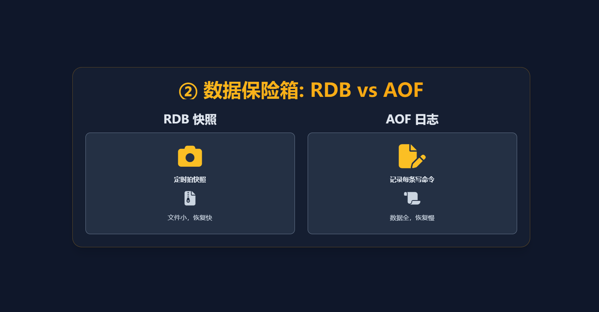
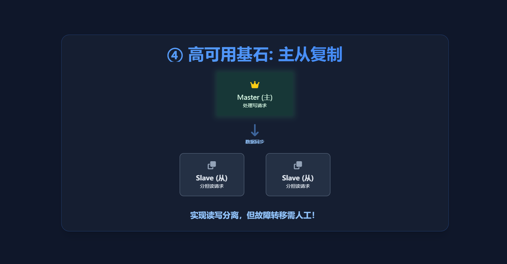
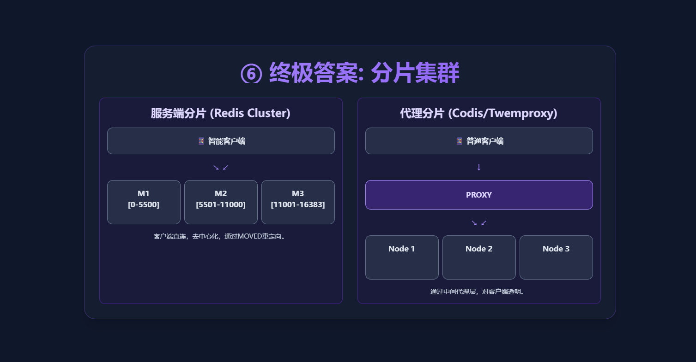

# 这就是你的精通Redis？结果连 “Redis架构演进都不知道！”

## 

## 引言：为什么我们需要“折腾”Redis？

在现代应用开发中，Redis以其闪电般的速度和丰富的数据结构，成为了缓存、消息队列乃至轻量级数据库的瑞士军刀。最初，我们引入Redis，可能只是为了解决数据库的性能瓶颈，一个单机版的Redis足以让应用性能得到质的飞跃。但随着业务的爆炸式增长，流量洪峰的冲击，这个“单兵作战”的Redis很快就会暴露出它的脆弱性：宕机、数据丢失、单点写入瓶颈……每一个问题都可能是压垮业务的最后一根稻草。

本文将带你踏上一场Redis的硬核进化之旅，从最简单的单机版开始，一步步剖析其在持久化、高可用、可扩展性方面遇到的挑战，并揭示Redis如何通过一系列精妙的设计（持久化、主从、哨兵、集群）最终演化成一个稳定、高性能的分布式“航母战斗群”。

***

## 第一站：单枪匹马 —— 单机版Redis的辉煌与脆弱

万丈高楼平地起。最开始，我们的架构非常纯粹：应用服务器、数据库（如MySQL），以及一个单机版的Redis。应用将热点数据从MySQL读出并缓存到Redis中。由于数据存储在内存，后续的读取请求快如闪电，极大地提升了用户体验。

这种模式在业务初期非常有效。但它的致命弱点也显而易见：

1. **数据易失性**：Redis是内存数据库，一旦服务器宕机或进程退出，所有数据将灰飞烟灭。
2. **服务不可用**：单点部署意味着一旦Redis挂掉，所有缓存请求将直接“击穿”到后端数据库，可能引发雪崩效应。

***

## 第二站：数据保险箱 —— RDB与AOF持久化

为了解决数据丢失问题，Redis提供了两种核心的持久化机制：RDB和AOF。

### 1. RDB (Redis Database) 快照

* **是什么**：在指定的时间间隔内，将该时刻内存中的数据集生成一个快照（snapshot），并以二进制、高度压缩的格式写入磁盘。
* **优点**：文件体积小，恢复速度快。非常适合用于备份、容灾和快速恢复。
* **缺点**：并非实时持久化。如果Redis在两次快照之间宕机，会丢失这期间的所有数据变更。

### 2. AOF (Append Only File) 日志

* **是什么**：以日志的形式，记录下每一条收到的“写”命令。当Redis重启时，会重新执行AOF文件中的所有命令来恢复数据。
* **优点**：数据完整性更高。根据配置（<code>appendfsync</code>），可以做到秒级甚至每个命令都持久化，最大程度减少数据丢失。
* **缺点**：文件体积通常比RDB大，恢复速度相对较慢。

### 优化组合拳：AOF重写与混合持久化

AOF文件会持续增长，为了解决这个问题，Redis引入了“AOF Rewrite”机制，它可以在不中断服务的情况下，生成一个包含当前数据集所需最少命令的新AOF文件。

而从Redis 4.0开始，更是推出了“混合持久化”这一王牌功能。在AOF重写时，它会将当前内存数据以RDB的格式写入AOF文件的开头，然后将重写期间的增量写命令追加到文件末尾。这完美结合了RDB的快速恢复和AOF的数据完整性优势。

***

## 第三站：高可用基石 —— 主从复制（Master-Slave）

持久化解决了数据备份问题，但无法解决服务中断问题——数据恢复需要时间。为了实现服务的高可用（High Availability），“主从复制”架构应运而生。

* **是什么**：部署多个Redis实例，分为一个主节点（Master）和多个从节点（Slave）。
* **怎么做**：
  * Master节点负责处理所有写请求，并将数据变更实时同步给所有Slave节点。
  * Slave节点通常只处理读请求，从而实现了“读写分离”，分担了Master的读取压力。
* **作用**：
  1. **高可用**：当Master宕机时，可以手动将一个Slave提升（promote）为新的Master，继续提供服务，大大缩短了服务中断时间。
  2. **读性能扩展**：通过增加Slave节点，可以线性扩展系统的读性能。

***

## 第四站：自动驾驶仪 —— 哨兵模式（Sentinel）

主从复制虽好，但Master宕机后需要“人工介入”进行故障转移，这在深夜或复杂场景下显然不够理想。于是，Redis的“自动驾驶仪”——哨兵（Sentinel）登场了。

* **是什么**：一个独立的进程集群，其核心任务是监控Redis主从系统的健康状况，并在主节点出现故障时，自动完成故障转移。
* **怎么做**：
  1. **监控**：哨兵集群中的每个哨兵进程，会定期向所有主从节点发送PING命令，检测其状态。
  2. **主观下线**：如果一个哨兵发现Master在规定时间内没有响应，它会主观地认为Master已下线。
  3. **客观下线与领导者选举**：该哨兵会向其他哨兵确认。当足够数量（可配置的quorum）的哨兵都认为Master已下线时，Master就被“客观下线”。随后，哨兵们会通过类Raft的共识算法，投票选举出一个“领导者”哨兵。
  4. **故障转移**：领导者哨兵负责执行故障转移：从存活的Slave中挑选一个最优的（基于复制偏移量、优先级等）提升为新Master，并通知其他Slave去复制新Master，同时更新客户端的连接信息。

为了保证选举的健壮性，哨兵集群通常部署奇数个节点（如3、5个），这样即使有节点故障，也能保证剩余节点能形成多数派，完成选举，有效防止“脑裂”。

***

## 第五站：横向扩容的终极答案 —— 分片集群（Cluster）

有了哨兵和主从，我们解决了高可用问题，并通过读写分离提升了读性能。但随着业务量级的持续攀升，所有写请求都压在单个Master上，很快就会达到其CPU和内存的极限。如何扩展写性能？答案是“分片”（Sharding）。

* **是什么**：将整个数据集分割成多个部分，分散存储在多个Master节点上。每个Master节点负责一部分数据，并可以拥有自己的Slave节点。所有Master节点共同组成一个逻辑上的大Redis。
* **核心原理**：Redis Cluster引入了“哈希槽”（Hash Slot）的概念，共有16384个槽。当存入一个key时，通过<code>CRC16(key) % 16384</code>计算出它属于哪个槽，然后将数据存入负责该槽的Master节点。

分片集群的实现主要有两种流派：

1. **服务端分片（Redis Cluster）**：这是Redis官方的解决方案。节点间通过Gossip协议交换状态信息，形成一个去中心化的集群。客户端连接任意一个节点，如果数据不在该节点，节点会返回一个<code>MOVED</code>重定向指令，告知客户端数据所在的正确节点。智能客户端（如JedisCluster）会自动处理重定向。
2. **代理分片（Proxy-based）**：在应用和Redis节点之间架设一个代理层（如Twemproxy, Codis）。客户端只与代理交互，由代理负责所有的路由、分片和节点管理逻辑。对客户端来说，后端就像一个单一的、巨大的Redis实例，侵入性更小。

***

## 总结：演进之路，永无止境

回顾Redis的架构演进之路，是一部不断发现问题、解决问题的精彩历史：

* 从**单机**的性能瓶颈和数据安全隐患出发...
* 引入**持久化 (RDB/AOF)**，为数据上了保险。
* 通过**主从复制**，实现了读写分离和高可用的基础。
* 部署**哨兵集群**，将故障转移自动化，迈入“准无人驾驶”时代。
* 最终通过**分片集群**，彻底打破了单点写入瓶颈，实现了真正意义上的水平扩展。

这条演进路径，不仅是Redis自身的技术成长史，也为我们设计任何一个分布式系统提供了宝贵的思想：在高性能、高可用、可扩展性之间寻求平衡，通过层层递进的架构升级，最终构建出能够支撑海量业务的坚实技术底座。

> 更新: 2025-09-19 21:36:45  
> 原文: <https://www.yuque.com/tulingzhouyu/db22bv/rhmxp80m5u936rpu>