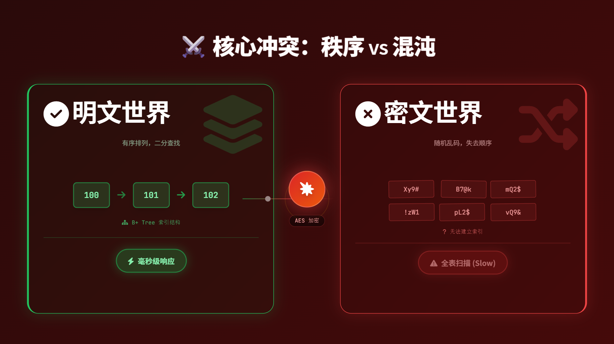
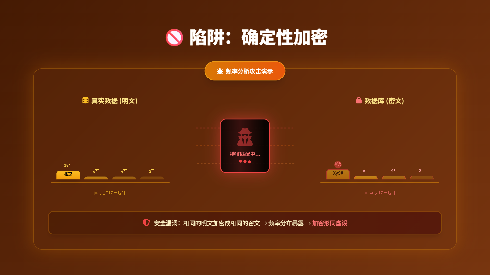
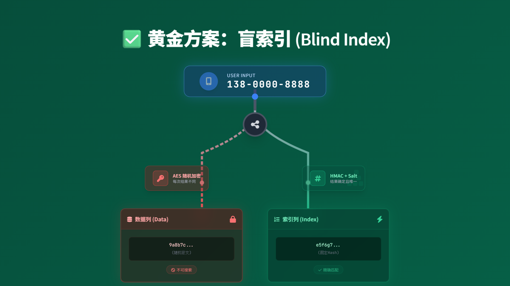

# 面试官：MySQL 里有 1 亿条加密数据，如何设计索引？

> ** 前言**：在数据安全日益严苛的今天，"脱敏"和"加密"已成为架构设计的标配。但安全往往伴随着性能的牺牲。当业务方要求对身份证、手机号等敏感字段进行加密存储，同时又要求毫秒级的精确查询，甚至范围查询时，作为架构师的你，该如何破局？

### 一、 核心冲突：秩序 vs 混沌

如上图所示，这不仅仅是颜色的对立，更是**数据结构层面的根本冲突**。

* **左侧（明文世界）**：MySQL 的 InnoDB 引擎之所以快，依赖于 B+ 树的**有序性**。因为 <code>100 < 101 < 102</code>，数据库可以通过二分查找迅速定位数据，时间复杂度是 O(logN)。
* **右侧（密文世界）**：现代加密算法（如 AES-CBC、GCM 模式）的核心设计目标就是**消除规律**。加密后的数据看起来必须像随机噪声（Random Noise）。

**矛盾点在于**：一旦使用了高强度的随机加密（每次加密结果都不同），数据就彻底失去了顺序性。数据库面对一堆乱码，B+ 树失效，只能退化为**全表扫描**。对于 1 亿条数据，这意味着查询时间从几毫秒劣化为几十秒甚至超时。

***

### 二、 致命陷阱：天真的"确定性加密"

为了解决索引问题，很多初级开发者会想到一个"聪明"的办法：**把加密算法改一改，让同样的明文永远生成同样的密文（如 AES-ECB 模式）**。这样不就可以利用数据库索引了吗？

**这是一个巨大的安全陷阱！**

如上图的频率分析所示：

* 在真实世界中，数据的分布是不均匀的（例如北京的用户远多于其他城市）。
* 如果加密是确定性的，密文的分布将完美复刻明文的分布。
* 黑客不需要解密，只需统计密文出现的频率（比如出现次数最多的那个密文串），就能推断出它代表"北京"。

这种泄露被称为**模式泄露（Pattern Leakage）**，它让加密形同虚设。因此，**直接对密文建索引，通常是在裸奔。**

***

### 三、 黄金方案：盲索引 (Blind Index)

如何既要安全的随机加密，又要高效的索引查询？答案是**将"存储"与"索引"解耦**。我们采用**双列策略**，如上图的管道分流模型所示：

1. **数据列 (Data Column)**：
   * **职责**：负责数据的最终展示和解密。
   * **算法**：使用**AES-CBC + 随机 IV**。
   * **特点**：每次加密结果都不同，彻底不可识别，不可搜索，安全性最高。
2. **索引列 (Index Column)**：
   * **职责**：仅负责 <code>WHERE column = ?</code> 的精确查询。
   * **算法**：使用 **HMAC-SHA256 + 专用 Salt**。
   * **特点**：这是一个单向哈希。对于相同的手机号，生成的哈希值是固定的。我们只对这一列建立数据库索引。

**查询流程**： 当用户搜索 <code>138-0000-8888</code> 时，系统在内存中计算其 Hash 值（如 <code>e5f6g7...</code>），然后去数据库查询 <code>WHERE blind_index = 'e5f6g7...'</code>。找到记录后，再取出对应的数据列进行解密。

这种方案被称为**盲索引（Blind Index）**，它完美平衡了安全性（数据列随机化）和性能（索引列走 B+ 树）。

***

### 四、 场景化决策指南

盲索引虽然好，但它只能解决"精确匹配"（Equals）的问题。在实际面试或架构设计中，我们需要根据具体的业务场景，按图索骥，选择最合适的方案：

1. **场景 A：精确查询（手机号、身份证）**
   * **推荐方案**：**盲索引 (Blind Index)**
   * **理由**：性价比最高。仅需增加一个 Hash 列，存储空间小，查询速度等同于普通索引，且不破坏原有数据的安全性。
2. **场景 B：范围查询（薪资 > 20k，年龄 20-30 岁）**
   * **推荐方案**：**区间标签法 (Range Tags)**
   * **原理**：不要存具体的加密数字。而是计算一个粗粒度的标签存入数据库。例如，将薪资映射为 <code>Tag_A</code> (0-10k), <code>Tag_B</code> (10k-20k)。
   * **流程**：查询时，先搜出所有 <code>Tag_B</code> 的数据（可能包含 100 条），然后在应用服务的内存中解密这 100 条数据，精确过滤出大于 20k 的记录。
   * **权衡**：以少量的内存计算换取了数据库索引的生效。
3. **场景 C：模糊搜索（住址 Like %朝阳区%）**
   * **推荐方案**：**异构索引 (Elasticsearch)**
   * **理由**：不要难为 MySQL。MySQL 的 B+ 树本身就不擅长左模糊查询，更别提加密数据了。
   * **流程**：将数据同步到 Elasticsearch，利用 ES 的分词加密插件或特定的搜索加密方案（如可搜索加密 SSE，虽然复杂但可行）来处理。对于常规业务，通常建议对非敏感字段分词，敏感字段依然走精确匹配。

> 更新: 2025-12-26 13:30:32  
> 原文: <https://www.yuque.com/tulingzhouyu/db22bv/qx7ycbfzcrorctz3>