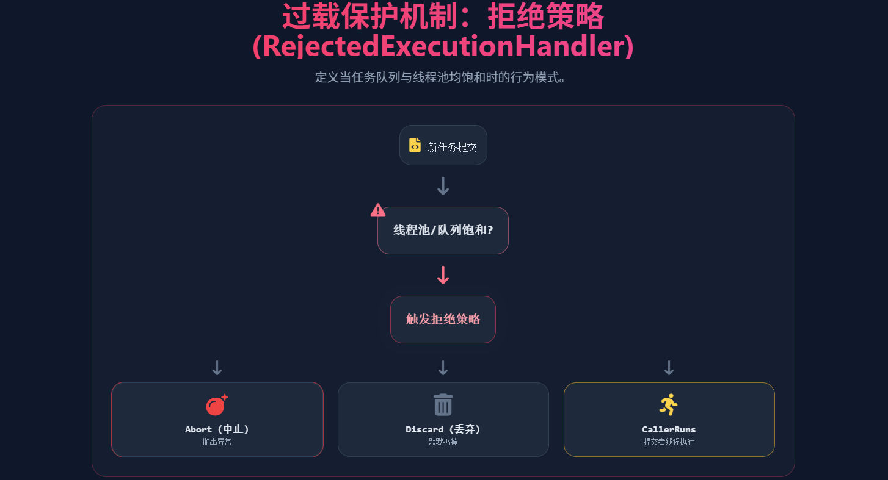
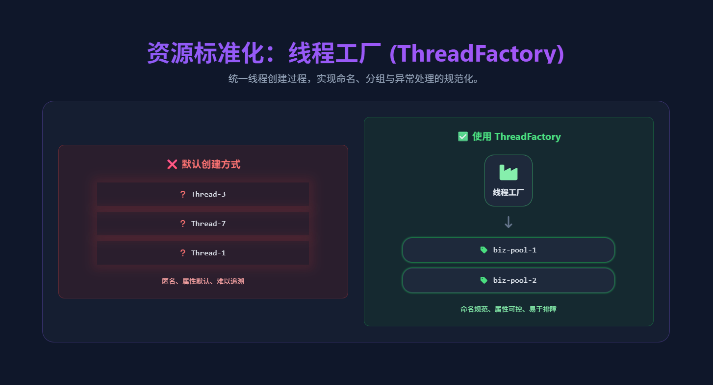
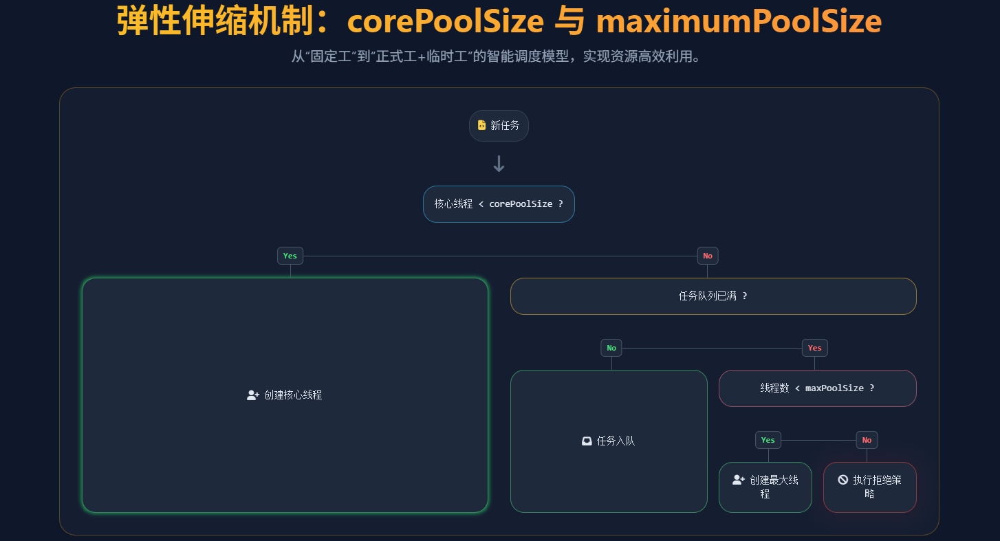

# 面试官：怎么手搓一个线程池？

在并发编程的世界里，线程池是绕不开的基石。但我们是否满足于仅仅会用<code>ThreadPoolExecutor</code>？不，真正的掌握源于深刻的理解。今天，就让我们一起踏上“造轮子”的旅程，从一个最简单的想法出发，亲手构建一个功能完备、设计精良的线程池。

#### **第一步：搭建核心骨架——任务队列与工作者线程 (V0.1)**

我们创建线程池的初衷，是为了避免为每个任务都创建和销毁线程。那么，最简单的思路就是：用一个线程来循环往复地执行任务。但任务从哪里来呢？一个共享的队列是显而易见的答案。

于是，我们的V0.1版本设计诞生了：

这个设计是线程池的灵魂。我们只需要在程序启动时，创建一个（或多个）“工作者线程”，让它在一个<code>while(true)</code>循环里不断地从一个\*\*阻塞任务队列（BlockingQueue）\*\*中<code>take()</code>任务。

* 当队列中有任务时，线程获取并执行它。
* 当队列为空时，<code>take()</code>方法会让线程自动进入等待状态，直到新任务入队。

这样，我们就用极低的成本实现了一个最基础的“任务执行器”，成功迈出了第一步。

#### **第二步：引入安全阀——设计拒绝策略以应对过载 (V0.2)**

我们的V0.1版本虽然能工作，但它很脆弱。如果任务提交的速度持续快于处理速度，任务队列（假设它有界）迟早会被塞满。这时，如果再有新任务提交，程序该怎么办？直接崩溃吗？显然不行。我们需要一个“安全阀门”。

为了让我们的线程池更健壮，我们必须引入**拒绝策略 (Rejection Policy)**。当线程池判断自己无法再接收新任务时（例如，队列已满），就必须执行这个预设的策略。我们可以设计几种不同的应对方式：

* **Abort (中止)**: 最直接的方式，抛出异常，明确告知调用方：“我处理不了了！”
* **Discard (丢弃)**: 如果任务不那么重要，我们可以选择默默地把它丢掉。
* **CallerRuns (调用者运行)**: 一种聪明的降级策略。让提交任务的线程自己去执行这个任务。这会暂时阻塞提交方，使其无法再快速提交新任务，从而给我们的线程池一个喘息之机。

加上这个机制后，我们的线程池V0.2版本就具备了初步的自我保护能力。

#### **第三步：规范化管理——利用线程工厂定制线程 (V0.3)**

随着项目变大，我们可能会有多个线程池，每个池里又有多个线程。当出现问题时，如果日志或堆栈信息里全是<code>Thread-1</code>, <code>Thread-5</code>这样的名字，排查问题将是一场噩梦。我们需要对我们创造出的“工人”进行规范化管理。

解决方案就是引入**线程工厂 (ThreadFactory)**。我们不再直接<code>new Thread()</code>，而是委托一个专门的工厂来创建工作者线程。在这个工厂里，我们可以：

1. **统一命名**：为线程设置有意义的前缀，如<code>my-order-pool-thread-</code>。
2. **设置属性**：统一将线程设置为守护线程，或调整它们的优先级。
3. **记录统计**：甚至可以记录工厂创建了多少个线程。

通过这个小小的改进，我们的线程池V0.3版本在可维护性和专业性上迈进了一大步。

#### **第四步：实现弹性伸缩——核心与最大线程的调度智慧 (V1.0)**

目前为止，我们的线程池要么是固定大小，要么需要手动调整。这不够智能。理想的线程池应该像一个管理有方的团队：有固定的“正式工”，在任务繁忙时还能招募“临时工”，任务清闲时再解雇“临时工”以节约成本。这就是<code>corePoolSize</code>和<code>maximumPoolSize</code>的设计精髓。

现在，我们要为我们的线程池V1.0版本实现这套复杂的调度逻辑。当一个新任务提交时，我们的处理流程如下：

1. 首先，判断当前“正式工”（核心线程）数量是否小于<code>corePoolSize</code>。如果是，直接创建新的核心线程来处理任务。
2. 如果核心线程已满，则尝试将任务放入任务队列。
3. 如果任务队列也满了，再判断当前总工人数（所有线程）是否小于<code>maximumPoolSize</code>。如果是，就招募一个“临时工”（非核心线程）来处理这个紧急任务。
4. 如果连总工人数也达到了上限，那就只能启动我们之前设计的“拒绝策略”了。

这套逻辑确保了资源的高效利用，是衡量一个线程池是否达到“生产级”的重要标准。

#### **第五步：架构师的思考——如何为我们的线程池配置最佳容量？**

我们已经成功“手搓”出了一个功能强大的线程池V1.0。但作为一个负责任的创造者，我们还必须知道如何为它配置最佳参数。线程池的容量并不是越大越好，它取决于我们要执行的任务类型。

* **CPU密集型任务**：这种任务需要消耗大量CPU算力。过多的线程只会导致CPU在它们之间频繁切换，浪费宝贵的上下文切换时间。因此，线程数通常设置为接近CPU的核心数。
* **I/O密集型任务**：这种任务大部分时间都在等待（如等待数据库返回数据、等待网络响应）。当一个线程在等待时，CPU是空闲的。为了不浪费CPU，我们应该让其他线程此时能顶上来工作。因此，可以配置远超CPU核心数的线程。

理解了这一点，我们才能根据实际应用场景，为我们亲手打造的线程池注入最合适的性能灵魂。

#### **最终章：从“手搓”到“精通”——旅程的终点与新的起点**

我们从一个简单的想法出发，通过不断发现问题、解决问题，最终完整地设计出了一个生产级线程池所应具备的所有核心组件和调度逻辑。

这次“造轮子”的旅程，其真正的价值不在于创造一个可以替代<code>ThreadPoolExecutor</code>的工具，而在于通过这个过程，我们深刻地理解了其每一项设计的背后所要解决的问题和蕴含的权衡。

现在，我们再回头看JDK的<code>ThreadPoolExecutor</code>，它的每一个参数、每一种策略对我们来说都不再是孤立的API，而是我们曾经亲手构建并为之思考过的鲜活设计。**“手搓”的意义，正是为了最终能够更专业、更自信地“精通”和使用好那个业界标准。**

> 更新: 2025-11-19 14:37:31  
> 原文: <https://www.yuque.com/tulingzhouyu/db22bv/imalggpi28agdxo6>