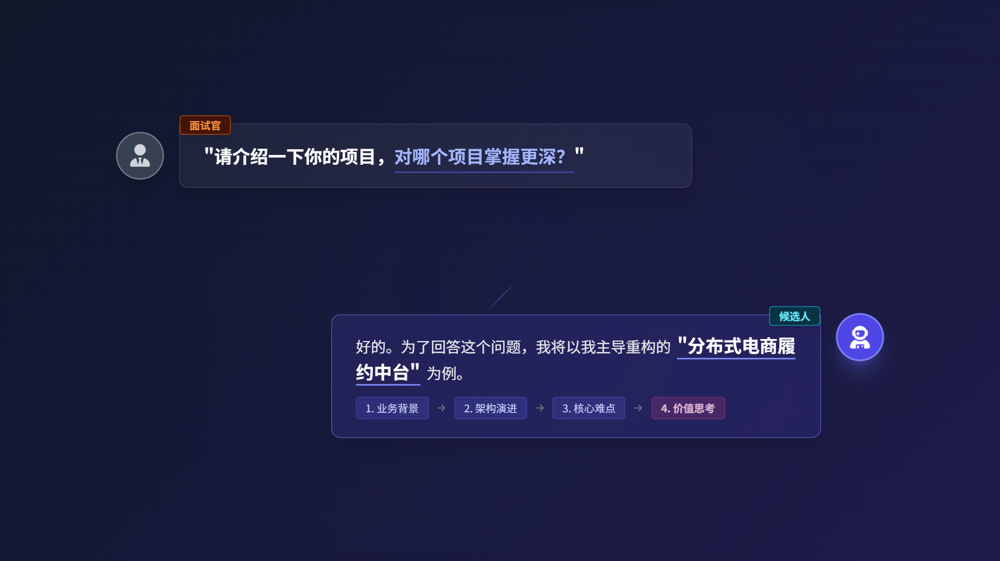
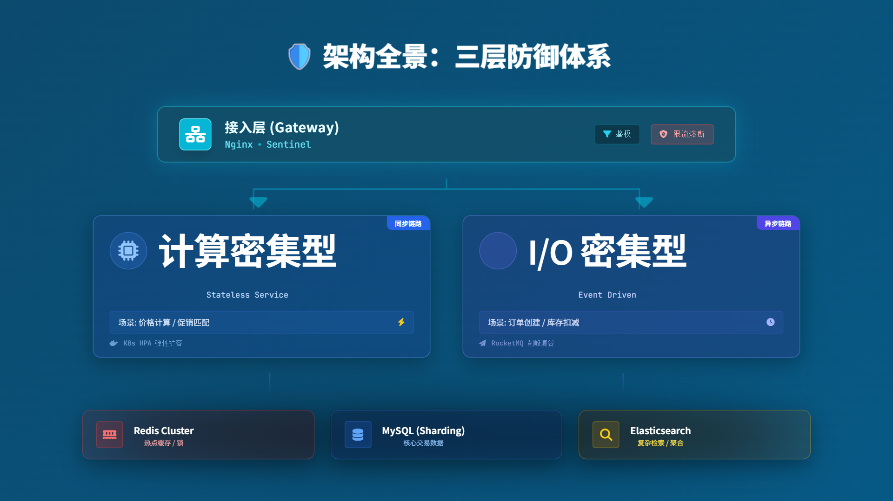
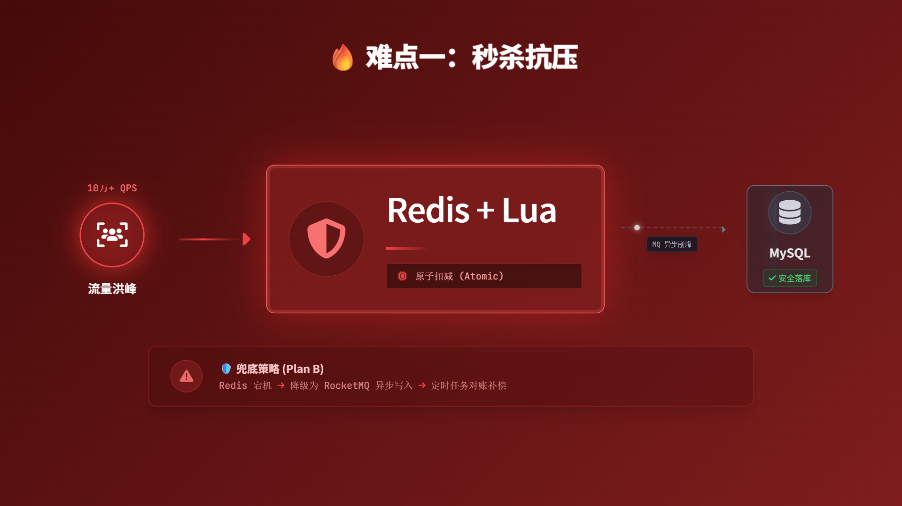
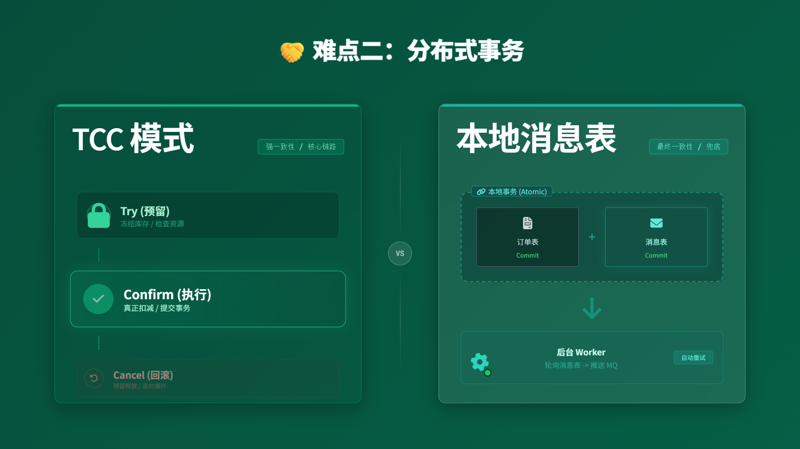
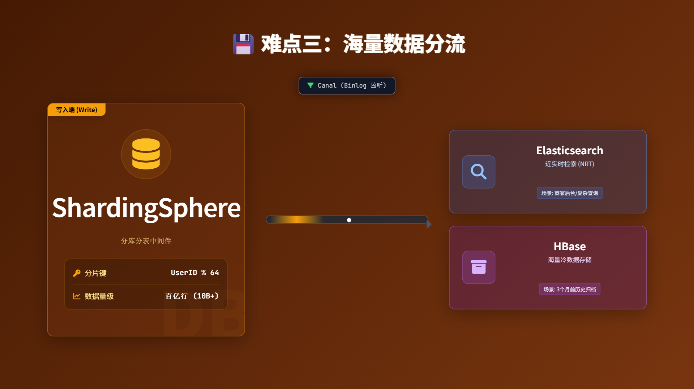
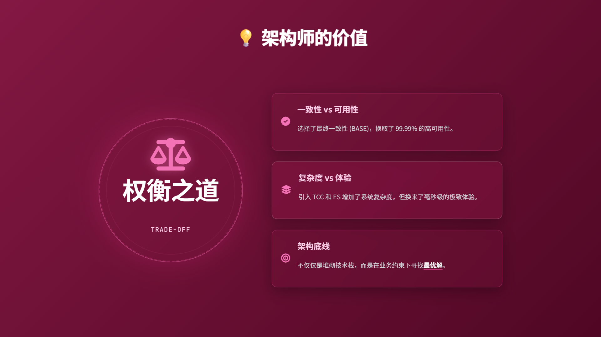

# 面试必问：如何介绍你的项目？

在面试中被问到"介绍一个你最深入的项目"时，很多候选人容易陷入流水账。其实，面试官想听的不是业务流程，而是**架构演进背后的思考（Trade-off）**。

本文将以我主导重构的**分布式电商履约中台**为例，复盘一套高并发、高可用的架构设计方法论。

---

### 一、 开篇：拒绝流水账，建立宏观视角

**💡**** 核心思考：** 不要一上来就谈"我们用了 Spring Boot"。我在介绍项目时，首先会明确**业务规模与核心挑战**。对于履约系统而言，核心矛盾在于：**大促流量洪峰（10w+ QPS）与库存数据强一致性之间的冲突**。

为了解决这个矛盾，我们确立了"分层治理"的整体策略，将系统拆解为三个维度的防御体系。

---

### 二、 架构全景：流量是如何被"层层过滤"的？

**💡**** 架构拆解：** 如上图所示，我们设计了三道防线，每一层都有明确的职责边界，避免单点压力过大：

1. **接入层（网关）**：这是第一道"大坝"。图片中展示了 Nginx + Sentinel 的组合，我们在这一层主要做**非业务逻辑的拦截**，比如基于 IP 的限流、鉴权以及黑名单过滤，确保进入内网的流量是相对"干净"的。
2. **服务层（分流）**：这是架构设计的亮点。我们并没有把所有逻辑塞进一个服务，而是根据**资源消耗类型**进行了物理拆分：
    - **计算密集型**（如价格计算）：无状态设计，配合 K8s HPA 实现秒级弹性伸缩。
    - **I/O 密集型**（如订单落库）：通过 RocketMQ 进行异步解耦，防止数据库被瞬间打死。
3. **数据层（基座）**：底层存储不再是单一的 MySQL，而是根据数据冷热和查询维度，构建了 Redis（热）+ MySQL（温）+ ES（冷/搜）的异构存储集群。

---

### 三、 难点攻克：如何在 10w+ QPS 下保证库存准确？

**💡**** 深度解析：** 秒杀场景最忌讳的是"超卖"。图片直观展示了流量的流向，但代码层面的核心逻辑在于**Redis + Lua 的原子性设计**。

+ **为什么不用数据库行锁？** 数据库行锁在高并发下会导致严重的线程阻塞（串行化），性能无法满足要求。
+ **Lua 的妙用**：我们将"查询库存"和"扣减库存"两个操作封装在一个 Lua 脚本中发送给 Redis。Redis 单线程执行脚本的特性，天然保证了这两个操作的原子性，就像上图中中间那个坚固的盾牌一样。
+ **兜底策略（Plan B）**：系统设计必须考虑最坏情况。如果 Redis 集群全挂了怎么办？我们设计了一套降级方案：直接切断同步链路，所有请求转入 RocketMQ 异步排队。虽然用户体验会变慢（前端显示"排队中"），但至少能保证系统不崩，数据不错。

---

### 四、 事务一致性：强一致 vs 最终一致的抉择

**💡**** 决策依据：** 分布式事务没有银弹，只有适合的场景。我们在系统中同时应用了这两种模式：

1. **核心链路（TCC）**： 对于"库存扣减"这种涉及到资金和货物的核心环节，我们必须保证**强一致性**。如左图所示，TCC 的 Try 阶段预留资源，Confirm 阶段真正执行。虽然开发成本高（需要实现三个接口），但它能确保只要订单创建成功，库存一定是被锁定的。
2. **异步链路（本地消息表）**： 对于"发送积分"、"推送物流单"等非核心业务，我们追求**最终一致性**。右图展示了其核心技巧：**将业务数据和消息数据写入同一个本地数据库事务中**。这样利用本地数据库的 ACID 特性，保证了"业务操作"和"发消息"这两个动作要么同时成功，要么同时失败，彻底解决了"消息发送后业务失败"的分布式难题。

---

### 五、 海量数据：写入与查询的分离之道

**💡**** 技术细节：** 随着业务发展，单表数据突破亿级，查询性能急剧下降。我们采用了**CQRS（命令查询职责分离）** 的思想：

+ **写入端**：使用 ShardingSphere 进行分库分表（按 UserID 取模），目的是为了**提升写入吞吐量**。
+ **同步端**：为了不影响主库性能，我们没有在代码里做双写，而是利用 Canal 伪装成 MySQL Slave，监听 Binlog 日志。这种方式对业务代码**零侵入**。
+ **查询端**：C端用户查订单走 MySQL（带分片键），而 B 端商家复杂的搜索（如"查询过去3个月发往北京的订单"）则走 Elasticsearch。这种"因地制宜"的存储选型，完美解决了海量数据的读写瓶颈。

---

### 六、 总结：架构师的价值在于"权衡"

**💡**** 核心观点：** 做架构不是堆砌最新的技术栈，而是**在约束条件下寻找最优解**。

在这个项目中，我们牺牲了部分的开发效率（引入 TCC），换取了核心数据的一致性；我们牺牲了部分数据实时性（引入 MQ 和 ES），换取了系统的高可用和高性能。

正如上图所示，架构师的工作，就是在那架天平上，根据业务阶段，精准地放置每一块砝码。

> 更新: 2025-12-04 21:35:22  
> 原文: <https://www.yuque.com/tulingzhouyu/db22bv/qg75fsiz4uh3wglr>