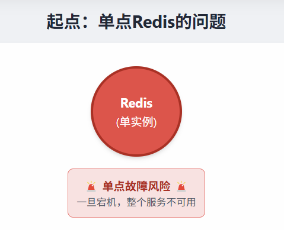
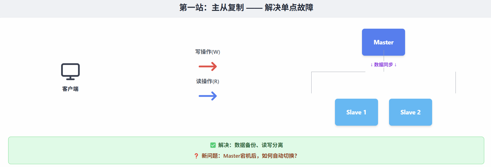
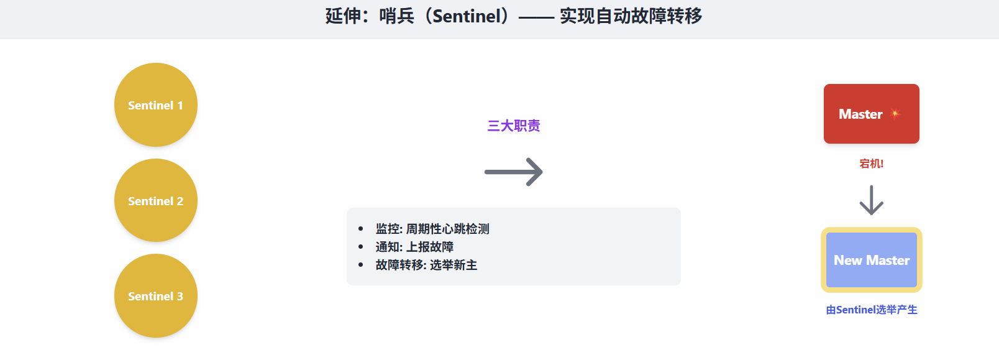
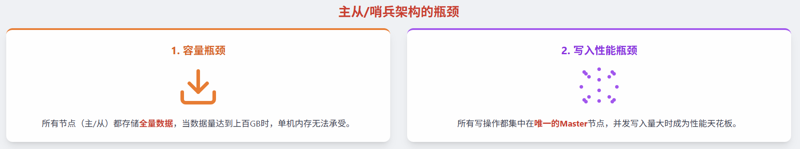
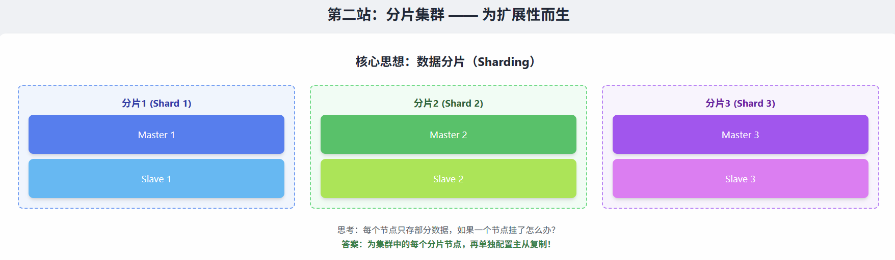
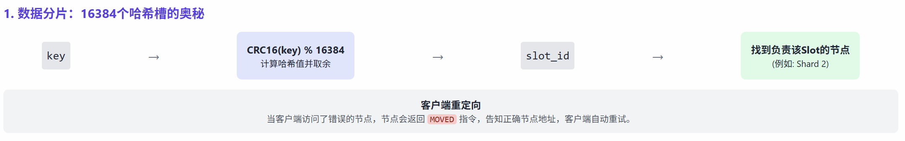
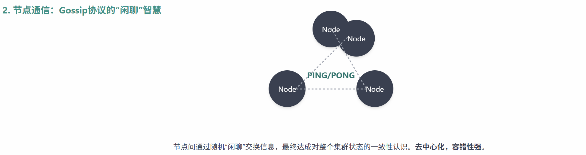
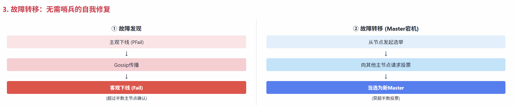

# 八张架构图讲透Redis服务端面试核心

在现代分布式系统中，Redis 凭借其卓越的性能，已成为缓存、消息队列、分布式锁等场景的首选。然而，一个单点的 Redis 实例无疑是系统中最脆弱的环节。为了解决这个问题，一套高可用（High Availability, HA）方案是必不可少的。当面试官问起“Redis 如何保证高可用”，很多人会脱口而出“主从集群”。但“主从”和“集群”究竟有何区别？为何有了主从还需要集群，反之亦然？

本文将遵循一条清晰的演进路径，带您从最基础的主从复制，到哨兵模式，最终深入到分片集群的内部，彻底弄懂 Redis 高可用架构的每一个细节。

## 第一站：主从复制与哨兵——解决单点故障

为了避免 Redis 服务器宕机导致整个服务不可用的问题，我们引入了最基础的高可用方案：**主从复制（Master-Slave Replication）**。

其核心思想非常简单：

* 部署一个**主节点（Master）****和多个****从节点（Slave）**。
* 写操作只在主节点上进行。
* 从节点通过主从复制协议，实时地从主节点同步数据。
* 读操作可以分摊到各个从节点上，实现**读写分离**，提升读取性能。

这样，即使主节点宕机，从节点依然可以提供读服务，同时因为有数据副本的存在，也保证了数据的安全性。

但这引出了一个新问题：主节点宕机后，谁来将从节点提升为新的主节点，恢复写服务呢？这就是\*\*哨兵（Sentinel）\*\*机制的用武之地。

**哨兵的核心职责有三点：**

1. **监控（Monitoring）**：周期性地检查主从节点是否正常工作。
2. **通知（Notification）**：当被监控的节点出现问题时，通过 API 向管理员或其他应用程序发送通知。
3. **自动故障转移（Automatic Failover）**：当主节点被判定为下线时，哨兵会自动在从节点中选举出一个新的主节点，并将其余从节点指向这个新主，同时通知客户端新的主节点地址。

至此，我们似乎拥有了一套看似完美的 HA 方案。但仔细思考，这套架构仍然存在两大无法回避的瓶颈。

### 主从架构的瓶颈

1. **容量瓶颈**：每个节点（无论是主是备）都存储着**全量数据**。当数据量达到几十上百 GB 时，单机的内存资源将不堪重负。巨大的数据量也会严重影响 RDB 持久化和主从全量同步的性能。
2. **写入性能瓶颈**：所有的写操作都必须在**唯一的 Master 节点**上执行。当并发写入量巨大时，单个 Master 节点的 CPU 和网络带宽会成为整个系统的性能天花板，无法通过增加从节点来水平扩展写入能力。

为了突破这两大瓶颈，Redis 的架构必须再次进化。

## 第二站：分片集群——为扩展性而生

基于主从架构的瓶颈，**Redis 分片集群（Redis Cluster）****应运而生。它彻底改变了数据的存储方式，其核心思想是****数据分片（Sharding）**。

集群不再让每个节点都持有全量数据，而是将所有数据拆分成多个部分，分散地存储在不同的 Redis 节点上。

**分片集群带来了两大革命性优势：**

1. **解决了容量问题**：每个节点只保存一部分数据，使得集群的总存储容量可以随着节点的增加而线性扩展，轻松支持海量数据。
2. **解决了写入瓶颈**：集群中的每个主节点都可以独立处理写操作，使得整个集群的写入能力也得以水平扩展。

**思考：** 那么问题来了，如果集群中的某个节点挂了怎么办？这个节点上的数据不就丢失了吗？

答案是：**为集群中的每一个分片节点，再单独配置主从复制！** 这就是为什么说“有了集群，还需要主从”。在生产环境中，一个完整的 Redis 集群架构，是由多个“主从”节点对组成的，每个主从对负责一个数据分片，共同构成一个既高可用又高可扩展的完整集群。

## 深入集群内部：三大核心机制

理解了集群的宏观架构后，我们还需要深入其内部，探究其高效运转的三大核心机制：数据分片、节点通信和故障转移。

### 1. 数据分片：16384 个哈希槽的奥秘

集群是如何巧妙地将数据均匀分散到各个节点的呢？答案是**哈希槽（Hash Slot）**。

Redis 集群内部预设了 **16384** 个哈希槽。在集群创建时，这些槽会被自动地、尽可能平均地分配给集群中的所有主节点。每个主节点只负责一部分哈希槽。

当客户端需要对一个 <code>key</code> 进行读写时，集群会遵循以下规则：

1. 使用 **CRC16 算法**计算 <code>key</code> 的哈希值。
2. 将计算出的哈希值对 **16384** 进行取余，得到一个 0 到 16383 之间的槽位编号。
3. 根据槽位编号，找到负责该槽的对应 Redis 节点，然后将命令发送到该节点执行。

<code>slot = CRC16(key) % 16384</code>

**客户端重定向（Redirection）**

在集群扩容（增加新节点）或缩容（移除节点）时，哈希槽会在节点间进行迁移。如果一个客户端访问的 <code>key</code> 所对应的槽正在迁移，或者已经迁移到了别的节点，会发生什么？

此时，集群依然能正常提供服务。当节点收到一个关于它不负责的槽的请求时，它不会直接拒绝，而是会返回一个 **MOVED 重定向指令**，该指令包含了目标槽当前正确的节点地址。智能客户端（如 Jedis、Lettuce）在收到 MOVED 指令后，会自动更新本地的槽位映射缓存，并重新向正确的节点发起请求。这个过程对用户是透明的。

### 2. 节点通信：Gossip 协议的“闲聊”智慧

在一个去中心化的集群中，各个节点需要频繁交换信息，以了解谁是正常的、谁下线了、谁又新加入了、哈希槽的分配情况如何等。Redis 集群没有采用中心化的注册中心，而是使用了一种名为 **Gossip（流言）** 的协议来进行通信。

Gossip 协议的思想如同其名，非常像办公室里的“八卦”或流行病的传播：

* 每个节点都会有一个定时任务，周期性地从集群中**随机**选择几个节点发送 <code>PING</code> 消息。
* <code>PING</code> 消息中包含了发送者自身的状态信息，以及它所知道的关于其他节点的状态信息。
* 接收到 <code>PING</code> 消息的节点会返回一个 <code>PONG</code> 消息，其中也包含它自身和它视角下的集群状态。
* 通过这种方式，一个节点的信息经过几轮“闲聊”后，就能快速地传播至整个集群，最终所有节点都会对整个集群的状态达成一致。

Gossip 协议的优点是**去中心化、容错性强**，即使部分节点故障或网络分区，信息交换依然能以最终一致的方式进行。

### 3. 故障转移：无需哨兵的自我修复

正因为有了 Gossip 协议，Redis 集群拥有了自我进行故障发现和转移的能力，不再需要独立的 Sentinel 集群。

**故障发现流程：**

1. **主观下线（PFail）**：当节点 A 发现节点 B 长时间没有响应其 <code>PING</code> 消息时，节点 A 会在自己的视角里，将节点 B 标记为“疑似下线”（P 代表 Probable）。这只是 A 的一家之言。
2. **客观下线（Fail）**：节点 A 会通过 Gossip 协议，将它对 B 的 PFail 判断“告诉”其他节点。当一个节点收到**超过半数**的主节点都认为 B 已经下线的信息后，它就会将 B 标记为“确定下线”（Fail），并向整个集群广播一条关于 B 的 <code>FAIL</code> 消息。

**故障转移流程：**

* **如果挂的是从节点**：非常简单。其对应的主节点会将其从复制列表中移除即可，对整个集群服务没有影响。
* **如果挂的是主节点**：
  1. 该主节点的所有从节点会检测到主节点已客观下线。
  2. 其中一个从节点会发起选举，向集群中其他所有主节点请求投票。
  3. 如果它获得了超过半数主节点的投票，那么它就成功当选为新的主节点。
  4. 新的主节点将立即接管旧主节点负责的所有哈希槽。
  5. 最后，它会通过 Gossip 协议向全集群广播自己的新身份，通知所有节点更新路由信息。

## 结论：架构的演进之路

回顾全文，我们可以清晰地看到一条为了应对不同挑战而不断演进的架构路线：

1. **单点 Redis**：性能优秀，但存在单点故障。
2. **主从 + 哨兵**：解决了单点故障和读性能问题，实现了高可用。但遇到了容量和写性能瓶颈。
3. **分片集群**：通过数据分片解决了容量和写性能瓶颈，实现了高可扩展。
4. **分片集群 + 主从复制**：将两者结合，为每个分片配备主从备份，最终构成了兼具**高可用、高可扩展**的终极生产级 Redis 架构。

理解这条演进路径，以及每一步是为了解决什么问题、引入了什么新技术，是彻底掌握 Redis 高可用体系的关键。

> 更新: 2025-09-18 16:17:34  
> 原文: <https://www.yuque.com/tulingzhouyu/db22bv/vrv2zsn2dmr2gx4z>