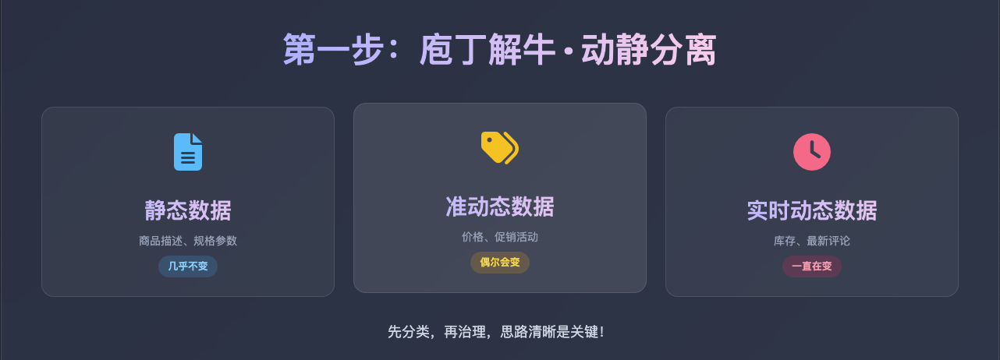
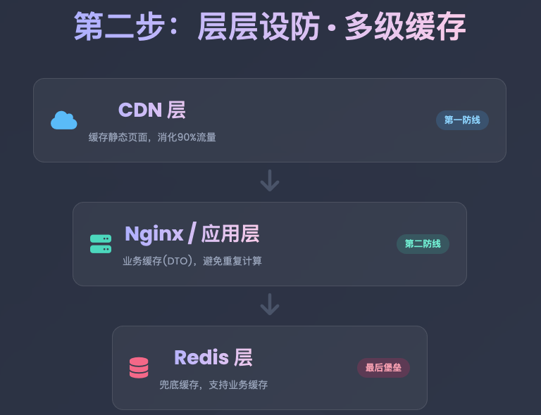
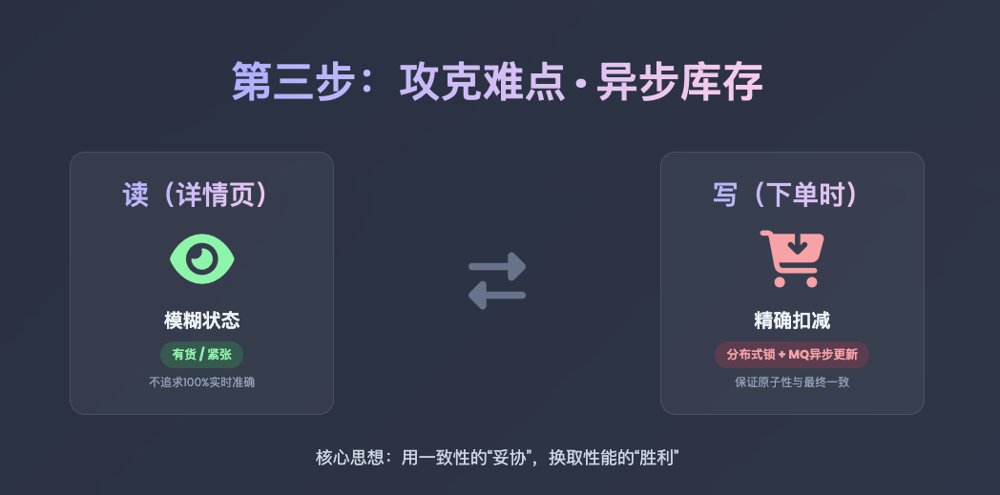
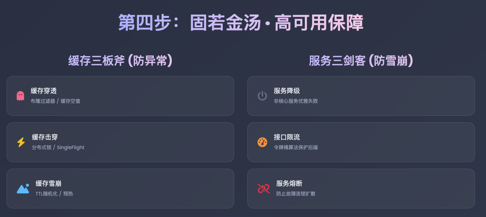
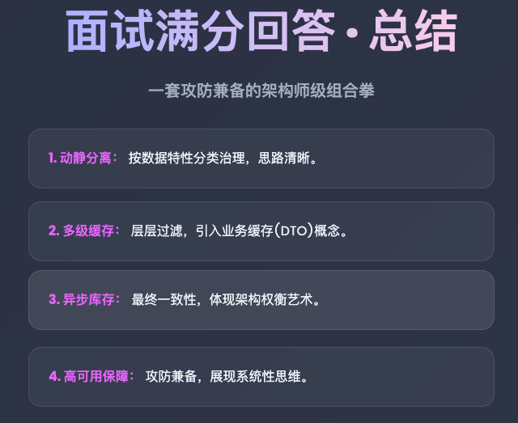

# 1、10万级并发电商商品详情页，如何设计？(京东）

“如何设计一个支持10万QPS的电商商品详情页？”

当面试官抛出这个经典问题时，他绝不是想听你说“上CDN、加Redis、做负载均衡”这样教科书式的答案。这道题是一块试金石，**其核心意图，是检验你是否具备从程序员到架构师的思维跃迁**。

一个平庸的回答，暴露的是你技术栈的堆砌；而一个卓越的回答，则能展现你对业务、系统、取舍的深刻洞见。作为一名技术专家，我将为你剖析这道题的考核点，并提供一个能让你脱颖而出的回答框架。

### **第一步：洞察本质 - 面试官究竟在考什么？**

首先，要明白面试官问题的弦外之音。他想看到的，远不止你的技术广度。

1. **系统性思维：** 你能否构建一个从用户浏览器到数据库的全链路视图，而不是孤立地谈论某个中间件？
2. **问题拆解能力：** 你是否能将一个宏大的10万QPS目标，精准拆解为一个个具体的技术挑战？
3. **业务理解深度：** 你是否理解商品详情页“读多写少”的本质？是否知道不同数据的实时性要求天差地别？
4. **架构权衡艺术：** 在高并发下，性能、可用性和数据一致性这个“不可能三角”中，你的取舍逻辑是什么？
5. **实战与前瞻性：** 你是否预见了系统可能遇到的瓶颈和风险（如缓存穿透、雪崩），并备好了“降级、限流、熔断”等预案？

理解了这些，你的回答才能真正搔到痒处。

### **第二步：逻辑为王 - 四层递进的回答框架**

一个能征服面试官的回答，必然是结构化、层层递进的。

#### **第一层：庖丁解牛 —— 业务分析与数据分层**

“面试官您好，针对这个问题，我的思考是首先要对业务场景进行分析。商品详情页是一个典型的‘读多写少’场景，10万QPS的压力几乎全部来自读请求。

因此，我会对页面数据进行**动静分离**，按其变化频率和一致性要求，划分为三个层次：

1. **静态数据（不变）：** 如商品白皮书、规格参数、图文描述。这类数据一经发布几乎不变。
2. **准动态数据（低频变）：** 如商品价格、标题、促销活动。这类数据会由运营在后台修改，但频率不高。
3. **实时动态数据（高频变）：** 如库存数量、用户评价、实时推荐。这类数据变化快，且与用户行为紧密相关。”

**点评：** 开局即展现你的分析能力，而不是急于抛出技术方案。这证明你懂得“技术服务于业务”，是架构师的优秀特质。

#### **第二层：层层设防 —— 多级缓存的攻击阵型**

“基于数据分层，我会构建一个从外到内的多级缓存体系，目标是让99.9%的请求都到不了数据库。

1. **客户端/CDN层（消化90%流量）：** 针对静态数据，生成纯静态的HTML页面，通过CDN分发到离用户最近的边缘节点。这是应对海量请求的**第一道、也是最重要的一道防线**。
2. **网关/应用层（消化9%流量）：** 对于准动态数据，可以在Nginx层使用<code>proxy_cache</code>或OpenResty做短时间缓存。更进一步，我们采用\*\*业务缓存（DTO缓存）\*\*的策略，在应用服务层将多个数据源（商品信息、价格、促销）聚合成一个完整的页面渲染对象（DTO），再将这个‘成品’缓存到Redis中，避免重复计算。
3. **分布式缓存层（消化0.9%流量）：** Redis集群作为兜底缓存，存储核心热点数据，并为‘业务缓存’提供支持。”

**点评：** 提出了具体的量化目标（99.9%），并引入了“业务缓存”这一区别于普通数据缓存的深度概念，展现了你的技术细节思考。

#### **第三层：攻坚克难 —— 核心瓶颈与解决方案**

“这个架构最大的挑战在于**库存的实时性与一致性**。

我的解决方案是\*\*‘读写分离，最终一致’\*\*：

* **库存的‘读’：** 详情页不展示精确的实时库存。只在Redis中缓存一个模糊状态，如‘有货’、‘库存紧张’。这极大降低了库存读的压力。
* **库存的‘写’：** 真正的精确库存校验和扣减，要延后到用户点击‘下单’按钮的那一刻。在下单服务中，通过**分布式锁（如Redisson）或数据库乐观锁**来保证扣减的原子性，成功后再通过MQ消息队列**异步**通知缓存进行更新。

这种‘牺牲强一致性，换取高性能’的设计，是应对海量读场景的经典取舍。”

**点评：** 精准地抓住了库存这个最难啃的骨头，并清晰地阐述了基于业务取舍的技术方案，体现了你在架构设计上的成熟度。

#### **第四层：固若金汤 —— 系统的韧性与高可用**

“最后，一个生产级的系统必须具备强大的防御和自愈能力。我会从以下几方面加固：

1. **缓存三板斧（防异常流量）：**
   * **缓存穿透：** 使用**布隆过滤器**在入口处拦截不存在的商品ID。
   * **缓存击穿：** 针对热点Key，使用**分布式锁**，确保只有一个请求回源加载数据。
   * **缓存雪崩：** 为缓存的过期时间增加一个**随机值**，避免集中失效。
2. **服务保护三剑客（防自身雪崩）：**
   * **服务降级：** 当评论、推荐等非核心服务不可用时，前端可以隐藏相应模块，保障核心购物流程。
   * **接口限流：** 在网关层，基于令牌桶算法对核心接口做精细化限流。
   * **服务熔断：** 当依赖的服务持续出错时，主动熔断，防止故障扩散。
3. **监控与预案：** 建立从CDN命中率到数据库慢查询的全链路监控，并对核心热点商品进行**缓存预热**。”

**点评：** 展现了你对系统稳定性的系统性思考，证明你不仅能把系统“建起来”，更能让系统“活得好”，这是高级技术人才与普通工程师的关键区别。

### **结论：从回答问题到引领对话**

当你按照以上框架，条理清晰、逻辑严谨地完成回答后，你已经不再是一个被动的答题者，而是一个主动引领技术对话的专家。

这篇文章的核心，是希望你能明白：一次成功的技术面试，本质上是一次你向面试官展示你如何**思考、分析和解决复杂问题**的过程。技术名词只是你的武器，而贯穿其中的**架构思维和权衡艺术**，才是你真正的核心竞争力。

下次再遇到这个问题，请记住，它是一个绝佳的舞台。用一个漂亮的架构回答，去征服你的面试官。

> 更新: 2025-09-18 21:57:04  
> 原文: <https://www.yuque.com/tulingzhouyu/db22bv/al1bftbiyko3zubx>