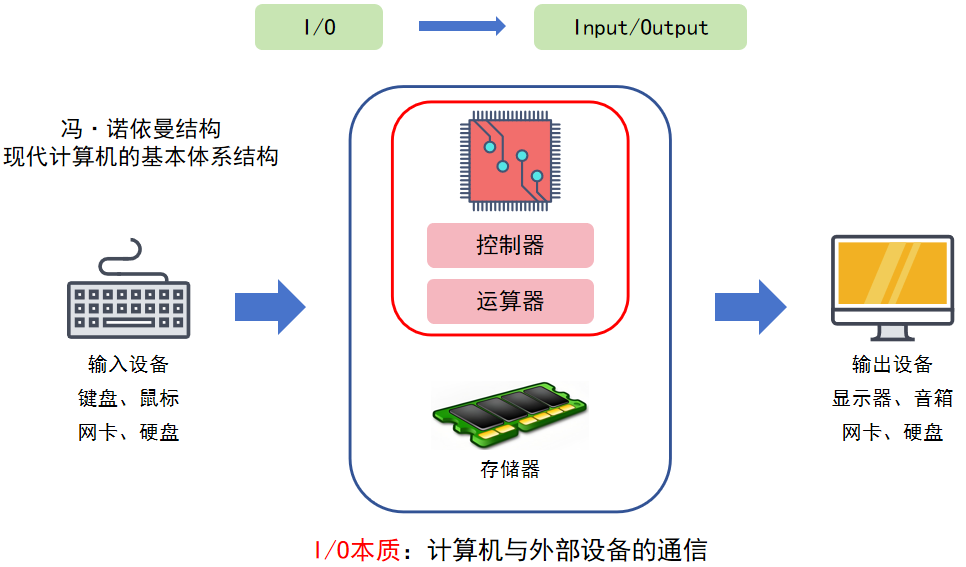
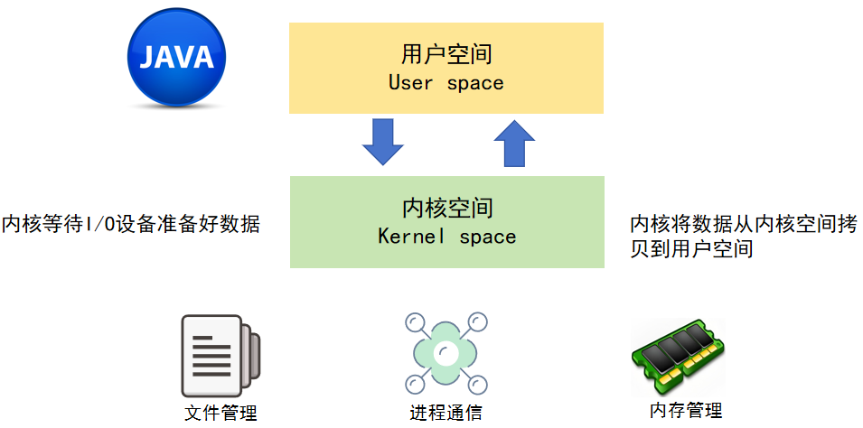
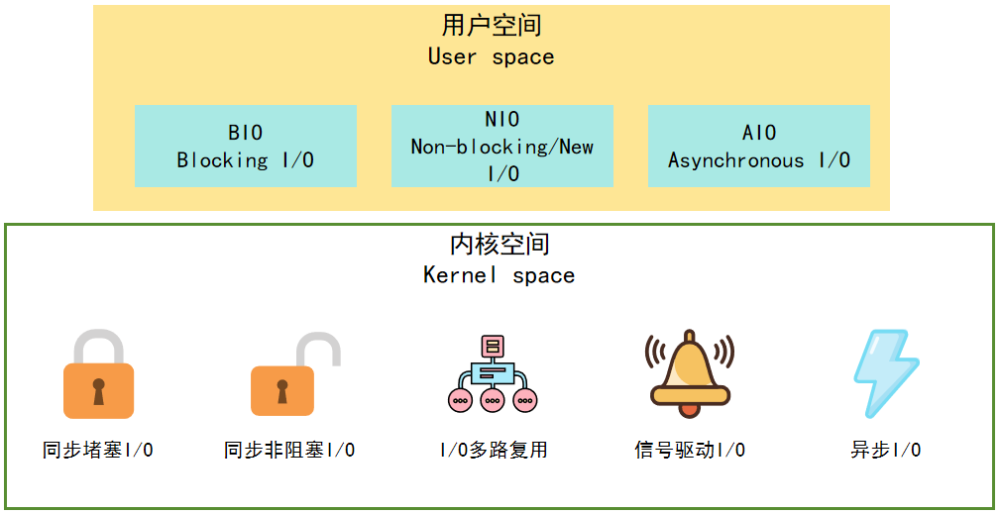
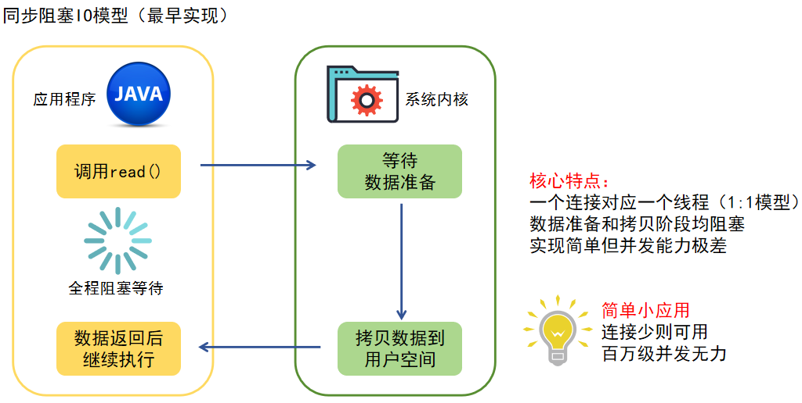
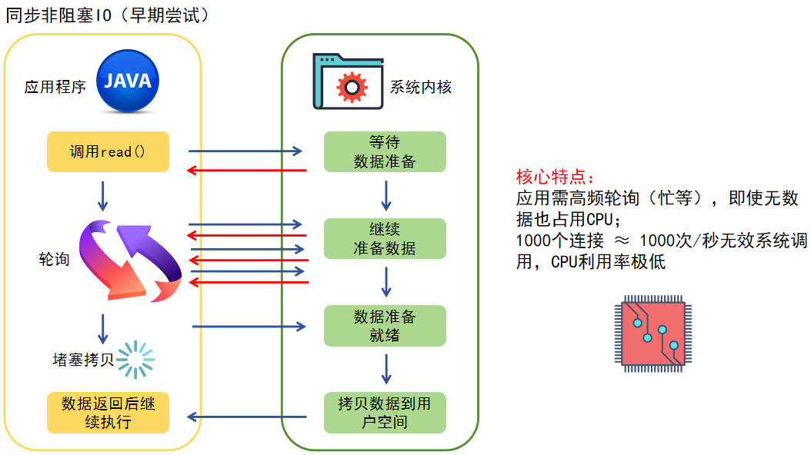
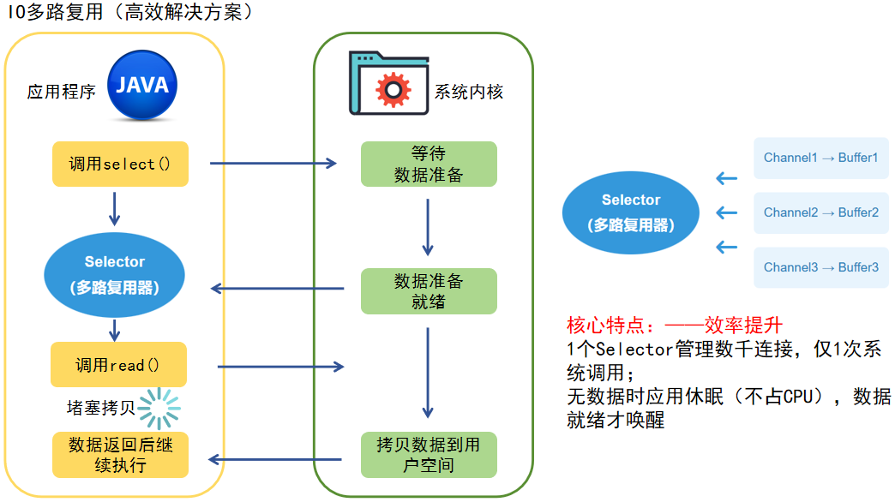
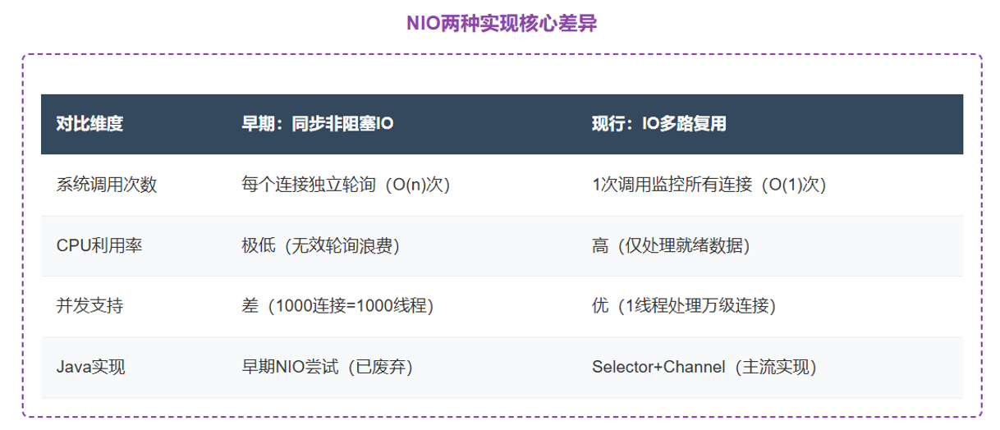
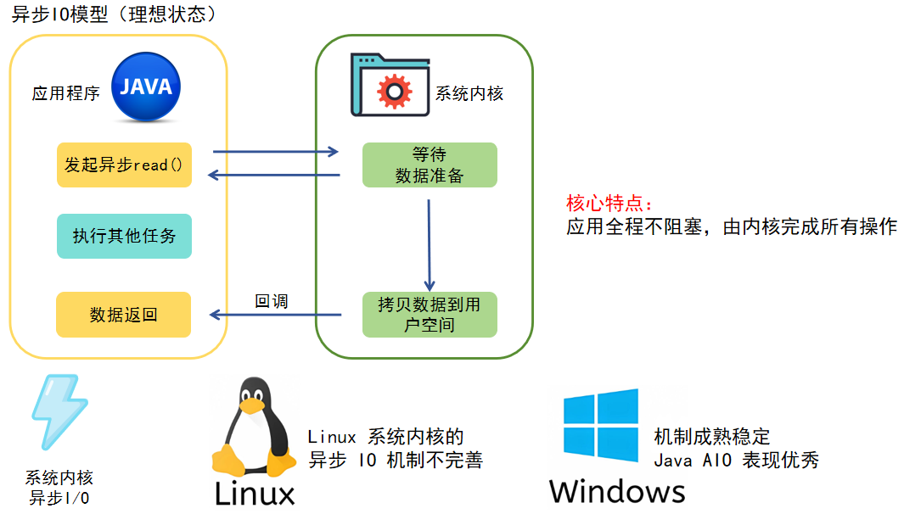

# Java IO 模型 BIO、NIO、AIO 的底层区别？一篇讲透

在 Java 面试中，“IO 模型区别” 是高频硬核题 —— 很多人只停留在 “BIO 阻塞、NIO 非阻塞、AIO 异步” 的表面认知，却答不出**Java IO 与操作系统 IO 模型的底层关联**。今天结合 PPT 图文（已标注对应截图位置），从 “操作系统 IO 模型” 这个 “地基” 讲起，补全所有逻辑链条，帮你彻底搞懂三者的底层差异。

## 一、先搞懂 2 个底层基础：不踩坑的前提

在聊 IO 模型前，必须先明确两个核心概念，这是理解 “系统 IO→Java IO” 关联的关键。

### 1. I/O 的本质：计算机与外部设备的通信

I/O（Input/Output）本质是 “计算机与外部设备的数据交互”，比如：

* 输入：键盘输入字符、网卡接收网络数据、硬盘读取文件；
* 输出：显示器显示内容、网卡发送网络数据、硬盘保存文件。

这里要注意**冯・诺依曼结构中的 “存储器”** —— 特指**内存（RAM）** ，而非硬盘！硬盘属于 “辅助存储设备”，归为 “输入 / 输出设备” 范畴（比如从硬盘读文件是输入，写文件是输出），面试时别混淆。

### 2. 用户空间与内核空间：IO 的 “必经之路”

Java 程序不能直接操作 IO 设备，必须依赖操作系统内核，整个 IO 流程分两步（所有 IO 模型的核心骨架）：

1. **内核等待 IO 设备准备数据**：比如内核等待网卡接收完客户端数据、等待硬盘读取完文件；
2. **内核拷贝数据到用户空间**：数据准备好后，内核将数据从 “内核空间”（操作系统核心区域）拷贝到 “用户空间”（Java 程序运行区域）。

所有 IO 模型的区别，本质就是 “这两步中，应用程序的‘等待方式’不同”—— 而 Java IO 模型，正是对 “操作系统 IO 模型” 的上层封装。

## 二、操作系统层面的 5 种 IO 模型（Java IO 的底层来源）

**所有 Java IO 模型，都源于操作系统的 5 种基础 IO 模型**——Java 并非凭空创造，而是根据场景选择了其中 3 种落地。先吃透这 5 种 “地基模型”，再看 Java IO 会一目了然：

| **操作系统 IO 模型** | **核心流程** | **关键特点** |
| :--- | :--- | :--- |
| 1. 同步阻塞 IO | 应用调用 read ()→内核等数据→内核拷贝数据→read () 返回 | 应用全程阻塞（等数据 + 拷贝数据阶段均阻塞） |
| 2. 同步非阻塞 IO | 应用调用 read ()→内核无数据则返回 “无数据”→应用高频轮询→有数据则拷贝并返回 | 应用不阻塞（无数据时立即返回），但需高频轮询（浪费 CPU） |
| 3. IO 多路复用 | 应用调用 select ()→内核监控多连接→有数据就绪则通知应用→应用调用 read () 拷贝 | 1 次调用监控多连接，无数据时应用休眠（不占 CPU），仅拷贝阶段阻塞 |
| 4. 信号驱动 IO | 应用注册信号→内核等数据→数据就绪发信号→应用调用 read () 拷贝 | 应用不阻塞（靠信号通知），但信号处理逻辑复杂，网络 IO 场景实用性低 |
| 5. 异步 IO | 应用发起异步 read ()→内核后台等数据 + 拷贝数据→完成后回调通知应用 | 应用全程不阻塞（无需轮询 / 等待），内核完成所有 IO 操作后主动回调 |

**核心关联**：Java 从这 5 种中选择了 3 种落地 ——BIO 对应 “同步阻塞 IO”，NIO 对应 “同步非阻塞 IO（早期）/IO 多路复用（现行）”，AIO 对应 “异步 IO”；跳过了 “信号驱动 IO”（因网络 IO 场景下逻辑复杂、性价比低）。

## 三、BIO：对应操作系统 “同步阻塞 IO”，最基础但最 “笨重”

Java 的 BIO（Blocking IO）是对操作系统 “同步阻塞 IO” 的直接封装，底层逻辑完全对齐：

### 1. 底层流程（与系统模型完全一致）

1. Java 应用调用<code>read()</code>方法，发起 IO 请求（本质是调用操作系统的<code>read()</code>系统调用）；
2. 操作系统内核进入 “两步操作”：①等待 IO 设备准备数据（如网卡等客户端数据）；②将数据从内核空间拷贝到用户空间；
3. 这两步期间，Java 应用的线程**全程阻塞**—— 既不能执行其他业务逻辑，也不能处理其他连接，直到数据拷贝完成、<code>read()</code>方法返回。

### 2. 底层核心特点（由系统模型决定）

* **1 个连接对应 1 个线程**：由于全程阻塞，1 个客户端连接必须占用 1 个 Java 线程（否则无法处理其他连接），1000 个连接需 1000 个线程；
* **CPU 利用率极低**：线程在 “等数据” 和 “拷贝数据” 阶段均阻塞，大量线程处于闲置状态，仅消耗资源不干活；
* **并发能力受限**：线程切换开销随连接数增加呈指数级增长，超过 1000 个连接后，CPU 会被切换开销占满。

### 3. 适用场景

仅适合 “连接数少、并发低” 的简单场景，比如公司内部的小型管理系统、早期 Tomcat（6.x 之前的 BIO 连接器）。

## 四、NIO：到底是系统 “同步非阻塞 IO” 还是“IO 多路复用”？

Java 的 NIO（Non-blocking IO/New IO）到底对应系统的“同步非阻塞 IO”，还是“IO 多路复用”？

### 1. 若对应系统 “同步非阻塞 IO”（其实没有使用）

#### 底层流程（对齐系统模型）

1. Java 应用通过<code>SocketChannel.configureBlocking(false)</code>将通道设为非阻塞模式；
2. 调用<code>read()</code>方法：若内核未准备好数据，**不阻塞线程**，直接返回 “-1”（表示 “无数据可用”）；
3. 为获取数据，Java 应用必须**高频轮询**—— 每隔几十毫秒遍历所有连接，重复调用<code>read()</code>询问 “数据是否就绪”。

#### 核心问题（由系统模型缺陷导致）

* **无效轮询浪费 CPU**：1000 个连接≈1000 次 / 秒的无效<code>read()</code>调用（多数连接无数据），CPU 被 “询问动作” 占满，无法处理业务；
* **系统调用次数过多**：每个连接的轮询都对应 1 次系统调用，内核需频繁处理无效请求，进一步加剧性能损耗。

### 2. 真实使用的方案：对应系统 “IO 多路复用”（高效核心）

Java NIO 的关键改进，是引入**Selector（多路复用器）** ，本质是对操作系统 “IO 多路复用” 模型的封装（Linux 下对应<code>epoll</code>/<code>poll</code>，Mac 下对应<code>kqueue</code>）：

#### 底层流程（依托系统 IO 多路复用能力）

1. Java 应用将所有需要监控的 “Channel（通道，如 SocketChannel）” 注册到 Selector；
2. 调用<code>Selector.select()</code>方法：本质是调用操作系统的<code>epoll_wait()</code>/<code>select()</code>系统调用，让内核同时监控所有注册的 Channel；
3. 内核判断 Channel 状态：①若无数据就绪，内核让 Java 线程**休眠**（不占用 CPU 资源）；②若有数据就绪，内核标记 “就绪的 Channel”，并唤醒 Java 线程；
4. Java 应用仅针对 “就绪的 Channel” 调用<code>read()</code>方法，拷贝数据到用户空间（仅这一步短暂阻塞，因数据已就绪，拷贝速度极快）。

### 3. 底层核心优势（系统模型赋予的能力）

* **1 个线程管多连接**：1 个 Selector 可监控数千甚至数万个 Channel，无需创建大量线程，线程数与连接数解耦；
* **CPU 利用率高**：无数据时线程休眠，有数据才唤醒处理，避免无效轮询，CPU 仅用于 “处理就绪数据”；
* **系统调用次数少**：1 次<code>select()</code>调用即可监控所有连接，替代早期 “每个连接 1 次调用”，大幅减少内核开销。

### 4. 适用场景

高并发核心场景，比如网关（Spring Cloud Gateway）、IM 即时通讯、直播推流，主流框架 Netty、Tomcat 8 + 均基于此实现。

### 3. 未使用方案：对应系统 “同步非阻塞 IO” VS  现行使用方案：对应系统 “IO 多路复用”（高效核心）

## 五、AIO：对应系统 “异步 IO”，理想很满但现实受限

Java 的 AIO（Asynchronous IO）是 Java 7 引入的模型，底层直接对应操作系统的 “异步 IO” 模型，理论上是 “最完美的 IO 模型”，但应用极少。

### 1. 底层流程（完全依赖系统异步能力）

1. Java 应用通过<code>AsynchronousSocketChannel</code>发起 “异步 read ()”（如<code>read(ByteBuffer, Attachment, CompletionHandler)</code>）；
2. 调用后**立即返回**：Java 线程无需等待，可继续执行其他业务逻辑（全程不阻塞）；
3. 操作系统内核在后台完成 “全流程 IO”：①等待 IO 设备准备数据；②将数据从内核空间拷贝到用户空间；
4. 内核完成所有操作后，通过 “<code>CompletionHandler</code>回调函数” 通知 Java 应用，应用在回调中处理已就绪的数据。

### 2. 底层核心特点（由系统模型决定）

* **全程不阻塞**：Java 应用从发起请求到接收结果，全程无需等待，线程利用率达到最高；
* **内核全托管**：IO 的 “准备数据” 和 “拷贝数据” 全由内核完成，应用无需参与任何等待或轮询；
* **回调机制**：依赖内核的回调通知，开发时需处理 “回调线程池”“结果聚合” 等复杂逻辑。

### 3. 应用极少的核心原因（系统支持度差异）

AIO 的性能完全依赖操作系统的 “异步 IO 能力”，但**Linux 与 Windows 的支持度天差地别**，直接限制了其应用场景：

* **Windows 环境**：有成熟的 “IOCP（IO 完成端口）” 机制（内核级原生异步），Java AIO 可完美适配，性能稳定高效；
* **Linux 环境**：早期的 “POSIX AIO” 是 “伪异步”（内核通过线程池模拟异步，性能不如 NIO）；直到 Linux 4.19 + 才引入<code>io_uring</code>（真正内核级异步 IO），但 Java AIO 的底层实现未及时适配，且多数企业服务器的 Linux 版本未升级到 4.19+。

而企业级 Java 应用 90% 以上部署在 Linux 服务器上，主流框架（如 Netty）也因 “Linux 支持不完善”，最终放弃 AIO，专注优化 NIO—— 这就是 AIO “技术先进但应用极少” 的底层原因。

### 4. 适用场景

仅适合 “Windows 平台 + 高并发” 场景，如 Windows 服务器上的实时通信应用，Linux 环境几乎无实用价值。

## 六、总结：Java IO 与操作系统 IO 模型的全对应关系（面试直接用）

| **类型** | **Java IO 模型** | **对应操作系统 IO 模型** | **同步 / 异步** | **是否阻塞** | **核心特点** | **适用场景** |
| :--- | :--- | :--- | :--- | :--- | :--- | :--- |
| BIO | 阻塞 IO | 同步阻塞 IO | 同步 | 全程阻塞 | 1 连接 1 线程，实现简单，并发差 | 小型管理系统（连接少） |
| NIO | IO 多路复用 | IO 多路复用 | 同步 | 仅拷贝时阻塞 | Selector 管多连接，高并发首选 | 网关、IM、直播（高并发） |
| AIO | 异步 IO | 异步 IO | 异步 | 全程不阻塞 | 内核回调，Linux 支持差，实现复杂 | Windows 高并发场景 |

## 面试应答技巧（补全系统 IO 关联后）

被问 “Java IO 模型底层区别” 时，按 “**Java IO→对应系统 IO 模型→同步 / 阻塞属性→核心特点→适用场景**” 的逻辑答，比如讲解 NIO：“Java NIO 的现行实现是 IO 多路复用，底层对应操作系统的 IO 多路复用模型（Linux 下是 epoll）；它属于同步非阻塞模型 —— 应用通过 Selector 将所有连接注册，1 次 select () 调用监控所有连接，无数据时线程休眠，有数据才唤醒处理，仅在数据拷贝阶段短暂阻塞；这种模型能靠 1 个线程处理万级连接，是高并发场景的首选，比如 Netty 框架就是基于此实现的。”

这样答既覆盖了 “Java IO 与系统 IO 的底层关联”，又讲清了核心差异，比单纯背诵 “阻塞 / 非阻塞” 更显深度，面试官会认为你真正理解了 IO 模型的本质。

> 更新: 2025-10-10 15:26:14  
> 原文: <https://www.yuque.com/tulingzhouyu/db22bv/yiq5swevx9gdsmkp>