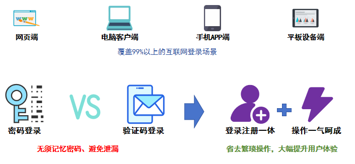
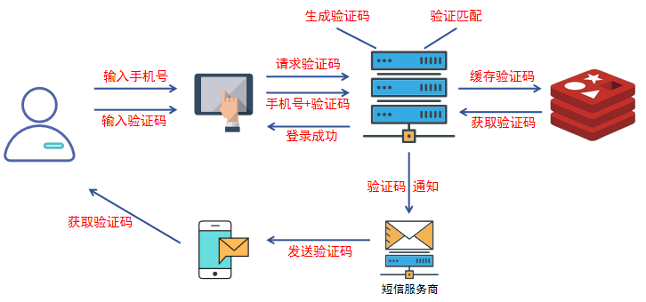
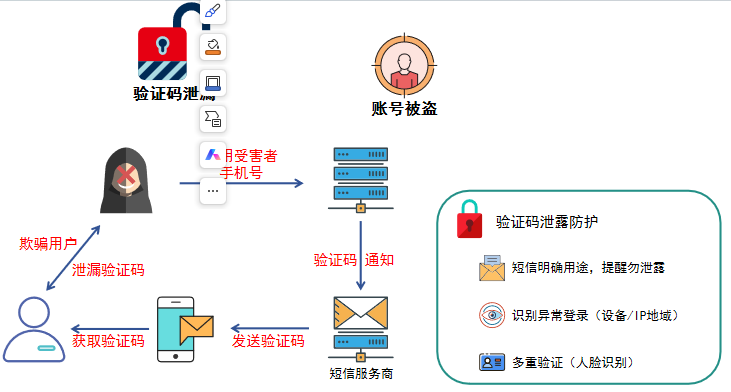
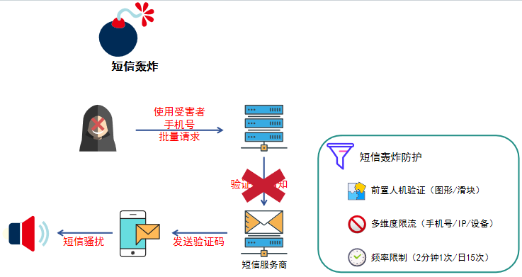
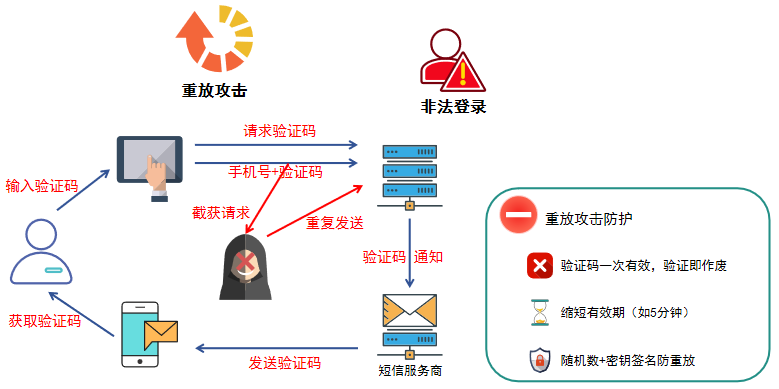
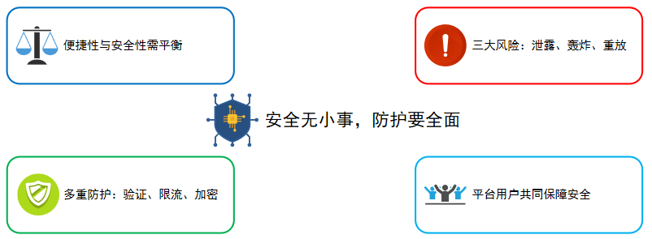

# Java 实战：手机验证码登录从原理到安全落地（含风险防护全方案）

<font style="color:rgb(0, 0, 0);">在互联网产品中，手机验证码登录已成为全终端标配的登录方式，覆盖网页端、电脑客户端、手机 APP、平板设备等 99% 以上的场景。相较于传统密码登录，它无需用户记忆复杂密码、能避免密码泄露风险，且支持登录注册一体化，大幅提升用户体验。对于 Java 开发者而言，如何高效、安全地实现这一功能，是面试高频考点，也是实际开发中的核心需求。本文将从原理拆解、Java 实现细节、三大风险防护三个维度，结合代码示例展开详细说明。</font>



## <font style="color:rgb(0, 0, 0);">一、核心登录原理拆解</font>

<font style="color:rgb(0, 0, 0);">手机验证码登录的核心逻辑是 “手机号唯一标识 + 临时验证码校验”，整个流程分为 6 个关键步骤，Java 后端需重点处理验证码生成、缓存、校验三大核心环节：</font>

### <font style="color:rgb(0, 0, 0);">1. 完整流程梳理</font>

1. <font style="color:rgb(0, 0, 0);">用户输入手机号，前端发起 “获取验证码” 请求；</font>
2. <font style="color:rgb(0, 0, 0);">后端生成随机验证码，将 “手机号 - 验证码” 键值对缓存至 Redis 并设置过期时间；</font>
3. <font style="color:rgb(0, 0, 0);">后端调用短信服务商 API（如阿里云、腾讯云短信），向用户手机发送验证码；</font>
4. <font style="color:rgb(0, 0, 0);">用户输入验证码，前端发起 “登录校验” 请求；</font>
5. <font style="color:rgb(0, 0, 0);">后端从 Redis 中查询该手机号对应的有效验证码；</font>
6. <font style="color:rgb(0, 0, 0);">对比用户输入的验证码与缓存中的验证码，一致则登录成功（生成 Token），否则返回错误提示。</font>



### <font style="color:rgb(0, 0, 0);">2. Java 核心模块实现（基于 Spring Boot）</font>

#### <font style="color:rgb(0, 0, 0);">（1）依赖准备</font>

<font style="color:rgb(0, 0, 0);">需引入 Redis 缓存、HTTP 客户端（调用短信 API）相关依赖：</font>

```xml
<!-- Redis依赖 -->
<dependency>
    <groupId>org.springframework.boot</groupId>
    <artifactId>spring-boot-starter-data-redis</artifactId>
</dependency>
<!-- HTTP客户端（调用短信API） -->
<dependency>
    <groupId>org.apache.httpcomponents</groupId>
    <artifactId>httpclient</artifactId>
    <version>4.5.13</version>
</dependency>
<!-- 工具类依赖 -->
<dependency>
    <groupId>cn.hutool</groupId>
    <artifactId>hutool-all</artifactId>
    <version>5.8.20</version>
</dependency>
```

#### <font style="color:rgb(0, 0, 0);">（2）验证码生成与缓存</font>

<font style="color:rgb(0, 0, 0);">核心逻辑：生成 6 位随机数字验证码，存入 Redis（过期时间 5 分钟），避免重复生成和验证码永久有效风险。</font>

```java
@Service
public class SmsCodeService {

    @Autowired
    private StringRedisTemplate redisTemplate;

    // 验证码过期时间：5分钟（300秒）
    private static final long CODE_EXPIRE_SECONDS = 300;
    // 验证码长度：6位
    private static final int CODE_LENGTH = 6;

    /**
     * 生成并缓存验证码
     */
    public String generateAndCacheCode(String phone) {
        // 1. 生成6位随机数字验证码
        String code = RandomUtil.randomNumbers(CODE_LENGTH);
        
        // 2. 缓存至Redis：key=phone:code:{手机号}，value=验证码
        String redisKey = String.format("phone:code:%s", phone);
        redisTemplate.opsForValue().set(redisKey, code, CODE_EXPIRE_SECONDS, TimeUnit.SECONDS);
        
        return code;
    }

    /**
     * 从Redis获取验证码（并校验是否过期）
     */
    public String getCachedCode(String phone) {
        String redisKey = String.format("phone:code:%s", phone);
        return redisTemplate.opsForValue().get(redisKey);
    }

    /**
     * 验证成功后删除验证码（保证一次有效）
     */
    public void deleteCode(String phone) {
        String redisKey = String.format("phone:code:%s", phone);
        redisTemplate.delete(redisKey);
    }
}
```

#### <font style="color:rgb(0, 0, 0);">（3）短信发送实现（调用阿里云短信 API）</font>

<font style="color:rgb(0, 0, 0);">通过 HTTP 客户端调用第三方短信服务，实际开发中需替换为自己的 AccessKey、模板 ID：</font>

```java
@Service
public class SmsSendService {

    // 阿里云短信API地址
    private static final String SMS_API_URL = "https://dysmsapi.aliyuncs.com/";
    // 替换为自己的AccessKey ID和Secret
    private static final String ACCESS_KEY_ID = "your-access-key-id";
    private static final String ACCESS_KEY_SECRET = "your-access-key-secret";
    // 短信模板ID（需在阿里云控制台申请）
    private static final String TEMPLATE_CODE = "SMS_204505834";

    /**
     * 发送验证码短信
     */
    public boolean sendCode(String phone, String code) {
        try {
            // 构建短信请求参数（符合阿里云API规范）
            Map<String, String> params = new HashMap<>();
            params.put("PhoneNumbers", phone);
            params.put("SignName", "你的短信签名");
            params.put("TemplateCode", TEMPLATE_CODE);
            params.put("TemplateParam", String.format("{\"code\":\"%s\"}", code));
            
            // 调用阿里云短信API（此处简化实现，实际需处理签名、时间戳等）
            HttpClient httpClient = HttpClientBuilder.create().build();
            HttpPost httpPost = new HttpPost(SMS_API_URL);
            // 设置请求头、参数（省略签名校验等细节，可参考阿里云SDK）
            httpPost.setEntity(new UrlEncodedFormEntity(convertParams(params), "UTF-8"));
            
            HttpResponse response = httpClient.execute(httpPost);
            return response.getStatusLine().getStatusCode() == 200;
        } catch (Exception e) {
            log.error("发送短信失败，手机号：{}", phone, e);
            return false;
        }
    }

    // 参数转换工具方法
    private List<NameValuePair> convertParams(Map<String, String> params) {
        List<NameValuePair> pairs = new ArrayList<>();
        for (Map.Entry<String, String> entry : params.entrySet()) {
            pairs.add(new BasicNameValuePair(entry.getKey(), entry.getValue()));
        }
        return pairs;
    }
}
```

#### <font style="color:rgb(0, 0, 0);">（4）登录校验接口</font>

<font style="color:rgb(0, 0, 0);">提供前后端交互的 API，处理 “获取验证码” 和 “登录校验” 请求：</font>

```java
@RestController
@RequestMapping("/auth")
public class AuthController {

    @Autowired
    private SmsCodeService smsCodeService;
    @Autowired
    private SmsSendService smsSendService;
    @Autowired
    private JwtTokenService jwtTokenService; // JWT Token生成服务（自定义）

    /**
     * 获取验证码接口
     */
    @PostMapping("/get-code")
    public Result<?> getCode(@RequestParam String phone) {
        // 1. 校验手机号格式（省略正则校验逻辑）
        if (!PhoneUtil.isMobile(phone)) {
            return Result.error("手机号格式错误");
        }
        
        // 2. 生成并缓存验证码
        String code = smsCodeService.generateAndCacheCode(phone);
        
        // 3. 发送短信
        boolean sendSuccess = smsSendService.sendCode(phone, code);
        if (sendSuccess) {
            return Result.success("验证码已发送至手机");
        } else {
            return Result.error("验证码发送失败，请重试");
        }
    }

    /**
     * 登录校验接口
     */
    @PostMapping("/login")
    public Result<?> login(@RequestParam String phone, @RequestParam String code) {
        // 1. 从Redis获取缓存的验证码
        String cachedCode = smsCodeService.getCachedCode(phone);
        
        // 2. 校验验证码（为空则过期，不一致则错误）
        if (StrUtil.isBlank(cachedCode)) {
            return Result.error("验证码已过期，请重新获取");
        }
        if (!cachedCode.equals(code)) {
            return Result.error("验证码错误");
        }
        
        // 3. 验证通过：删除验证码（保证一次有效），生成JWT Token
        smsCodeService.deleteCode(phone);
        String token = jwtTokenService.generateToken(phone);
        
        return Result.success("登录成功", token);
    }
}
```

## <font style="color:rgb(0, 0, 0);">二、三大核心风险与 Java 防护实现</font>

<font style="color:rgb(0, 0, 0);">验证码登录的便捷性背后，隐藏着验证码泄露、短信轰炸、重放攻击三大核心风险。Java 后端需针对性地通过技术手段构建防护体系，每个风险均遵循 “风险成因 + 防护方案 + 代码实现” 的逻辑落地。</font>

### <font style="color:rgb(0, 0, 0);">1. 风险一：验证码泄露</font>

#### <font style="color:rgb(0, 0, 0);">（1）风险成因</font>

<font style="color:rgb(0, 0, 0);">攻击者获取用户手机号后，通过伪装客服、快递员等身份欺骗用户，诱导其泄露收到的验证码，进而登录账户盗取信息或财产。</font>

#### <font style="color:rgb(0, 0, 0);">（2）Java 防护方案</font>

1. <font style="color:rgb(0, 0, 0);">短信内容明确用途，提醒用户勿泄露；</font>
2. <font style="color:rgb(0, 0, 0);">识别异常登录行为（设备、IP、地域），触发二次验证；</font>
3. <font style="color:rgb(0, 0, 0);">高危操作强制多重验证（如人脸识别、预留信息校验）。</font>



#### <font style="color:rgb(0, 0, 0);">（3）代码实现：异常登录检测</font>

<font style="color:rgb(0, 0, 0);">基于用户登录设备（设备指纹）、IP 地址判断是否为异常登录，需引入设备指纹工具类：</font>

```java
@Service
public class AbnormalLoginDetectService {

    @Autowired
    private UserLoginRecordMapper loginRecordMapper; // 登录记录DAO层

    /**
     * 检测是否为异常登录
     * @param phone 手机号
     * @param deviceId 设备指纹（前端传入）
     * @param ip 登录IP
     * @return true=异常，false=正常
     */
    public boolean isAbnormalLogin(String phone, String deviceId, String ip) {
        // 1. 查询该用户最近3次登录记录（设备、IP、地域）
        List<UserLoginRecord> recentRecords = loginRecordMapper.selectRecentLogin(phone, 3);
        if (recentRecords.isEmpty()) {
            return false; // 首次登录，暂不判定为异常
        }

        // 2. 校验设备是否为常用设备
        boolean isCommonDevice = recentRecords.stream()
                .anyMatch(record -> deviceId.equals(record.getDeviceId()));
        if (isCommonDevice) {
            return false; // 常用设备登录，正常
        }

        // 3. 校验IP地域是否为常用地域（省略IP转地域逻辑，可调用第三方接口）
        String currentRegion = IpUtil.getRegionByIp(ip); // 自定义IP解析工具
        boolean isCommonRegion = recentRecords.stream()
                .anyMatch(record -> currentRegion.equals(record.getRegion()));
        
        // 非常用设备+非常用地域 → 判定为异常登录
        return !isCommonRegion;
    }
}
```

<font style="color:rgba(0, 0, 0, 0.85);">在登录接口中集成异常检测：</font>

```java
@PostMapping("/login")
public Result<?> login(@RequestParam String phone, @RequestParam String code,
                       @RequestParam String deviceId, @RequestHeader("X-Real-IP") String ip) {
    // ... 前面省略验证码校验逻辑 ...

    // 新增：异常登录检测
    boolean isAbnormal = abnormalLoginDetectService.isAbnormalLogin(phone, deviceId, ip);
    if (isAbnormal) {
        // 触发二次验证（如要求输入预留邮箱验证码）
        return Result.error("登录环境异常，请完成二次验证", "need_second_verify");
    }

    // ... 后面省略Token生成逻辑 ...
}
```

### <font style="color:rgb(0, 0, 0);">2. 风险二：短信轰炸</font>

#### <font style="color:rgb(0, 0, 0);">（1）风险成因</font>

<font style="color:rgb(0, 0, 0);">攻击者通过脚本批量、高频次向同一手机号发起 “获取验证码” 请求，导致用户手机被海量短信骚扰，同时消耗平台短信费用，甚至导致短信通道被封禁。</font>

#### <font style="color:rgb(0, 0, 0);">（2）Java 防护方案</font>

1. <font style="color:rgb(0, 0, 0);">前置人机验证（前端实现图形 / 滑块验证，后端校验）；</font>
2. <font style="color:rgb(0, 0, 0);">多维度限流（基于手机号、IP、设备 ID）；</font>
3. <font style="color:rgb(0, 0, 0);">设置请求频率上限（如 2 分钟 1 次、每日 15 次）。</font>



#### <font style="color:rgb(0, 0, 0);">（3）代码实现：Redis 限流（基于滑动窗口算法）</font>

```java
@Service
public class RateLimitService {

    @Autowired
    private StringRedisTemplate redisTemplate;

    /**
     * 多维度限流校验
     * @param type 限流类型（PHONE/IP/DEVICE）
     * @param key 限流键（手机号/IP/设备ID）
     * @param maxCount 最大请求数
     * @param period 时间窗口（秒）
     * @return true=允许请求，false=限流拦截
     */
    public boolean checkRateLimit(String type, String key, int maxCount, int period) {
        String redisKey = String.format("rate:limit:%s:%s", type, key);
        long currentTime = System.currentTimeMillis();

        // 1. 移除时间窗口外的请求记录
        redisTemplate.opsForZSet().removeRangeByScore(redisKey, 0, currentTime - period * 1000);
        
        // 2. 获取当前时间窗口内的请求次数
        Long count = redisTemplate.opsForZSet().zCard(redisKey);
        if (count >= maxCount) {
            return false; // 超过限制，拦截请求
        }
        
        // 3. 记录当前请求（value=UUID，score=时间戳）
        redisTemplate.opsForZSet().add(redisKey, UUID.randomUUID().toString(), currentTime);
        // 4. 设置Redis键过期时间（避免内存溢出）
        redisTemplate.expire(redisKey, period, TimeUnit.SECONDS);
        
        return true;
    }
}
```

<font style="color:rgba(0, 0, 0, 0.85);">在 “获取验证码” 接口中集成限流：</font>

```java
@PostMapping("/get-code")
public Result<?> getCode(@RequestParam String phone, 
                         @RequestParam String deviceId,
                         @RequestHeader("X-Real-IP") String ip) {
    // 1. 手机号格式校验（省略）
    if (!PhoneUtil.isMobile(phone)) {
        return Result.error("手机号格式错误");
    }

    // 2. 多维度限流校验
    // 手机号限流：2分钟1次
    boolean phoneLimit = rateLimitService.checkRateLimit("PHONE", phone, 1, 120);
    // IP限流：1分钟5次（防止同一IP批量攻击）
    boolean ipLimit = rateLimitService.checkRateLimit("IP", ip, 5, 60);
    // 设备ID限流：1分钟3次
    boolean deviceLimit = rateLimitService.checkRateLimit("DEVICE", deviceId, 3, 60);
    
    if (!phoneLimit) {
        return Result.error("验证码发送过于频繁，请2分钟后重试");
    }
    if (!ipLimit || !deviceLimit) {
        return Result.error("操作过于频繁，请稍后重试");
    }

    // ... 后面省略验证码生成、发送逻辑 ...
}
```

### <font style="color:rgb(0, 0, 0);">3. 风险三：重放攻击</font>

#### <font style="color:rgb(0, 0, 0);">（1）风险成因</font>

<font style="color:rgb(0, 0, 0);">攻击者通过网络抓包截获用户的 “手机号 + 验证码” 登录请求报文，在验证码有效期内重复发送该报文，绕开验证逻辑非法登录用户账户。</font>

#### <font style="color:rgb(0, 0, 0);">（2）Java 防护方案</font>

1. <font style="color:rgb(0, 0, 0);">验证码一次有效（验证成功后立即删除 Redis 缓存）；</font>
2. <font style="color:rgb(0, 0, 0);">缩短验证码有效期（5 分钟内）；</font>
3. <font style="color:rgb(0, 0, 0);">增加随机数 + 密钥签名（防止请求被篡改和重复提交）。</font>



#### <font style="color:rgb(0, 0, 0);">（3）代码实现：请求签名校验</font>

<font style="color:rgb(0, 0, 0);">前端发起请求时，生成唯一随机数（nonce）和时间戳（timestamp），并通过密钥签名；后端校验签名合法性、随机数唯一性、时间戳有效性。</font>

```java
@Service
public class SignValidateService {

    // 密钥（前后端一致，需保密）
    private static final String SECRET_KEY = "your-secret-key-xxx";
    // 时间戳有效期：30秒（防止过期请求被重放）
    private static final long TIMESTAMP_EXPIRE_SECONDS = 30;

    /**
     * 生成请求签名（前端使用相同逻辑生成）
     */
    public String generateSign(String phone, String nonce, long timestamp) {
        // 签名规则：phone + nonce + timestamp + secretKey → MD5加密
        String source = String.format("%s%s%s%s", phone, nonce, timestamp, SECRET_KEY);
        return SecureUtil.md5(source);
    }

    /**
     * 校验请求签名
     */
    public Result<?> validateSign(String phone, String nonce, long timestamp, String sign) {
        // 1. 校验时间戳是否过期
        if (System.currentTimeMillis() - timestamp > TIMESTAMP_EXPIRE_SECONDS * 1000) {
            return Result.error("请求已过期，请重新发起");
        }

        // 2. 校验随机数是否已使用（防止重复提交）
        String nonceKey = String.format("sign:nonce:%s", nonce);
        Boolean isExists = redisTemplate.hasKey(nonceKey);
        if (Boolean.TRUE.equals(isExists)) {
            return Result.error("请求已处理，请勿重复提交");
        }

        // 3. 校验签名是否合法
        String validSign = generateSign(phone, nonce, timestamp);
        if (!validSign.equals(sign)) {
            return Result.error("请求非法");
        }

        // 4. 标记随机数已使用（过期时间=时间戳有效期）
        redisTemplate.opsForValue().set(nonceKey, "1", TIMESTAMP_EXPIRE_SECONDS, TimeUnit.SECONDS);
        return Result.success("签名校验通过");
    }
}
```

<font style="color:rgba(0, 0, 0, 0.85);">在登录接口中集成签名校验：</font>

```java
@PostMapping("/login")
public Result<?> login(@RequestParam String phone, @RequestParam String code,
                       @RequestParam String nonce, @RequestParam long timestamp,
                       @RequestParam String sign) {
    // 1. 签名校验（优先于验证码校验，拦截非法请求）
    Result<?> signResult = signValidateService.validateSign(phone, nonce, timestamp, sign);
    if (!signResult.isSuccess()) {
        return signResult;
    }

    // ... 后面省略验证码校验、异常检测逻辑 ...
}
```

## <font style="color:rgb(0, 0, 0);">三、Java 实现优化要点</font>

1. **<font style="color:rgb(0, 0, 0) !important;">验证码安全性</font>**<font style="color:rgb(0, 0, 0);">：避免使用纯数字验证码（可混合字母 / 符号），生成逻辑需确保随机性（禁止使用可预测的算法）；</font>
2. **<font style="color:rgb(0, 0, 0) !important;">Redis 缓存优化</font>**<font style="color:rgb(0, 0, 0);">：缓存键名统一规范（如</font><code><font style="color:rgb(0, 0, 0);">phone:code:{手机号}</font></code><font style="color:rgb(0, 0, 0);">），设置合理过期时间，避免内存泄漏；</font>
3. **<font style="color:rgb(0, 0, 0) !important;">异步发送短信</font>**<font style="color:rgb(0, 0, 0);">：使用 Spring 的</font><code><font style="color:rgb(0, 0, 0);">@Async</font></code><font style="color:rgb(0, 0, 0);">注解异步处理短信发送，提升接口响应速度，避免用户等待；</font>
4. **<font style="color:rgb(0, 0, 0) !important;">异常处理</font>**<font style="color:rgb(0, 0, 0);">：短信发送失败时，需删除 Redis 中的验证码缓存，允许用户重新获取；</font>
5. **<font style="color:rgb(0, 0, 0) !important;">日志监控</font>**<font style="color:rgb(0, 0, 0);">：记录验证码发送、登录校验、限流拦截等关键日志，便于排查问题和监控攻击行为。</font>

## <font style="color:rgb(0, 0, 0);">四、核心总结</font>

<font style="color:rgb(0, 0, 0);">手机验证码登录的 Java 实现，核心是 “便捷性与安全性的平衡”。开发者需掌握三大核心要点：</font>

1. <font style="color:rgb(0, 0, 0);">基础流程：验证码生成→缓存→发送→校验→Token 生成，Redis 和短信 API 是关键依赖；</font>
2. <font style="color:rgb(0, 0, 0);">风险防护：针对泄露、轰炸、重放三大风险，通过异常检测、多维度限流、签名校验构建防护体系；</font>
3. <font style="color:rgb(0, 0, 0);">工程实践：注重接口通用性（支持全终端调用）、性能优化（异步、缓存）、安全性细节（一次有效、签名验证）。</font>

<font style="color:rgb(0, 0, 0);">通过本文的代码示例和逻辑拆解，Java 开发者可快速落地安全可靠的验证码登录功能，同时应对面试中的相关问题。实际开发中，还可结合 Spring Security、OAuth2.0 等框架进一步完善认证授权体系，提升系统安全性。</font>




> 更新: 2025-12-28 22:26:09  
> 原文: <https://www.yuque.com/tulingzhouyu/db22bv/nhnmb44uyqw3vh4s>