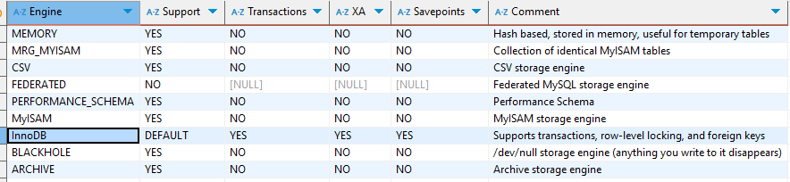
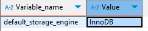
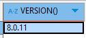
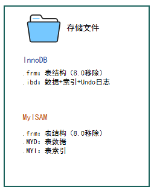
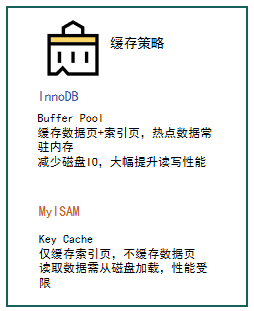
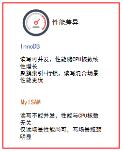

# Java 面试高频题｜吃透 MySQL InnoDB 与 MyISAM 差异：从原理到落地（附 SQL/Java 实例 + PPT 图文）

<font style="color:rgb(0, 0, 0);">在 Java 后端面试中，“MySQL 存储引擎 InnoDB 和 MyISAM 的差异” 是一道绕不开的高频题。不是面试官 “偏爱” 这道题，而是它能从</font>**<font style="color:rgb(0, 0, 0) !important;">底层原理、生产落地、细节把控</font>**<font style="color:rgb(0, 0, 0);">三个维度，快速判断候选人是否具备 “能干活、懂原理” 的核心能力 —— 既要看你是否停留在 “写 SQL” 的表层，更要看你能否结合业务场景做技术选型。</font>

<font style="color:rgb(0, 0, 0);">本文将从 “引擎基础→查看方式→核心差异→业务选型” 逐步拆解，穿插 SQL 命令与 Java 业务代码，需要插入 PPT 截图的位置已标注明确提示，方便你对应自身 PPT 补充，帮你既能应对面试，也能落地生产。</font>

## <font style="color:rgb(0, 0, 0);">一、先搞懂：存储引擎是什么？为什么面试必问？</font>

<font style="color:rgb(0, 0, 0);">在讲差异前，我们得先明确 “存储引擎” 的定位 —— 它是 MySQL 的</font>**<font style="color:rgb(0, 0, 0) !important;">数据存取核心模块</font>**<font style="color:rgb(0, 0, 0);">，负责数据的存储、索引构建、事务管理、锁机制处理，相当于数据库的 “管家”。</font>

<font style="color:rgb(0, 0, 0);">从 MySQL 架构来看，存储引擎属于 “引擎层”，位于 “Server 层”（连接器、查询缓存、分析器等）之下，直接对接磁盘 IO，是影响数据库性能与数据安全性的关键：</font>


<font style="color:rgb(0, 0, 0);">这里有个面试基础考点：</font>**<font style="color:rgb(0, 0, 0) !important;">MySQL 5.5 版本是 “引擎分水岭”</font>**<font style="color:rgb(0, 0, 0);">——5.5 之前默认 MyISAM，之后默认 InnoDB（如 MySQL 8.0 版本，默认引擎已固化为 InnoDB）。这个版本差异，直接关联后续 “为什么生产环境不用 MyISAM” 的核心逻辑。</font>

## <font style="color:rgb(0, 0, 0);">二、面试延伸：如何查看 MySQL 存储引擎？（附 SQL 命令）</font>

<font style="color:rgb(0, 0, 0);">面试官常在 “差异” 前加一个实操问题：“怎么查看当前 MySQL 的存储引擎？”，本质是考察你是否有 “动手能力”，而非纯背理论。记住两个核心 SQL 命令即可，对应结果可参考自身 PPT 截图补充：</font>

### <font style="color:rgb(0, 0, 0);">1. 查看 MySQL 支持的所有存储引擎</font>

<font style="color:rgb(0, 0, 0);">用</font><code><font style="color:rgba(0, 0, 0, 0.85) !important;">show engines;</font></code><font style="color:rgb(0, 0, 0);">命令，能看到所有引擎的支持状态、事务能力等关键信息。核心关注两列：</font>

* <code><font style="color:rgb(0, 0, 0);">Support</font></code><font style="color:rgb(0, 0, 0);">：是否支持，</font><code><font style="color:rgb(0, 0, 0);">DEFAULT</font></code><font style="color:rgb(0, 0, 0);">表示默认引擎（InnoDB）；</font>
* <code><font style="color:rgb(0, 0, 0);">Transactions</font></code><font style="color:rgb(0, 0, 0);">：是否支持事务（InnoDB 为 YES，MyISAM 为 NO）。</font>

```sql
-- 查看所有存储引擎及核心属性
show engines;
```



### <font style="color:rgb(0, 0, 0);">2. 查看当前默认存储引擎</font>

<font style="color:rgb(0, 0, 0);">用</font><code><font style="color:rgba(0, 0, 0, 0.85) !important;">SHOW VARIABLES LIKE 'default_storage_engine';</font></code><font style="color:rgb(0, 0, 0);">命令，直接定位默认引擎，结果必然是 InnoDB（MySQL 5.5+）：</font>

```sql
-- 查看默认存储引擎
SHOW VARIABLES LIKE 'default_storage_engine';
```



## <font style="color:rgb(0, 0, 0);">三、核心差异拆解：从原理到代码，面试要讲透这 8 点</font>

<font style="color:rgb(0, 0, 0);">这是面试的 “重头戏”，也是本文核心。我们从 “数据安全→底层结构→性能并发→生产规范” 四个维度，对比 8 个关键差异，每个点都附明确 PPT 截图提示与实操说明。</font>

### <font style="color:rgb(0, 0, 0);">1. 事务支持：InnoDB 安全，MyISAM 致命缺陷（面试必答）</font>

<font style="color:rgb(0, 0, 0);">事务是保障数据一致性的核心（如转账、订单创建），这是 InnoDB 与 MyISAM 最本质的区别：</font>

* **<font style="color:rgb(0, 0, 0) !important;">MyISAM</font>**<font style="color:rgb(0, 0, 0);">：完全不支持事务，无 ACID 特性。若中途服务器崩溃，数据可能丢失（如转账只扣了钱，没加钱）；</font>
* **<font style="color:rgb(0, 0, 0) !important;">InnoDB</font>**<font style="color:rgb(0, 0, 0);">：支持完整 ACID 事务，可通过</font><code><font style="color:rgb(0, 0, 0);">begin/commit</font></code><font style="color:rgb(0, 0, 0);">显式控制，还支持</font><code><font style="color:rgb(0, 0, 0);">savepoint</font></code><font style="color:rgb(0, 0, 0);">回滚到指定节点。</font>

#### <font style="color:rgb(0, 0, 0);">用 Java 代码模拟事务差异（电商下单场景）</font>

<font style="color:rgb(0, 0, 0);">假设我们用 MyISAM 和 InnoDB 分别实现 “扣库存 + 创建订单” 的原子操作：</font>

```java
// 1. MyISAM：无事务，崩溃后数据不一致
public void createOrderWithMyISAM(Long productId, Long userId) {
    Connection conn = null;
    try {
        conn = DBUtil.getConnection();
        // MyISAM不支持事务，自动提交无法关闭
        conn.setAutoCommit(false); // 无效！MyISAM会忽略该设置
        
        // 步骤1：扣库存（假设库存表用MyISAM）
        String updateStockSql = "UPDATE product_stock SET stock = stock - 1 WHERE product_id = ?";
        PreparedStatement pstmt1 = conn.prepareStatement(updateStockSql);
        pstmt1.setLong(1, productId);
        pstmt1.executeUpdate();
        
        // 模拟服务器崩溃（如抛出异常）
        if (true) throw new RuntimeException("服务器突然崩溃");
        
        // 步骤2：创建订单（假设订单表用MyISAM）
        String insertOrderSql = "INSERT INTO orders (user_id, product_id) VALUES (?, ?)";
        PreparedStatement pstmt2 = conn.prepareStatement(insertOrderSql);
        pstmt2.setLong(1, userId);
        pstmt2.setLong(2, productId);
        pstmt2.executeUpdate();
        
        conn.commit(); // MyISAM下无意义
    } catch (Exception e) {
        if (conn != null) try { conn.rollback(); } catch (Exception ex) {} // 无效
        e.printStackTrace();
    }
}

// 2. InnoDB：事务生效，崩溃后回滚
public void createOrderWithInnoDB(Long productId, Long userId) {
    Connection conn = null;
    try {
        conn = DBUtil.getConnection();
        conn.setAutoCommit(false); // 关闭自动提交，开启事务
        
        // 步骤1：扣库存（InnoDB表）
        String updateStockSql = "UPDATE product_stock SET stock = stock - 1 WHERE product_id = ?";
        PreparedStatement pstmt1 = conn.prepareStatement(updateStockSql);
        pstmt1.setLong(1, productId);
        pstmt1.executeUpdate();
        
        // 模拟服务器崩溃
        if (true) throw new RuntimeException("服务器突然崩溃");
        
        // 步骤2：创建订单（InnoDB表）
        String insertOrderSql = "INSERT INTO orders (user_id, product_id) VALUES (?, ?)";
        PreparedStatement pstmt2 = conn.prepareStatement(insertOrderSql);
        pstmt2.setLong(1, userId);
        pstmt2.setLong(2, productId);
        pstmt2.executeUpdate();
        
        conn.commit(); // 两步都成功才提交
    } catch (Exception e) {
        if (conn != null) try { conn.rollback(); } catch (Exception ex) {} // 崩溃后回滚，库存恢复
        e.printStackTrace();
    }
}
```

**<font style="color:rgb(0, 0, 0) !important;">面试结论</font>**<font style="color:rgb(0, 0, 0);">：生产环境只要涉及 “多步操作原子性”（如支付、下单），必选 InnoDB；MyISAM 因无事务支持，已被淘汰出核心业务场景。</font>


### <font style="color:rgb(0, 0, 0);">2. 存储文件结构：InnoDB “全能文件”，MyISAM “三文件分离”</font>

<font style="color:rgb(0, 0, 0);">存储文件的差异，直接决定了索引实现与数据安全性，也是面试常考的细节：</font>

* **<font style="color:rgb(0, 0, 0) !important;">MyISAM</font>**<font style="color:rgb(0, 0, 0);">：一张表对应 3 个文件（MySQL 8.0 后</font><code><font style="color:rgb(0, 0, 0);">.frm</font></code><font style="color:rgb(0, 0, 0);">移除）：</font>
  * <code><font style="color:rgb(0, 0, 0);">.frm</font></code><font style="color:rgb(0, 0, 0);">：表结构定义文件；</font>
  * <code><font style="color:rgb(0, 0, 0);">.MYD</font></code><font style="color:rgb(0, 0, 0);">：（MyData）存储表数据；</font>
  * <code><font style="color:rgb(0, 0, 0);">.MYI</font></code><font style="color:rgb(0, 0, 0);">：（MyIndex）存储表索引；</font>
* **<font style="color:rgb(0, 0, 0) !important;">InnoDB</font>**<font style="color:rgb(0, 0, 0);">：一张表对应 2 个文件（MySQL 8.0 后</font><code><font style="color:rgb(0, 0, 0);">.frm</font></code><font style="color:rgb(0, 0, 0);">合并到</font><code><font style="color:rgb(0, 0, 0);">ibdata1</font></code><font style="color:rgb(0, 0, 0);">）：</font>
  * <code><font style="color:rgb(0, 0, 0);">.frm</font></code><font style="color:rgb(0, 0, 0);">：表结构定义文件；</font>
  * <code><font style="color:rgb(0, 0, 0);">.ibd</font></code><font style="color:rgb(0, 0, 0);">：（InnoDB Data）存储数据、索引、Undo 日志（“一站式” 文件）。</font>



**<font style="color:rgb(0, 0, 0) !important;">面试延伸</font>**<font style="color:rgb(0, 0, 0);">：为什么 InnoDB 的</font><code><font style="color:rgba(0, 0, 0, 0.85) !important;">.ibd</font></code><font style="color:rgb(0, 0, 0);">文件包含日志？因为要支持事务回滚（Undo 日志）与崩溃恢复（Redo 日志），而 MyISAM 无日志文件，崩溃后无法恢复数据。</font>

### <font style="color:rgb(0, 0, 0);">3. 锁机制：MyISAM “表锁堵死”，InnoDB “行锁高并发”（高频考点）</font>

<font style="color:rgb(0, 0, 0);">锁机制是影响数据库并发性能的关键，面试官会追问 “高并发场景选哪个”，核心差异在锁粒度：</font>

* **<font style="color:rgb(0, 0, 0) !important;">MyISAM</font>**<font style="color:rgb(0, 0, 0);">：仅支持 “表级锁”（Table-level Lock）：</font>
  * <font style="color:rgb(0, 0, 0);">读操作（SELECT）加 “表共享锁”，多个读可并发，但写操作会阻塞；</font>
  * <font style="color:rgb(0, 0, 0);">写操作（INSERT/UPDATE/DELETE）加 “表排他锁”，一旦加锁，全表读写都阻塞；</font>
  * <font style="color:rgb(0, 0, 0);">典型问题：电商秒杀场景，一个写操作会堵死所有读请求。</font>
* **<font style="color:rgb(0, 0, 0) !important;">InnoDB</font>**<font style="color:rgb(0, 0, 0);">：支持 “行级锁”（Row-level Lock）+“表级锁”（默认行锁）：</font>
  * <font style="color:rgb(0, 0, 0);">仅对 “修改的行” 加锁，其他行不受影响；</font>
  * <font style="color:rgb(0, 0, 0);">读操作无锁（靠 MVCC 实现），写操作只锁单行，并发性能大幅提升。</font>

#### <font style="color:rgb(0, 0, 0);">用 SQL 演示锁机制差异</font>

```sql
-- 场景：两个会话操作同一张表，对比锁阻塞情况
-- 表结构：user(id int primary key, name varchar(20))，分别用MyISAM和InnoDB引擎

-- 会话1（MyISAM表）：执行写操作，加表排他锁
UPDATE user SET name = 'test' WHERE id = 1; 
-- 此时会话2执行读操作：SELECT * FROM user WHERE id = 2; 会被阻塞！（表锁）

-- 会话1（InnoDB表）：执行写操作，加行锁
UPDATE user SET name = 'test' WHERE id = 1; 
-- 此时会话2执行读操作：SELECT * FROM user WHERE id = 2; 正常执行！（仅锁id=1的行）
```


**<font style="color:rgb(0, 0, 0) !important;">面试结论</font>**<font style="color:rgb(0, 0, 0);">：只要业务存在 “读写并发”（如电商商品详情页 + 库存修改），必选 InnoDB；MyISAM 仅适合 “纯读场景”（如博客静态日志）。</font>

### <font style="color:rgb(0, 0, 0);">4. 主键要求：InnoDB “必须有主键”，MyISAM “可选”</font>

<font style="color:rgb(0, 0, 0);">主键是索引的核心，两者对主键的要求差异，反映了引擎设计理念的不同：</font>

* **<font style="color:rgb(0, 0, 0) !important;">MyISAM</font>**<font style="color:rgb(0, 0, 0);">：主键可选，无主键时索引存储 “数据物理地址”（磁盘地址）；</font>
* **<font style="color:rgb(0, 0, 0) !important;">InnoDB</font>**<font style="color:rgb(0, 0, 0);">：必须有主键，若未显式定义，会自动生成 “6 字节隐藏主键”（</font><code><font style="color:rgb(0, 0, 0);">row_id</font></code><font style="color:rgb(0, 0, 0);">），原因是 InnoDB 采用 “聚簇索引”（数据按主键排序存储），无主键则数据无法有序组织。</font>


**<font style="color:rgb(0, 0, 0) !important;">面试踩坑点</font>**<font style="color:rgb(0, 0, 0);">：不要让 InnoDB 自动生成隐藏主键！显式定义自增主键（如</font><code><font style="color:rgba(0, 0, 0, 0.85) !important;">id int auto_increment primary key</font></code><font style="color:rgb(0, 0, 0);">），能避免隐藏主键带来的索引性能损耗。</font>

### <font style="color:rgb(0, 0, 0);">5. 外键支持：InnoDB “支持但慎用”，MyISAM “不支持”（阿里规范考点）</font>

<font style="color:rgb(0, 0, 0);">外键用于保证表间数据一致性（如订单表</font><code><font style="color:rgba(0, 0, 0, 0.85) !important;">order</font></code><font style="color:rgb(0, 0, 0);">的</font><code><font style="color:rgba(0, 0, 0, 0.85) !important;">product_id</font></code><font style="color:rgb(0, 0, 0);">关联商品表</font><code><font style="color:rgba(0, 0, 0, 0.85) !important;">product</font></code><font style="color:rgb(0, 0, 0);">的</font><code><font style="color:rgba(0, 0, 0, 0.85) !important;">id</font></code><font style="color:rgb(0, 0, 0);">），但两者支持度差异明显：</font>

* **<font style="color:rgb(0, 0, 0) !important;">MyISAM</font>**<font style="color:rgb(0, 0, 0);">：不支持外键，表间约束需靠 Java 代码实现（如先查商品是否存在，再创建订单）；</font>
* **<font style="color:rgb(0, 0, 0) !important;">InnoDB</font>**<font style="color:rgb(0, 0, 0);">：支持外键，但</font>**<font style="color:rgb(0, 0, 0) !important;">阿里《Java 开发手册》明确禁止使用外键</font>**<font style="color:rgb(0, 0, 0);">，原因是：</font>
  * <font style="color:rgb(0, 0, 0);">分布式场景下，外键会导致跨库约束失效（如订单库与商品库分离）；</font>
  * <font style="color:rgb(0, 0, 0);">外键会增加写操作开销（修改订单时需检查商品表，影响性能）。</font>

#### <font style="color:rgb(0, 0, 0);">Java 代码实现 “外键替代逻辑”（阿里规范推荐）</font>

<font style="color:rgb(0, 0, 0);">既然禁止用外键，我们用 Java 代码保证表间一致性：</font>

```java
// 场景：创建订单前，检查商品是否存在（替代外键约束）
public void createOrderWithoutForeignKey(Long productId, Long userId) {
    Connection conn = null;
    try {
        conn = DBUtil.getConnection();
        conn.setAutoCommit(false);
        
        // 1. 先查商品是否存在（替代外键的“引用完整性”检查）
        String checkProductSql = "SELECT COUNT(1) FROM product WHERE id = ?";
        PreparedStatement pstmt1 = conn.prepareStatement(checkProductSql);
        pstmt1.setLong(1, productId);
        ResultSet rs = pstmt1.executeQuery();
        if (!rs.next() || rs.getInt(1) == 0) {
            throw new RuntimeException("商品不存在，无法创建订单");
        }
        
        // 2. 再创建订单
        String insertOrderSql = "INSERT INTO orders (user_id, product_id) VALUES (?, ?)";
        PreparedStatement pstmt2 = conn.prepareStatement(insertOrderSql);
        pstmt2.setLong(1, userId);
        pstmt2.setLong(2, productId);
        pstmt2.executeUpdate();
        
        conn.commit();
    } catch (Exception e) {
        if (conn != null) try { conn.rollback(); } catch (Exception ex) {}
        e.printStackTrace();
    }
}
```


### <font style="color:rgb(0, 0, 0);">6. MVCC 支持：InnoDB “读写不阻塞”，MyISAM “无此能力”</font>

<font style="color:rgb(0, 0, 0);">MVCC（多版本并发控制）是 InnoDB 实现 “高并发读” 的核心技术，面试官可能会问 “为什么 InnoDB 读不会阻塞写”，答案就在这里：</font>

* **<font style="color:rgb(0, 0, 0) !important;">MyISAM</font>**<font style="color:rgb(0, 0, 0);">：不支持 MVCC，读操作加表共享锁，写操作加表排他锁，导致 “读阻塞写、写阻塞读”；</font>
* **<font style="color:rgb(0, 0, 0) !important;">InnoDB</font>**<font style="color:rgb(0, 0, 0);">：支持 MVCC，通过 “隐藏字段（如</font><code><font style="color:rgb(0, 0, 0);">DB_TRX_ID</font></code><font style="color:rgb(0, 0, 0);">事务 ID）+ Undo 日志” 实现多版本数据，读操作无需加锁，写操作只锁单行，做到 “读写不阻塞、写读不阻塞”。</font>


**<font style="color:rgb(0, 0, 0) !important;">面试简化回答</font>**<font style="color:rgb(0, 0, 0);">：InnoDB 靠 MVCC 实现 “快照读”（如普通 SELECT），读的时候不影响写；MyISAM 读的时候会锁表，写操作只能等。</font>

### <font style="color:rgb(0, 0, 0);">7. 崩溃恢复：InnoDB “可恢复”，MyISAM “数据丢失风险”</font>

<font style="color:rgb(0, 0, 0);">崩溃恢复是数据安全性的最后一道防线，也是生产环境淘汰 MyISAM 的关键原因：</font>

* **<font style="color:rgb(0, 0, 0) !important;">MyISAM</font>**<font style="color:rgb(0, 0, 0);">：无崩溃恢复机制，若服务器突然断电 / 崩溃，未写入磁盘的数据会丢失，且无法恢复；</font>
* **<font style="color:rgb(0, 0, 0) !important;">InnoDB</font>**<font style="color:rgb(0, 0, 0);">：靠 “Redo 日志”（重做日志）实现崩溃恢复 —— 事务执行时，先写 Redo 日志再写磁盘，崩溃后重启 MySQL，会通过 Redo 日志恢复未完成的事务，保证数据不丢失。</font>


### <font style="color:rgb(0, 0, 0);">8. 索引实现：InnoDB “聚簇索引”，MyISAM “非聚簇索引”（新增核心模块）</font>

<font style="color:rgb(0, 0, 0);">索引实现是影响查询性能的关键，两者差异源于存储文件结构：</font>

* **<font style="color:rgb(0, 0, 0) !important;">MyISAM</font>**<font style="color:rgb(0, 0, 0);">：采用 “非聚簇索引”（索引与数据分离）：</font>
  * <font style="color:rgb(0, 0, 0);">主键索引与普通索引结构一致，均存储 “数据物理地址”（指向</font><code><font style="color:rgb(0, 0, 0);">.MYD</font></code><font style="color:rgb(0, 0, 0);">文件的磁盘位置）；</font>
  * <font style="color:rgb(0, 0, 0);">查询时需先查索引拿到物理地址，再去</font><code><font style="color:rgb(0, 0, 0);">.MYD</font></code><font style="color:rgb(0, 0, 0);">文件读数据，存在 “回表” 操作，性能损耗大。</font>
* **<font style="color:rgb(0, 0, 0) !important;">InnoDB</font>**<font style="color:rgb(0, 0, 0);">：采用 “聚簇索引”（数据即索引）：</font>
  * <font style="color:rgb(0, 0, 0);">主键索引：叶子节点直接存储完整数据（按主键排序，存于</font><code><font style="color:rgb(0, 0, 0);">.ibd</font></code><font style="color:rgb(0, 0, 0);">文件）；</font>
  * <font style="color:rgb(0, 0, 0);">二级索引（如 name 索引）：叶子节点存储 “主键值”，查询时先查二级索引拿到主键，再通过主键索引查数据（仅一次回表，或覆盖索引下无需回表）；</font>
  * <font style="color:rgb(0, 0, 0);">优势：主键查询无需回表，速度更快；数据按主键有序存储，范围查询效率高。</font>

#### <font style="color:rgb(0, 0, 0);">用示意图理解索引差异（对应 PPT 逻辑）</font>

| **<font style="color:rgb(0, 0, 0) !important;">索引类型</font>** | **<font style="color:rgb(0, 0, 0) !important;">MyISAM（非聚簇索引）</font>** | **<font style="color:rgb(0, 0, 0) !important;">InnoDB（聚簇索引）</font>** |
| :--- | :--- | :--- |
| <font style="color:rgba(0, 0, 0, 0.85) !important;">主键索引</font> | <font style="color:rgba(0, 0, 0, 0.85) !important;">叶子节点存 “数据物理地址”</font> | <font style="color:rgba(0, 0, 0, 0.85) !important;">叶子节点存 “完整数据”</font> |
| <font style="color:rgba(0, 0, 0, 0.85) !important;">二级索引</font> | <font style="color:rgba(0, 0, 0, 0.85) !important;">叶子节点存 “数据物理地址”</font> | <font style="color:rgba(0, 0, 0, 0.85) !important;">叶子节点存 “主键值”</font> |
| <font style="color:rgba(0, 0, 0, 0.85) !important;">查询流程</font> | <font style="color:rgba(0, 0, 0, 0.85) !important;">索引→物理地址→</font><code><font style="color:rgb(0, 0, 0);">.MYD</font></code><br/><font style="color:rgba(0, 0, 0, 0.85) !important;">读数据（回表）</font> | <font style="color:rgba(0, 0, 0, 0.85) !important;">二级索引→主键→主键索引读数据（回表）</font> |
| <font style="color:rgba(0, 0, 0, 0.85) !important;">核心优势</font> | <font style="color:rgba(0, 0, 0, 0.85) !important;">索引结构简单</font> | <font style="color:rgba(0, 0, 0, 0.85) !important;">主键查询快、范围查询优</font> |


**<font style="color:rgb(0, 0, 0) !important;">面试延伸</font>**<font style="color:rgb(0, 0, 0);">：为什么 InnoDB 二级索引存主键值？因为聚簇索引按主键排序，存储主键值能保证数据一致性，避免存储物理地址导致的性能问题（如数据迁移后物理地址变化）。</font>

### <font style="color:rgb(0, 0, 0);">9. 缓存策略：InnoDB “全量缓存”，MyISAM “仅缓存索引”（新增核心模块）</font>

<font style="color:rgb(0, 0, 0);">缓存策略直接影响磁盘 IO 开销，决定性能上限：</font>

* **<font style="color:rgb(0, 0, 0) !important;">MyISAM</font>**<font style="color:rgb(0, 0, 0);">：依赖 “Key Cache” 缓存：</font>
  * <font style="color:rgb(0, 0, 0);">仅缓存索引（</font><code><font style="color:rgb(0, 0, 0);">.MYI</font></code><font style="color:rgb(0, 0, 0);">文件内容），不缓存数据（</font><code><font style="color:rgb(0, 0, 0);">.MYD</font></code><font style="color:rgb(0, 0, 0);">文件）；</font>
  * <font style="color:rgb(0, 0, 0);">每次查询数据需从磁盘读取</font><code><font style="color:rgb(0, 0, 0);">.MYD</font></code><font style="color:rgb(0, 0, 0);">文件，磁盘 IO 频繁，高并发场景性能瓶颈明显；</font>
  * <font style="color:rgb(0, 0, 0);">缓存配置：通过</font><code><font style="color:rgb(0, 0, 0);">key_buffer_size</font></code><font style="color:rgb(0, 0, 0);">调整缓存大小，默认值较小，需手动优化。</font>
* **<font style="color:rgb(0, 0, 0) !important;">InnoDB</font>**<font style="color:rgb(0, 0, 0);">：依赖 “Buffer Pool”（缓冲池）缓存：</font>
  * <font style="color:rgb(0, 0, 0);">缓存范围更广：包含数据页、索引页、Undo 日志页（均来自</font><code><font style="color:rgb(0, 0, 0);">.ibd</font></code><font style="color:rgb(0, 0, 0);">文件）；</font>
  * <font style="color:rgb(0, 0, 0);">热点数据常驻内存：多次查询的热点数据无需读磁盘，大幅减少 IO 开销；</font>
  * <font style="color:rgb(0, 0, 0);">缓存优化：支持预读（Read Ahead）、LRU 淘汰算法，缓存命中率更高；</font>
  * <font style="color:rgb(0, 0, 0);">配置关键：</font><code><font style="color:rgb(0, 0, 0);">innodb_buffer_pool_size</font></code><font style="color:rgb(0, 0, 0);">建议设为物理内存的 50%-70%（如 16G 内存设 10G），最大化缓存效果。</font>

#### <font style="color:rgb(0, 0, 0);">缓存策略差异对比表</font>

| **<font style="color:rgb(0, 0, 0) !important;">对比维度</font>** | **<font style="color:rgb(0, 0, 0) !important;">MyISAM（Key Cache）</font>** | **<font style="color:rgb(0, 0, 0) !important;">InnoDB（Buffer Pool）</font>** |
| :--- | :--- | :--- |
| <font style="color:rgba(0, 0, 0, 0.85) !important;">缓存内容</font> | <font style="color:rgba(0, 0, 0, 0.85) !important;">仅索引（.MYI 文件）</font> | <font style="color:rgba(0, 0, 0, 0.85) !important;">数据 + 索引 + Undo 日志（.ibd 文件）</font> |
| <font style="color:rgba(0, 0, 0, 0.85) !important;">磁盘 IO</font> | <font style="color:rgba(0, 0, 0, 0.85) !important;">每次查询数据需读磁盘（.MYD）</font> | <font style="color:rgba(0, 0, 0, 0.85) !important;">热点数据常驻内存，IO 少</font> |
| <font style="color:rgba(0, 0, 0, 0.85) !important;">缓存命中率</font> | <font style="color:rgba(0, 0, 0, 0.85) !important;">低（仅缓存索引）</font> | <font style="color:rgba(0, 0, 0, 0.85) !important;">高（全量缓存 + LRU 算法）</font> |
| <font style="color:rgba(0, 0, 0, 0.85) !important;">核心配置参数</font> | <font style="color:rgba(0, 0, 0, 0.85) !important;">key\_buffer\_size</font> | <font style="color:rgba(0, 0, 0, 0.85) !important;">innodb\_buffer\_pool\_size</font> |



**<font style="color:rgb(0, 0, 0) !important;">面试结论</font>**<font style="color:rgb(0, 0, 0);">：InnoDB 的 Buffer Pool 能最大化减少磁盘 IO，高并发读写场景性能远超 MyISAM；MyISAM 因仅缓存索引，数据查询依赖磁盘，性能受限。</font>

### <font style="color:rgb(0, 0, 0);">10. 性能与并发：InnoDB “线性增长”，MyISAM “性能瓶颈”</font>

<font style="color:rgb(0, 0, 0);">结合锁机制、缓存策略、索引实现，两者性能差异明显：</font>

* **<font style="color:rgb(0, 0, 0) !important;">MyISAM</font>**<font style="color:rgb(0, 0, 0);">：</font>
  * <font style="color:rgb(0, 0, 0);">读写不能并发，性能与 CPU 核数无关（核再多也无法并行处理读写）；</font>
  * <font style="color:rgb(0, 0, 0);">仅纯读场景性能尚可，写操作（如 INSERT/UPDATE）会阻塞全表，高并发场景直接崩溃。</font>
* **<font style="color:rgb(0, 0, 0) !important;">InnoDB</font>**<font style="color:rgb(0, 0, 0);">：</font>
  * <font style="color:rgb(0, 0, 0);">读写可并发（行锁 + MVCC），性能随 CPU 核数线性增长（8 核性能接近 4 核的 2 倍）；</font>
  * <font style="color:rgb(0, 0, 0);">Buffer Pool + 聚簇索引减少 IO，读写混合场景（如电商订单、用户中心）性能优势显著。</font>



## <font style="color:rgb(0, 0, 0);">四、业务选型：99% 场景选 InnoDB，1% 场景选 MyISAM</font>

<font style="color:rgb(0, 0, 0);">讲完所有差异后，面试官会追问 “如何选型”，记住核心原则：</font>**<font style="color:rgb(0, 0, 0) !important;">生产环境优先 InnoDB，MyISAM 仅用于特殊纯读场景</font>**<font style="color:rgb(0, 0, 0);">：</font>

| **<font style="color:rgb(0, 0, 0) !important;">场景类型</font>** | **<font style="color:rgb(0, 0, 0) !important;">推荐引擎</font>** | **<font style="color:rgb(0, 0, 0) !important;">核心原因</font>** |
| :--- | :--- | :--- |
| <font style="color:rgba(0, 0, 0, 0.85) !important;">电商订单 / 支付 / 用户表</font> | <font style="color:rgba(0, 0, 0, 0.85) !important;">InnoDB</font> | <font style="color:rgba(0, 0, 0, 0.85) !important;">需事务原子性、高并发行锁、数据安全（崩溃恢复）</font> |
| <font style="color:rgba(0, 0, 0, 0.85) !important;">高并发读写混合场景</font> | <font style="color:rgba(0, 0, 0, 0.85) !important;">InnoDB</font> | <font style="color:rgba(0, 0, 0, 0.85) !important;">靠 MVCC+Buffer Pool + 聚簇索引，减少 IO、提升并发</font> |
| <font style="color:rgba(0, 0, 0, 0.85) !important;">分布式业务（跨库关联）</font> | <font style="color:rgba(0, 0, 0, 0.85) !important;">InnoDB</font> | <font style="color:rgba(0, 0, 0, 0.85) !important;">支持事务，适配分布式事务（如 Seata），阿里规范禁止外键后可通过代码控制约束</font> |
| <font style="color:rgba(0, 0, 0, 0.85) !important;">博客日志 / 静态数据报表</font> | <font style="color:rgba(0, 0, 0, 0.85) !important;">MyISAM</font> | <font style="color:rgba(0, 0, 0, 0.85) !important;">纯读场景，无事务 / 并发需求，MyISAM 读性能尚可（InnoDB 也能满足，差异极小）</font> |


**<font style="color:rgb(0, 0, 0) !important;">权威引用</font>**<font style="color:rgb(0, 0, 0);">：《高性能 MySQL》明确指出：“不要轻信 MyISAM 更快的说法，InnoDB 在多数场景下（尤其是读写混合）性能更优、安全性更高，是生产环境的首选。”</font>

## <font style="color:rgb(0, 0, 0);">五、面试高频考点总结（含新增模块速记）</font>

<font style="color:rgb(0, 0, 0);">最后整理 “考前速记表”，覆盖所有核心考点：</font>

1. **<font style="color:rgb(0, 0, 0) !important;">默认引擎版本</font>**<font style="color:rgb(0, 0, 0);">：MySQL 5.5 前默认 MyISAM，之后默认 InnoDB；</font>
2. **<font style="color:rgb(0, 0, 0) !important;">事务支持</font>**<font style="color:rgb(0, 0, 0);">：InnoDB 支持 ACID，MyISAM 不支持；</font>
3. **<font style="color:rgb(0, 0, 0) !important;">锁机制</font>**<font style="color:rgb(0, 0, 0);">：InnoDB 行锁，MyISAM 表锁；</font>
4. **<font style="color:rgb(0, 0, 0) !important;">主键要求</font>**<font style="color:rgb(0, 0, 0);">：InnoDB 必须有主键（无则生成隐藏主键），MyISAM 可选；</font>
5. **<font style="color:rgb(0, 0, 0) !important;">外键规范</font>**<font style="color:rgb(0, 0, 0);">：InnoDB 支持但阿里禁止，MyISAM 不支持；</font>
6. **<font style="color:rgb(0, 0, 0) !important;">MVCC 支持</font>**<font style="color:rgb(0, 0, 0);">：InnoDB 支持（读写不阻塞），MyISAM 不支持；</font>
7. **<font style="color:rgb(0, 0, 0) !important;">崩溃恢复</font>**<font style="color:rgb(0, 0, 0);">：InnoDB 靠 Redo 日志恢复，MyISAM 不能；</font>
8. **<font style="color:rgb(0, 0, 0) !important;">索引实现</font>**<font style="color:rgb(0, 0, 0);">：InnoDB 聚簇索引（数据即索引），MyISAM 非聚簇索引（索引 - 数据分离）；</font>
9. **<font style="color:rgb(0, 0, 0) !important;">缓存策略</font>**<font style="color:rgb(0, 0, 0);">：InnoDB Buffer Pool 缓存数据 + 索引，MyISAM Key Cache 仅缓存索引；</font>
10. **<font style="color:rgb(0, 0, 0) !important;">性能并发</font>**<font style="color:rgb(0, 0, 0);">：InnoDB 读写可并发（性能随核数增长），MyISAM 读写互斥。</font>

<font style="color:rgb(0, 0, 0);">通过本文的完整拆解，你不仅能应对 “引擎差异” 的面试题，更能理解 “为什么生产环境选 InnoDB” 的底层逻辑。记住：面试不是 “背答案”，而是 “讲清楚原理 + 结合业务”—— 当你能说出 “订单表选 InnoDB 是因为要事务原子性 + 行锁高并发”，而非 “InnoDB 好”，面试官才会认可你的深度。</font>


> 更新: 2025-10-27 19:48:32  
> 原文: <https://www.yuque.com/tulingzhouyu/db22bv/fmb9giic196cgdkk>