# 面试官问：你是怎么统计接口耗时的？

<font style="color:rgba(0, 0, 0, 0.85);">       其实面试官问这个问题，核心是考察你 “性能优化的闭环思维”—— 光说优化效果不够，得说清你怎么量化出这个效果，这才是技术人的严谨性。今天就用一篇详细文章，把统计接口耗时的 6 种核心方法讲透，不仅包含原理、代码实现，还附上适用场景和选型建议，不管是面试还是工作都能用得上。</font>

## <font style="color:rgb(0, 0, 0);">一、为什么统计接口耗时是性能优化的 “第一步”？</font>

<font style="color:rgb(0, 0, 0);">在聊具体方法前，我们必须先明确：统计接口耗时不是 “多此一举”，而是性能优化的前提和基础，核心价值体现在三个方面：</font>

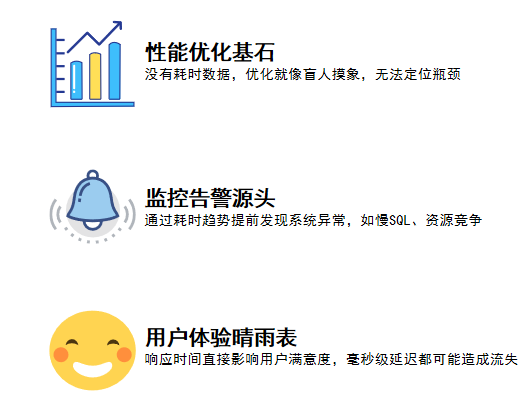

1. **<font style="color:rgb(0, 0, 0) !important;">性能优化的基石</font>**<font style="color:rgb(0, 0, 0);">：没有具体的耗时数据，优化就是 “盲人摸象”。你以为是数据库慢，但可能是 Redis 缓存穿透；你觉得是代码冗余，但实际是网络调用延迟 —— 只有量化耗时，才能精准定位瓶颈。</font>
2. **<font style="color:rgb(0, 0, 0) !important;">监控告警的源头</font>**<font style="color:rgb(0, 0, 0);">：通过耗时趋势分析，能提前发现系统异常。比如某接口耗时从 200ms 突增至 1s，可能是慢 SQL、资源竞争或依赖服务故障，及时告警能避免故障扩大。</font>
3. **<font style="color:rgb(0, 0, 0) !important;">用户体验的晴雨表</font>**<font style="color:rgb(0, 0, 0);">：用户对响应时间的感知极其敏感，行业内有明确的体验分级标准：</font>

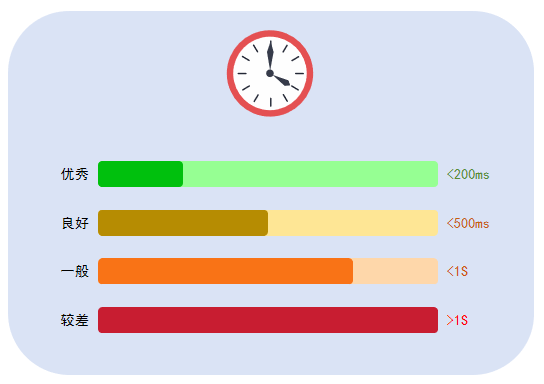

* <font style="color:rgb(0, 0, 0);">响应时间 < 200ms：用户无感知，体验优秀；</font>
* <font style="color:rgb(0, 0, 0);">200ms~500ms：体验良好，用户操作流畅；</font>
* <font style="color:rgb(0, 0, 0);">500ms~1s：用户能感知到延迟，但可接受；</font>
* <font style="color:rgb(0, 0, 0);">超过 1s：用户明显觉得卡顿，可能直接放弃操作。</font>

<font style="color:rgb(0, 0, 0);">毫秒级的差异，可能就是用户留存率的分水岭。</font>

## <font style="color:rgb(0, 0, 0);">二、6 种接口耗时统计方法（从基础到生产级，附代码实现）</font>

<font style="color:rgb(0, 0, 0);">接下来进入核心部分，6 种统计方法按 “基础→进阶→生产级” 排序，每种方法都包含原理、代码实现、优缺点和适用场景，方便你按需选择。</font>

### <font style="color:rgb(0, 0, 0);">方法 1：System.currentTimeMillis ()—— 最基础的 “手动埋点”</font>

<font style="color:rgb(0, 0, 0);">这是 Java 开发者最熟悉的基础方法，核心逻辑是 “记录前后时间戳，计算差值”。</font>

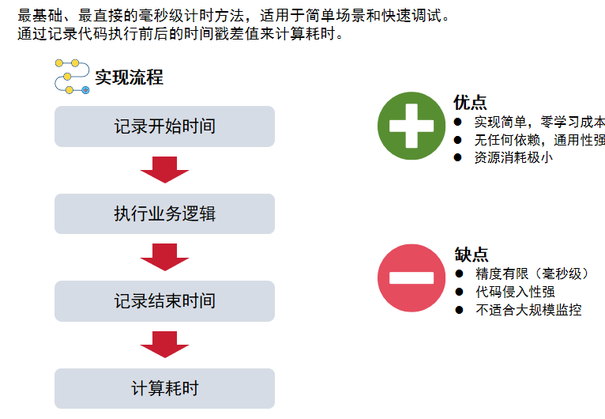

#### <font style="color:rgb(0, 0, 0);">核心原理</font>

<font style="color:rgb(0, 0, 0);">通过</font><code><font style="color:rgba(0, 0, 0, 0.85) !important;">System.currentTimeMillis()</font></code><font style="color:rgb(0, 0, 0);">获取当前时间戳（毫秒级），在业务逻辑执行前后各调用一次，差值即为接口耗时。</font>

#### <font style="color:rgb(0, 0, 0);">代码实现</font>

```java
public class OrderService {
    // 统计订单处理接口耗时
    public void processOrder(Long orderId) {
        // 1. 记录开始时间
        long startTime = System.currentTimeMillis();
        
        try {
            // 2. 核心业务逻辑（示例：查询订单→验证库存→扣减库存→生成订单）
            Order order = getOrderById(orderId);
            checkInventory(order.getProductId(), order.getQuantity());
            deductInventory(order.getProductId(), order.getQuantity());
            saveOrder(order);
        } finally {
            // 3. 记录结束时间，计算耗时（finally确保异常时也能统计）
            long endTime = System.currentTimeMillis();
            long costTime = endTime - startTime;
            // 输出耗时日志（实际可存入日志系统）
            System.out.printf("订单处理接口（orderId:%d）耗时：%dms%n", orderId, costTime);
        }
    }

    // 以下为业务逻辑伪代码
    private Order getOrderById(Long orderId) { /* 查询订单 */ return new Order(); }
    private void checkInventory(Long productId, int quantity) { /* 验证库存 */ }
    private void deductInventory(Long productId, int quantity) { /* 扣减库存 */ }
    private void saveOrder(Order order) { /* 保存订单 */ }
}
```

#### <font style="color:rgb(0, 0, 0);">优缺点</font>

* **<font style="color:rgb(0, 0, 0) !important;">优点</font>**<font style="color:rgb(0, 0, 0);">：零学习成本、无任何依赖、资源消耗极小（几乎可忽略）；</font>
* **<font style="color:rgb(0, 0, 0) !important;">缺点</font>**<font style="color:rgb(0, 0, 0);">：精度仅毫秒级、代码侵入性强（需手动嵌入业务代码）、不支持大规模监控（需逐个方法添加）。</font>

#### <font style="color:rgb(0, 0, 0);">适用场景</font>

<font style="color:rgb(0, 0, 0);">本地开发调试、简单验证某个方法的执行时间、临时统计非核心接口耗时。</font>

### <font style="color:rgb(0, 0, 0);">方法 2：System.nanoTime ()—— 高精度场景的 “进阶选择”</font>

<font style="color:rgb(0, 0, 0);">如果需要更精细的耗时统计（如微服务间调用、算法性能对比），</font><code><font style="color:rgba(0, 0, 0, 0.85) !important;">System.nanoTime()</font></code><font style="color:rgb(0, 0, 0);">是更好的选择。</font>

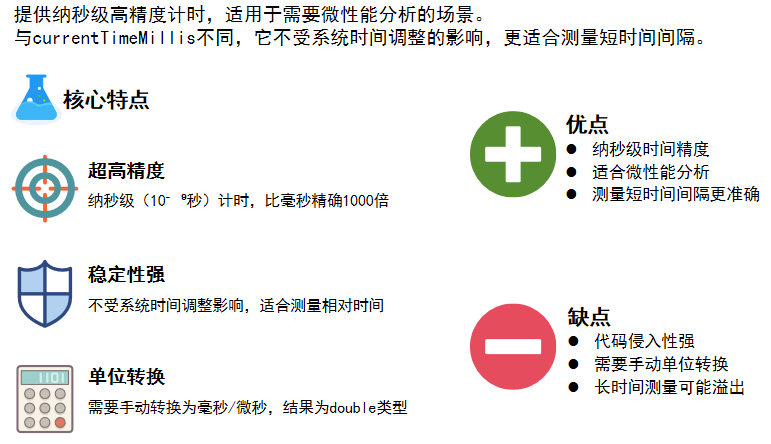

#### <font style="color:rgb(0, 0, 0);">核心原理</font>

<font style="color:rgb(0, 0, 0);">与</font><code><font style="color:rgba(0, 0, 0, 0.85) !important;">System.currentTimeMillis()</font></code><font style="color:rgb(0, 0, 0);">类似，但返回</font>**<font style="color:rgb(0, 0, 0) !important;">纳秒级</font>**<font style="color:rgb(0, 0, 0);">时间戳（1 纳秒 = 10⁻⁹秒），且基于系统计时器，不受系统时间调整（如 NTP 同步）影响，测量更稳定。</font>

#### <font style="color:rgb(0, 0, 0);">代码实现</font>

```java
public class AlgorithmPerformanceTest {
    // 统计排序算法执行耗时（高精度场景）
    public void testSortAlgorithm() {
        // 1. 生成测试数据（10万条随机整数）
        int[] data = generateRandomData(100000);
        
        // 2. 记录纳秒级开始时间
        long startNano = System.nanoTime();
        
        // 3. 执行核心算法（示例：快速排序）
        quickSort(data, 0, data.length - 1);
        
        // 4. 计算耗时，转换为毫秒（便于阅读）
        long elapsedNano = System.nanoTime() - startNano;
        double elapsedMs = elapsedNano / 1_000_000.0; // 纳秒→毫秒
        
        System.out.printf("快速排序（10万条数据）耗时：%.3fms%n", elapsedMs);
    }

    // 以下为辅助方法伪代码
    private int[] generateRandomData(int size) { /* 生成随机数组 */ return new int[size]; }
    private void quickSort(int[] data, int left, int right) { /* 快速排序实现 */ }
}
```

#### <font style="color:rgb(0, 0, 0);">优缺点</font>

* **<font style="color:rgb(0, 0, 0) !important;">优点</font>**<font style="color:rgb(0, 0, 0);">：纳秒级精度（比毫秒精确 1000 倍）、测量稳定（不受系统时间影响）、适合短时间间隔统计；</font>
* **<font style="color:rgb(0, 0, 0) !important;">缺点</font>**<font style="color:rgb(0, 0, 0);">：代码侵入性强、需手动转换单位（纳秒→毫秒 / 微秒）、长时间测量可能溢出（</font><code><font style="color:rgb(0, 0, 0);">long</font></code><font style="color:rgb(0, 0, 0);">类型最大可记录约 292 年，实际业务中可忽略）。</font>

#### <font style="color:rgb(0, 0, 0);">适用场景</font>

<font style="color:rgb(0, 0, 0);">算法性能对比、微服务间调用延迟统计、高精度计时场景（如高频交易系统）。</font>

### <font style="color:rgb(0, 0, 0);">方法 3：Spring AOP 切面 ——Spring 项目的 “无侵入方案”</font>

<font style="color:rgb(0, 0, 0);">对于 Spring Boot/Spring MVC 项目，Spring AOP 是统计接口耗时的首选，核心优势是 “业务代码零侵入”。</font>

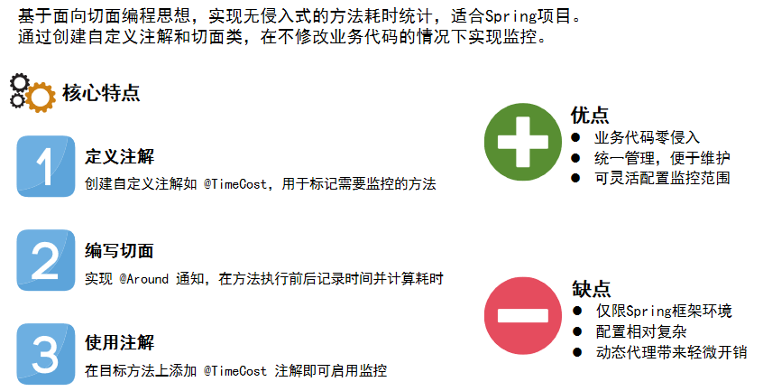

#### <font style="color:rgb(0, 0, 0);">核心原理</font>

<font style="color:rgb(0, 0, 0);">基于 “面向切面编程” 思想，通过自定义注解标记需要监控的方法，再通过</font><code><font style="color:rgba(0, 0, 0, 0.85) !important;">@Around</font></code><font style="color:rgb(0, 0, 0);">通知拦截方法执行，在执行前后自动记录耗时，无需修改业务代码。</font>

#### <font style="color:rgb(0, 0, 0);">代码实现（完整可运行）</font>

##### <font style="color:rgb(0, 0, 0);">步骤 1：定义自定义注解（标记需要统计的方法）</font>

```java
import java.lang.annotation.*;

// 作用于方法上
@Target(ElementType.METHOD)
// 运行时生效（允许反射获取注解）
@Retention(RetentionPolicy.RUNTIME)
public @interface TimeCost {
    // 可选：添加描述属性，用于日志区分
    String value() default "";
}
```

##### <font style="color:rgb(0, 0, 0);">步骤 2：编写 AOP 切面类（核心计时逻辑）</font>

```java
import org.aspectj.lang.ProceedingJoinPoint;
import org.aspectj.lang.annotation.Around;
import org.aspectj.lang.annotation.Aspect;
import org.aspectj.lang.annotation.Pointcut;
import org.slf4j.Logger;
import org.slf4j.LoggerFactory;
import org.springframework.stereotype.Component;

@Aspect // 标记为切面类
@Component // 交给Spring容器管理
public class TimeCostAspect {
    private static final Logger logger = LoggerFactory.getLogger(TimeCostAspect.class);

    // 切入点：拦截所有标注了@TimeCost注解的方法
    @Pointcut("@annotation(com.example.demo.annotation.TimeCost)")
    public void timeCostPointcut() {}

    // 环绕通知：方法执行前后的逻辑
    @Around("timeCostPointcut() && @annotation(timeCost)")
    public Object around(ProceedingJoinPoint joinPoint, TimeCost timeCost) throws Throwable {
        // 1. 记录开始时间
        long startTime = System.currentTimeMillis();
        
        // 2. 执行目标方法（业务逻辑）
        Object result = joinPoint.proceed(); // 放行，执行原方法
        
        // 3. 计算耗时
        long costTime = System.currentTimeMillis() - startTime;
        
        // 4. 日志输出（包含方法名、注解描述、耗时）
        String methodName = joinPoint.getSignature().toShortString(); // 获取方法名（如：OrderService.createOrder()）
        String description = timeCost.value();
        logger.info("[耗时统计] 方法：{} | 描述：{} | 耗时：{}ms", methodName, description, costTime);
        
        // 返回方法执行结果
        return result;
    }
}
```

#### <font style="color:rgb(0, 0, 0);">优缺点</font>

* **<font style="color:rgb(0, 0, 0) !important;">优点</font>**<font style="color:rgb(0, 0, 0);">：业务代码零侵入、统一管理计时逻辑（修改切面即可全局生效）、可灵活配置（按注解 / 包 / 类拦截）、支持获取方法名 / 参数等详情；</font>
* **<font style="color:rgb(0, 0, 0) !important;">缺点</font>**<font style="color:rgb(0, 0, 0);">：仅限 Spring 框架环境、动态代理有轻微性能开销（生产环境可忽略）、无法拦截非 Spring Bean 的方法（如静态方法、私有方法）。</font>

#### <font style="color:rgb(0, 0, 0);">适用场景</font>

<font style="color:rgb(0, 0, 0);">Spring Boot/Spring MVC 项目、需要统一监控多个方法 / 接口、希望保持业务代码纯净的场景。</font>

### <font style="color:rgb(0, 0, 0);">方法 4：拦截器（HandlerInterceptor）——Web 接口的 “专属方案”</font>

<font style="color:rgb(0, 0, 0);">拦截器是 Spring MVC 提供的 Web 层专属组件，专门用于拦截 HTTP 请求，适合统计 Web 接口的端到端耗时。</font>

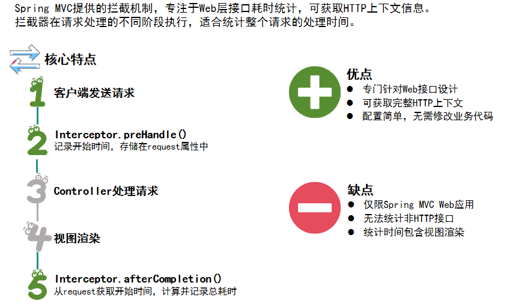

#### <font style="color:rgb(0, 0, 0);">核心原理</font>

<font style="color:rgb(0, 0, 0);">拦截器工作在 Spring MVC 的请求处理链中，通过</font><code><font style="color:rgba(0, 0, 0, 0.85) !important;">preHandle</font></code><font style="color:rgb(0, 0, 0);">（请求处理前）记录开始时间，</font><code><font style="color:rgba(0, 0, 0, 0.85) !important;">afterCompletion</font></code><font style="color:rgb(0, 0, 0);">（请求完成后，含异常场景）计算耗时，能获取完整的 HTTP 上下文（如 URL、请求参数、响应状态码）。</font>

#### <font style="color:rgb(0, 0, 0);">代码实现</font>

##### <font style="color:rgb(0, 0, 0);">步骤 1：实现拦截器接口</font>

```java
import org.slf4j.Logger;
import org.slf4j.LoggerFactory;
import org.springframework.web.servlet.HandlerInterceptor;
import org.springframework.web.servlet.ModelAndView;

import javax.servlet.http.HttpServletRequest;
import javax.servlet.http.HttpServletResponse;

public class ApiTimeInterceptor implements HandlerInterceptor {
    private static final Logger logger = LoggerFactory.getLogger(ApiTimeInterceptor.class);
    // 存储开始时间的请求属性名
    private static final String START_TIME_ATTR = "API_START_TIME";

    // 1. 请求处理前执行（Controller方法调用前）
    @Override
    public boolean preHandle(HttpServletRequest request, HttpServletResponse response, Object handler) {
        // 记录开始时间，存入request属性（线程安全）
        long startTime = System.currentTimeMillis();
        request.setAttribute(START_TIME_ATTR, startTime);
        return true; // 返回true，放行请求
    }

    // 2. 视图渲染后执行（仅当preHandle返回true时）
    @Override
    public void postHandle(HttpServletRequest request, HttpServletResponse response, Object handler, ModelAndView modelAndView) {
        // 此处可处理视图渲染相关逻辑，计时无需用到
    }

    // 3. 请求完成后执行（无论是否抛出异常）
    @Override
    public void afterCompletion(HttpServletRequest request, HttpServletResponse response, Object handler, Exception ex) {
        // 获取开始时间
        long startTime = (long) request.getAttribute(START_TIME_ATTR);
        // 计算耗时
        long costTime = System.currentTimeMillis() - startTime;
        
        // 获取HTTP上下文信息
        String requestUri = request.getRequestURI(); // 接口URL（如：/api/orders）
        String httpMethod = request.getMethod(); // 请求方法（GET/POST）
        int statusCode = response.getStatus(); // 响应状态码（200/400/500）
        
        // 日志输出
        logger.info("[Web接口耗时] {} {} | 状态码：{} | 耗时：{}ms", httpMethod, requestUri, statusCode, costTime);
    }
}
```

##### <font style="color:rgb(0, 0, 0);">步骤 2：注册拦截器（配置拦截范围）</font>

```java
import org.springframework.context.annotation.Configuration;
import org.springframework.web.servlet.config.annotation.InterceptorRegistry;
import org.springframework.web.servlet.config.annotation.WebMvcConfigurer;

@Configuration
public class WebMvcConfig implements WebMvcConfigurer {

    @Override
    public void addInterceptors(InterceptorRegistry registry) {
        registry.addInterceptor(new ApiTimeInterceptor())
                .addPathPatterns("/api/**") // 拦截所有/api/开头的Web接口
                .excludePathPatterns("/api/login", "/api/health"); // 排除登录、健康检查接口
    }
}
```

#### <font style="color:rgb(0, 0, 0);">优缺点</font>

* **<font style="color:rgb(0, 0, 0) !important;">优点</font>**<font style="color:rgb(0, 0, 0);">：专门针对 Web 接口、可获取完整 HTTP 上下文、配置灵活（按 URL 拦截）、无业务侵入；</font>
* **<font style="color:rgb(0, 0, 0) !important;">缺点</font>**<font style="color:rgb(0, 0, 0);">：仅限 Spring MVC Web 应用、无法统计非 HTTP 接口（如 Dubbo 接口、内部方法）、统计时间包含视图渲染耗时。</font>

#### <font style="color:rgb(0, 0, 0);">适用场景</font>

<font style="color:rgb(0, 0, 0);">Spring MVC Web 项目、RESTful API 耗时统计、需要获取 HTTP 上下文信息的场景。</font>

### <font style="color:rgb(0, 0, 0);">方法 5：过滤器（Servlet Filter）——Java Web 的 “底层方案”</font>

<font style="color:rgb(0, 0, 0);">过滤器是 Java Servlet 规范的标准组件，比拦截器更底层，适用于所有 Java Web 应用（不限于 Spring MVC）。</font>

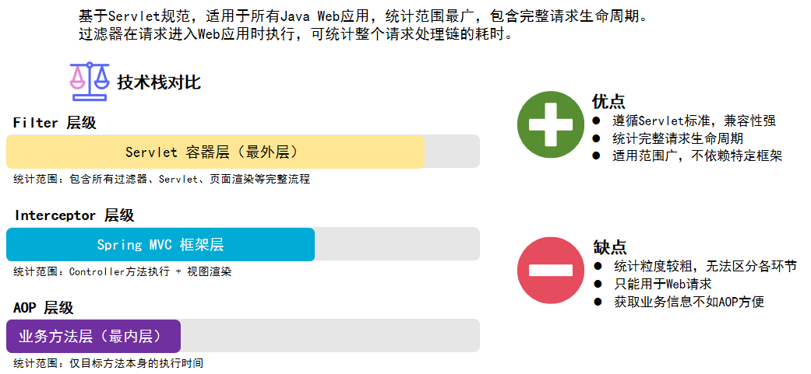

#### <font style="color:rgb(0, 0, 0);">核心原理</font>

<font style="color:rgb(0, 0, 0);">过滤器工作在 Servlet 容器层，拦截所有进入 Web 应用的请求（包括静态资源、JSP、Servlet），统计范围是 “请求进入容器→响应返回客户端” 的完整生命周期，包含过滤器链、拦截器、Controller、视图渲染等所有环节。</font>

#### <font style="color:rgb(0, 0, 0);">代码实现</font>

##### <font style="color:rgb(0, 0, 0);">步骤 1：实现 Filter 接口</font>

```java
import org.slf4j.Logger;
import org.slf4j.LoggerFactory;

import javax.servlet.*;
import javax.servlet.annotation.WebFilter;
import javax.servlet.http.HttpServletRequest;
import java.io.IOException;

// 注解配置：拦截所有/api/开头的请求
@WebFilter(urlPatterns = "/api/*")
public class ApiTimeFilter implements Filter {
    private static final Logger logger = LoggerFactory.getLogger(ApiTimeFilter.class);

    @Override
    public void doFilter(ServletRequest request, ServletResponse response, FilterChain chain) 
            throws IOException, ServletException {
        // 1. 记录开始时间
        long startTime = System.currentTimeMillis();
        
        try {
            // 2. 放行请求，执行后续过滤器链、拦截器、Controller等
            chain.doFilter(request, response);
        } finally {
            // 3. 计算耗时（finally确保异常时也能统计）
            long costTime = System.currentTimeMillis() - startTime;
            
            // 转换为HttpServletRequest，获取请求详情
            if (request instanceof HttpServletRequest) {
                HttpServletRequest httpRequest = (HttpServletRequest) request;
                String method = httpRequest.getMethod();
                String requestUri = httpRequest.getRequestURI();
                
                logger.info("[Filter耗时统计] {} {} | 总耗时：{}ms", method, requestUri, costTime);
            }
        }
    }

    // 初始化和销毁方法（可选）
    @Override
    public void init(FilterConfig filterConfig) {}

    @Override
    public void destroy() {}
}
```

##### <font style="color:rgb(0, 0, 0);">步骤 2：启用过滤器扫描（Spring Boot 项目）</font>

<font style="color:rgb(0, 0, 0);">在 Spring Boot 启动类上添加</font><code><font style="color:rgba(0, 0, 0, 0.85) !important;">@ServletComponentScan</font></code><font style="color:rgb(0, 0, 0);">注解，自动扫描</font><code><font style="color:rgba(0, 0, 0, 0.85) !important;">@WebFilter</font></code><font style="color:rgb(0, 0, 0);">注解的过滤器：</font>

```java
import org.springframework.boot.SpringApplication;
import org.springframework.boot.autoconfigure.SpringBootApplication;
import org.springframework.boot.web.servlet.ServletComponentScan;

@SpringBootApplication
@ServletComponentScan // 启用Servlet组件扫描（Filter、Servlet、Listener）
public class DemoApplication {
    public static void main(String[] args) {
        SpringApplication.run(DemoApplication.class, args);
    }
}
```

#### <font style="color:rgb(0, 0, 0);">优缺点</font>

* **<font style="color:rgb(0, 0, 0) !important;">优点</font>**<font style="color:rgb(0, 0, 0);">：遵循 Servlet 标准、兼容性强（支持所有 Java Web 容器）、统计范围完整（端到端）、不依赖特定框架；</font>
* **<font style="color:rgb(0, 0, 0) !important;">缺点</font>**<font style="color:rgb(0, 0, 0);">：统计粒度粗（无法区分各环节耗时）、仅支持 Web 请求、获取业务信息不便（需手动解析请求参数）。</font>

#### <font style="color:rgb(0, 0, 0);">适用场景</font>

<font style="color:rgb(0, 0, 0);">传统 Java Web 项目（非 Spring Boot）、需要统计完整请求生命周期耗时、无需框架依赖的场景。</font>

### <font style="color:rgb(0, 0, 0);">方法 6：Micrometer + APM 工具 —— 生产级 “分布式方案”</font>

<font style="color:rgb(0, 0, 0);">以上 5 种方法适用于单体应用或简单场景，对于微服务、分布式系统，推荐使用 Micrometer（指标采集）+ APM 工具（如 SkyWalking、Pinpoint）的生产级方案。</font>

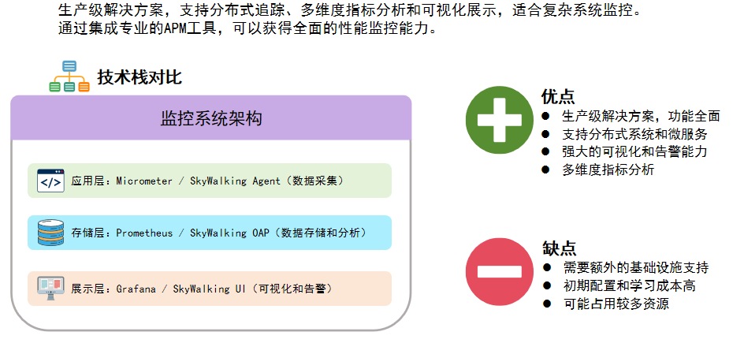

#### <font style="color:rgb(0, 0, 0);">核心原理</font>

* **<font style="color:rgb(0, 0, 0) !important;">Micrometer</font>**<font style="color:rgb(0, 0, 0);">：指标采集门面库，统一对接 Prometheus、Graphite 等监控系统，提供</font><code><font style="color:rgb(0, 0, 0);">Timer</font></code><font style="color:rgb(0, 0, 0);">（计时）、</font><code><font style="color:rgb(0, 0, 0);">Counter</font></code><font style="color:rgb(0, 0, 0);">（计数）等指标类型，支持自定义标签（如服务名、接口名、环境）；</font>
* **<font style="color:rgb(0, 0, 0) !important;">APM 工具</font>**<font style="color:rgb(0, 0, 0);">：通过字节码增强自动采集耗时数据，支持分布式链路追踪，可可视化展示调用链、耗时分布、异常信息等。</font>

#### <font style="color:rgb(0, 0, 0);">代码实现（Micrometer + Prometheus 示例）</font>

##### <font style="color:rgb(0, 0, 0);">步骤 1：添加依赖（Spring Boot 项目）</font>

```xml
<!-- Micrometer核心依赖 -->
<dependency>
    <groupId>io.micrometer</groupId>
    <artifactId>micrometer-core</artifactId>
</dependency>
<!-- Prometheus注册中心（对接Prometheus监控系统） -->
<dependency>
    <groupId>io.micrometer</groupId>
    <artifactId>micrometer-registry-prometheus</artifactId>
</dependency>
<!-- Spring Boot Actuator（暴露监控端点） -->
<dependency>
    <groupId>org.springframework.boot</groupId>
    <artifactId>spring-boot-starter-actuator</artifactId>
</dependency>
```

##### <font style="color:rgb(0, 0, 0);">步骤 2：配置监控端点（application.yml）</font>

```yaml
management:
  endpoints:
    web:
      exposure:
        include: health,info,prometheus # 暴露prometheus监控端点
  metrics:
    tags:
      application: order-service # 添加应用名标签（区分多服务）
  endpoint:
    health:
      show-details: always # 显示健康检查详情
```

##### <font style="color:rgb(0, 0, 0);">步骤 3：使用 @Timed 注解统计接口耗时</font>

```java
import io.micrometer.core.annotation.Timed;
import org.springframework.web.bind.annotation.PostMapping;
import org.springframework.web.bind.annotation.RequestBody;
import org.springframework.web.bind.annotation.RestController;

@RestController
@RequestMapping("/api/orders")
public class OrderController {

    // @Timed注解：统计该接口耗时，添加自定义标签
    @Timed(
        value = "order.create", // 指标名称（Prometheus中显示为order_create_seconds）
        description = "创建订单接口耗时", // 指标描述
        tags = {"type", "business", "env", "prod"} // 自定义标签（用于多维度分析）
    )
    @PostMapping
    public ResponseEntity<OrderVO> createOrder(@RequestBody OrderDTO orderDTO) {
        // 核心业务逻辑
        OrderVO orderVO = orderService.createOrder(orderDTO);
        return ResponseEntity.ok(orderVO);
    }
}
```

##### <font style="color:rgb(0, 0, 0);">步骤 4：集成 APM 工具（以 SkyWalking 为例）</font>

1. <font style="color:rgb(0, 0, 0);">下载 SkyWalking Agent（字节码增强代理）；</font>
2. <font style="color:rgb(0, 0, 0);">启动应用时添加 JVM 参数，指定 Agent 路径：</font>

```bash
java -javaagent:/path/to/skywalking-agent.jar \
     -Dskywalking.agent.service_name=order-service \
     -Dskywalking.collector.backend_service=127.0.0.1:11800 \
     -jar your-application.jar
```

#### <font style="color:rgb(0, 0, 0);">优缺点</font>

* **<font style="color:rgb(0, 0, 0) !important;">优点</font>**<font style="color:rgb(0, 0, 0);">：生产级解决方案、支持分布式链路追踪、多维度指标分析（按服务 / 接口 / 标签）、可视化展示（Grafana/SkyWalking UI）、支持告警配置；</font>
* **<font style="color:rgb(0, 0, 0) !important;">缺点</font>**<font style="color:rgb(0, 0, 0);">：需要额外部署基础设施（如 Prometheus、SkyWalking OAP）、初期配置和学习成本高、资源消耗比前 5 种方法略高。</font>

#### <font style="color:rgb(0, 0, 0);">适用场景</font>

<font style="color:rgb(0, 0, 0);">微服务架构、分布式系统、生产环境大规模监控、需要链路追踪和告警的场景。</font>

## <font style="color:rgb(0, 0, 0);">三、6 种方法核心特性对比（一目了然）</font>

<font style="color:rgb(0, 0, 0);">为了方便你快速选型，整理了核心特性对比表，涵盖精度、侵入性、适用范围等关键维度：</font>

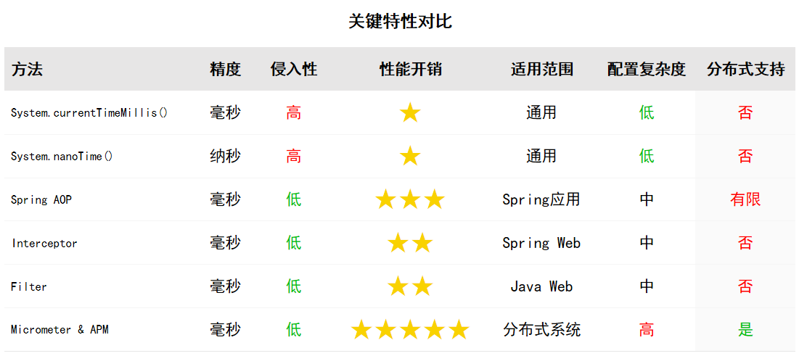

| **<font style="color:rgb(0, 0, 0) !important;">方法</font>** | **<font style="color:rgb(0, 0, 0) !important;">精度</font>** | **<font style="color:rgb(0, 0, 0) !important;">侵入性</font>** | **<font style="color:rgb(0, 0, 0) !important;">性能开销</font>** | **<font style="color:rgb(0, 0, 0) !important;">适用范围</font>** | **<font style="color:rgb(0, 0, 0) !important;">配置复杂度</font>** | **<font style="color:rgb(0, 0, 0) !important;">分布式支持</font>** |
| :--- | :--- | :--- | :--- | :--- | :--- | :--- |
| <font style="color:rgba(0, 0, 0, 0.85) !important;">System.currentTimeMillis()</font> | <font style="color:rgba(0, 0, 0, 0.85) !important;">毫秒</font> | <font style="color:rgba(0, 0, 0, 0.85) !important;">高</font> | <font style="color:rgba(0, 0, 0, 0.85) !important;">★</font> | <font style="color:rgba(0, 0, 0, 0.85) !important;">通用（调试）</font> | <font style="color:rgba(0, 0, 0, 0.85) !important;">低</font> | <font style="color:rgba(0, 0, 0, 0.85) !important;">否</font> |
| <font style="color:rgba(0, 0, 0, 0.85) !important;">System.nanoTime()</font> | <font style="color:rgba(0, 0, 0, 0.85) !important;">纳秒</font> | <font style="color:rgba(0, 0, 0, 0.85) !important;">高</font> | <font style="color:rgba(0, 0, 0, 0.85) !important;">★</font> | <font style="color:rgba(0, 0, 0, 0.85) !important;">通用（高精度）</font> | <font style="color:rgba(0, 0, 0, 0.85) !important;">低</font> | <font style="color:rgba(0, 0, 0, 0.85) !important;">否</font> |
| <font style="color:rgba(0, 0, 0, 0.85) !important;">Spring AOP</font> | <font style="color:rgba(0, 0, 0, 0.85) !important;">毫秒</font> | <font style="color:rgba(0, 0, 0, 0.85) !important;">低</font> | <font style="color:rgba(0, 0, 0, 0.85) !important;">★★★</font> | <font style="color:rgba(0, 0, 0, 0.85) !important;">Spring 应用</font> | <font style="color:rgba(0, 0, 0, 0.85) !important;">中</font> | <font style="color:rgba(0, 0, 0, 0.85) !important;">有限</font> |
| <font style="color:rgba(0, 0, 0, 0.85) !important;">拦截器（Interceptor）</font> | <font style="color:rgba(0, 0, 0, 0.85) !important;">毫秒</font> | <font style="color:rgba(0, 0, 0, 0.85) !important;">低</font> | <font style="color:rgba(0, 0, 0, 0.85) !important;">★★</font> | <font style="color:rgba(0, 0, 0, 0.85) !important;">Spring Web</font> | <font style="color:rgba(0, 0, 0, 0.85) !important;">中</font> | <font style="color:rgba(0, 0, 0, 0.85) !important;">否</font> |
| <font style="color:rgba(0, 0, 0, 0.85) !important;">过滤器（Filter）</font> | <font style="color:rgba(0, 0, 0, 0.85) !important;">毫秒</font> | <font style="color:rgba(0, 0, 0, 0.85) !important;">低</font> | <font style="color:rgba(0, 0, 0, 0.85) !important;">★★</font> | <font style="color:rgba(0, 0, 0, 0.85) !important;">Java Web</font> | <font style="color:rgba(0, 0, 0, 0.85) !important;">中</font> | <font style="color:rgba(0, 0, 0, 0.85) !important;">否</font> |
| <font style="color:rgba(0, 0, 0, 0.85) !important;">Micrometer + APM</font> | <font style="color:rgba(0, 0, 0, 0.85) !important;">毫秒</font> | <font style="color:rgba(0, 0, 0, 0.85) !important;">低</font> | <font style="color:rgba(0, 0, 0, 0.85) !important;">★★★★★</font> | <font style="color:rgba(0, 0, 0, 0.85) !important;">分布式系统</font> | <font style="color:rgba(0, 0, 0, 0.85) !important;">高</font> | <font style="color:rgba(0, 0, 0, 0.85) !important;">是</font> |

## <font style="color:rgb(0, 0, 0);">四、适用场景选型指南（面试 / 工作直接用）</font>

<font style="color:rgb(0, 0, 0);">不同场景对应不同方案，无需盲目追求 “最复杂”，选择最适合当前需求的即可：</font>

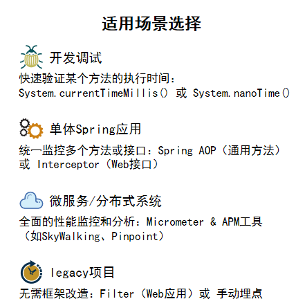

1. **<font style="color:rgb(0, 0, 0) !important;">开发调试 / 临时统计</font>**<font style="color:rgb(0, 0, 0);">：优先用</font><code><font style="color:rgb(0, 0, 0);">System.currentTimeMillis()</font></code><font style="color:rgb(0, 0, 0);">（简单）或</font><code><font style="color:rgb(0, 0, 0);">System.nanoTime()</font></code><font style="color:rgb(0, 0, 0);">（高精度）；</font>
2. **<font style="color:rgb(0, 0, 0) !important;">单体 Spring 应用</font>**<font style="color:rgb(0, 0, 0);">：优先用</font><code><font style="color:rgb(0, 0, 0);">Spring AOP</font></code><font style="color:rgb(0, 0, 0);">（通用方法）或</font><code><font style="color:rgb(0, 0, 0);">拦截器</font></code><font style="color:rgb(0, 0, 0);">（Web 接口）；</font>
3. **<font style="color:rgb(0, 0, 0) !important;">传统 Java Web 项目（非 Spring）</font>**<font style="color:rgb(0, 0, 0);">：用</font><code><font style="color:rgb(0, 0, 0);">过滤器（Filter）</font></code><font style="color:rgb(0, 0, 0);">；</font>
4. **<font style="color:rgb(0, 0, 0) !important;">微服务 / 分布式系统（生产环境）</font>**<font style="color:rgb(0, 0, 0);">：必须用</font><code><font style="color:rgb(0, 0, 0);">Micrometer + APM工具</font></code><font style="color:rgb(0, 0, 0);">；</font>
5. **<font style="color:rgb(0, 0, 0) !important;">Legacy 项目（无需框架改造）</font>**<font style="color:rgb(0, 0, 0);">：用</font><code><font style="color:rgb(0, 0, 0);">过滤器</font></code><font style="color:rgb(0, 0, 0);">或手动埋点（前两种方法）。</font>

## <font style="color:rgb(0, 0, 0);">五、最佳实践建议（让你的统计更专业）</font>

1. **<font style="color:rgb(0, 0, 0) !important;">优先选择低侵入方案</font>**<font style="color:rgb(0, 0, 0);">：生产环境尽量用 AOP、拦截器、APM 工具，避免手动埋点污染业务代码；</font>
2. **<font style="color:rgb(0, 0, 0) !important;">仅统计核心接口</font>**<font style="color:rgb(0, 0, 0);">：无需监控所有方法，聚焦关键路径（如订单创建、支付流程），减少性能开销；</font>
3. **<font style="color:rgb(0, 0, 0) !important;">设置合理采样率</font>**<font style="color:rgb(0, 0, 0);">：高并发场景下，可设置采样率（如 10%），避免监控本身成为性能瓶颈；</font>
4. **<font style="color:rgb(0, 0, 0) !important;">结合日志和指标</font>**<font style="color:rgb(0, 0, 0);">：日志用于问题排查（含详细上下文），指标用于监控告警（趋势分析）；</font>
5. **<font style="color:rgb(0, 0, 0) !important;">建立多级告警阈值</font>**<font style="color:rgb(0, 0, 0);">：参考响应时间分级，配置告警（如：>500ms 警告、>1s 严重告警）；</font>
6. **<font style="color:rgb(0, 0, 0) !important;">保留上下文信息</font>**<font style="color:rgb(0, 0, 0);">：统计时记录方法名、接口 URL、用户 ID 等，便于定位问题。</font>

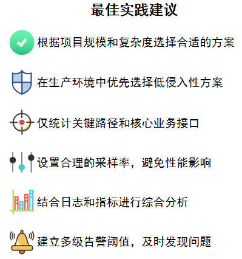

## <font style="color:rgb(0, 0, 0);">六、面试回答总结（直接套用）</font>

<font style="color:rgb(0, 0, 0);">回到开头的面试问题，你可以这样回答，体现你的严谨性和技术深度：</font>

<font style="color:rgb(0, 0, 0);">“面试官您好，统计接口耗时是性能优化的基础，我会根据项目场景选择合适的方案：</font>

1. <font style="color:rgb(0, 0, 0);">开发调试阶段，用 System.currentTimeMillis () 快速验证；</font>
2. <font style="color:rgb(0, 0, 0);">单体 Spring 应用中，用 Spring AOP 实现无侵入统计，通过自定义注解标记需要监控的接口；</font>
3. <font style="color:rgb(0, 0, 0);">生产环境的微服务架构，我会用 Micrometer 采集指标，结合 SkyWalking 实现分布式链路追踪，不仅能统计耗时，还能定位跨服务调用的瓶颈；</font>
4. <font style="color:rgb(0, 0, 0);">最终通过这些工具量化优化效果，从 850ms 降至 220ms 的结论，就是通过 APM 工具统计的真实数据，确保优化效果可量化、可复现。</font>

<font style="color:rgb(0, 0, 0);">同时，我会遵循最佳实践：只监控核心接口、设置多级告警、结合日志和指标分析，确保统计既准确又不影响系统性能。”</font>

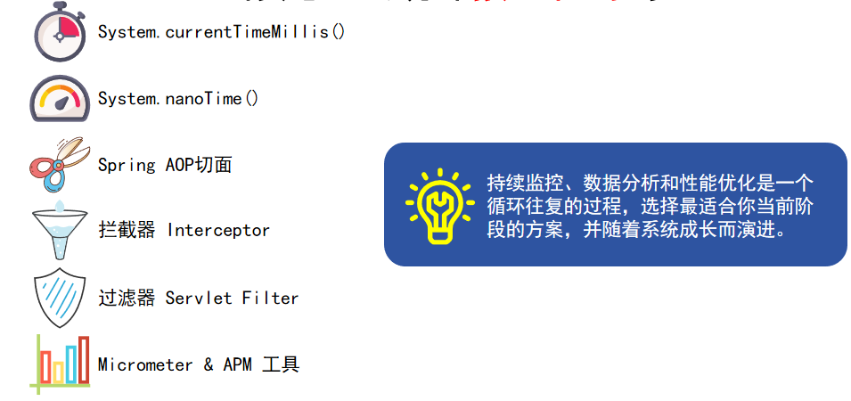

## <font style="color:rgb(0, 0, 0);">总结</font>

<font style="color:rgb(0, 0, 0);">统计接口耗时不是 “选最复杂的工具”，而是 “选最适合的方案”。从基础的手动埋点到生产级的 APM 工具，每种方法都有其适用场景。掌握这些方法，不仅能应对面试，更能在工作中形成 “量化 - 优化 - 再量化” 的性能优化闭环，成为更严谨的技术人。</font>

<font style="color:rgb(0, 0, 0);">持续监控、数据分析和性能优化是一个循环往复的过程，选择最适合你当前阶段的方案，并随着系统成长而演进 —— 这就是统计接口耗时的核心逻辑。</font>


> 更新: 2025-11-25 15:18:57  
> 原文: <https://www.yuque.com/tulingzhouyu/db22bv/nieioyltn02ee0tq>