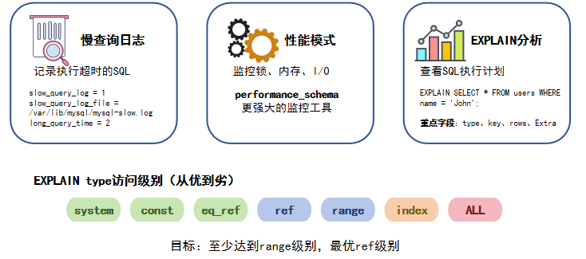
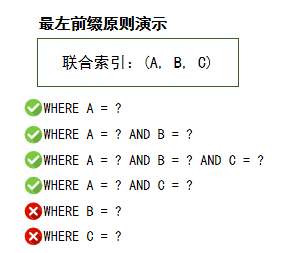
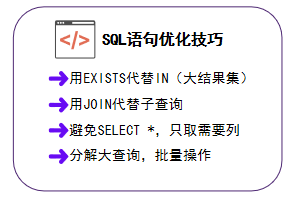
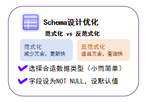

# 面试官问：如何系统性解决 MySQL 性能问题？（从入门到实战全指南）

<font style="color:rgb(0, 0, 0);">在后端开发与面试中，“MySQL 性能优化” 是绕不开的核心话题。很多人面对这个问题时，容易陷入 “想到哪说到哪” 的零散状态，既体现不出系统性，也难以覆盖实战场景。本文将基于 “定位瓶颈→索引策略→SQL 与 Schema 设计→系统级优化” 的完整框架，结合实操案例与代码示例，带你一步到位掌握 MySQL 性能优化的核心方法论 —— 无论你是准备面试，还是解决生产环境问题，都能直接套用。</font>

## <font style="color:rgb(0, 0, 0);">一、为什么需要 “系统性” 优化？</font>

<font style="color:rgb(0, 0, 0);">很多人优化 MySQL 时，习惯上来就加索引、改 SQL，但往往效果甚微 —— 因为没有先找到 “性能瓶颈到底在哪”。系统性优化的核心逻辑，是 “先诊断，再开方”，避免无差别投入。</font>

<font style="color:rgb(0, 0, 0);">我们的优化框架分为 4 个核心步骤，也是本次分享的主线：</font>

1. **<font style="color:rgb(0, 0, 0) !important;">定位瓶颈</font>**<font style="color:rgb(0, 0, 0);">：找到性能问题的根源（用工具说话，不凭感觉）；</font>
2. **<font style="color:rgb(0, 0, 0) !important;">索引策略</font>**<font style="color:rgb(0, 0, 0);">：性价比最高的优化手段（索引用对，性能翻倍）；</font>
3. **<font style="color:rgb(0, 0, 0) !important;">SQL 与 Schema 设计</font>**<font style="color:rgb(0, 0, 0);">：从 “语句” 和 “结构” 层面减少性能消耗；</font>
4. **<font style="color:rgb(0, 0, 0) !important;">系统级优化</font>**<font style="color:rgb(0, 0, 0);">：通过配置与架构，支撑高并发场景。</font>


## <font style="color:rgb(0, 0, 0);">二、第一步：定位瓶颈 ——3 个工具找到 “性能病灶”</font>

<font style="color:rgb(0, 0, 0);">优化的前提是 “找到问题”，这一步依赖 3 个核心工具，覆盖从 “慢 SQL” 到 “底层资源” 的全维度诊断。</font>

### <font style="color:rgb(0, 0, 0);">1. 慢查询日志：捕捉 “超时 SQL”</font>

<font style="color:rgb(0, 0, 0);">慢查询日志是最基础的诊断工具，用于记录执行时间超过阈值的 SQL 语句，帮你快速定位 “哪些 SQL 拖慢了系统”。</font>

#### <font style="color:rgb(0, 0, 0);">关键配置（需在 MySQL 配置文件中设置）：</font>

```sql
# 开启慢查询日志（1=开启，0=关闭）
slow_query_log = 1
# 慢查询日志存储路径（需确保MySQL有写入权限）
slow_query_log_file = /var/lib/mysql/mysql-slow.log
# 超时阈值（单位：秒，这里设为2秒，可根据业务调整）
long_query_time = 2
# 记录未使用索引的查询（可选，建议开启，避免漏查无索引SQL）
log_queries_not_using_indexes = 1
```

<font style="color:rgba(0, 0, 0, 0.85);">配置后重启 MySQL 生效，之后所有执行时间超过 2 秒的 SQL，都会被记录到</font><code><font style="color:rgba(0, 0, 0, 0.85);">mysql-slow.log</font></code><font style="color:rgba(0, 0, 0, 0.85);">中。通过</font><code><font style="color:rgba(0, 0, 0, 0.85);">mysqldumpslow</font></code><font style="color:rgba(0, 0, 0, 0.85);">工具还能统计慢 SQL 的频率，比如：</font>

```bash
# 统计出现次数最多的10条慢SQL
mysqldumpslow -s c -t 10 /var/lib/mysql/mysql-slow.log
```

<font style="color:rgb(0, 0, 0);">【对应 PPT 截图：定位瓶颈 - 慢查询日志配置】</font>

### <font style="color:rgb(0, 0, 0);">2. 性能模式（performance\_schema）：监控 “底层资源”</font>

<font style="color:rgb(0, 0, 0);">慢查询日志只能捕捉 “执行慢的 SQL”，但无法解释 “为什么慢”—— 比如是锁等待、内存不足，还是 I/O 耗时？这时候需要性能模式（</font><code><font style="color:rgba(0, 0, 0, 0.85) !important;">performance_schema</font></code><font style="color:rgb(0, 0, 0);">）。</font>

<font style="color:rgb(0, 0, 0);">它是 MySQL 内置的监控模块，能实时采集数据库的底层资源使用情况，包括：</font>

* <font style="color:rgb(0, 0, 0);">锁等待：哪些 SQL 在等表锁 / 行锁？</font>
* <font style="color:rgb(0, 0, 0);">内存消耗：各模块（如连接池、缓存）的内存使用量；</font>
* <font style="color:rgb(0, 0, 0);">I/O 操作：磁盘读写的耗时与频次。</font>

<font style="color:rgb(0, 0, 0);">启用方式（默认已启用，若未启用可通过 SQL 开启）：</font>

```sql
SET GLOBAL performance_schema = ON;
```

<font style="color:rgb(0, 0, 0);">通过查询性能模式的表，可定位具体问题，比如查看锁等待：</font>

```sql
SELECT * FROM performance_schema.events_waits_current 
WHERE EVENT_NAME LIKE '%lock%';
```

<font style="color:rgb(0, 0, 0);">【对应 PPT 截图：定位瓶颈 - 性能模式介绍】</font>

### <font style="color:rgb(0, 0, 0);">3. EXPLAIN 分析：拆解 “SQL 执行计划”</font>

<font style="color:rgb(0, 0, 0);">找到慢 SQL 后，下一步要搞清楚 “这条 SQL 是怎么执行的”—— 是否走了索引？扫描了多少行数据？这就需要 EXPLAIN 分析。</font>

<font style="color:rgb(0, 0, 0);">用法非常简单：在 SQL 语句前加</font><code><font style="color:rgba(0, 0, 0, 0.85) !important;">EXPLAIN</font></code><font style="color:rgb(0, 0, 0);">关键字即可，例如：</font>

```sql
EXPLAIN SELECT * FROM users WHERE name = 'John' AND age > 25;
```

<font style="color:rgb(0, 0, 0);">执行后会返回一张 “执行计划表”，重点关注 4 个字段：</font>

| **<font style="color:rgb(0, 0, 0) !important;">字段</font>** | **<font style="color:rgb(0, 0, 0) !important;">核心作用</font>** |
| :--- | :--- |
| <font style="color:rgba(0, 0, 0, 0.85) !important;">type</font> | <font style="color:rgba(0, 0, 0, 0.85) !important;">访问级别（从优到劣：system→const→eq\_ref→ref→range→index→ALL）</font> |
| <font style="color:rgba(0, 0, 0, 0.85) !important;">key</font> | <font style="color:rgba(0, 0, 0, 0.85) !important;">实际使用的索引（若为 NULL，说明未走索引）</font> |
| <font style="color:rgba(0, 0, 0, 0.85) !important;">rows</font> | <font style="color:rgba(0, 0, 0, 0.85) !important;">预估扫描的行数（数值越小越好，全表扫描时会显示表的总行数）</font> |
| <font style="color:rgba(0, 0, 0, 0.85) !important;">Extra</font> | <font style="color:rgba(0, 0, 0, 0.85) !important;">额外信息（如 “Using filesort”“Using temporary” 表示需要优化）</font> |

<font style="color:rgb(0, 0, 0);">这里有个硬性标准：</font><code><font style="color:rgba(0, 0, 0, 0.85) !important;">type</font></code><font style="color:rgb(0, 0, 0);">级别至少要达到</font>**<font style="color:rgb(0, 0, 0) !important;">range</font>**<font style="color:rgb(0, 0, 0);">（范围查询），最优是</font>**<font style="color:rgb(0, 0, 0) !important;">ref</font>**<font style="color:rgb(0, 0, 0);">（非唯一索引匹配）；如果出现</font>**<font style="color:rgb(0, 0, 0) !important;">ALL</font>**<font style="color:rgb(0, 0, 0);">（全表扫描），必须优先优化。</font>



## <font style="color:rgb(0, 0, 0);">三、第二步：索引策略 —— 性价比最高的优化手段</font>

<font style="color:rgb(0, 0, 0);">定位到瓶颈后，优先优化索引 —— 这是 “花最少的力，得最大效果” 的操作。但索引不是越多越好，关键要掌握 “创建原则” 和 “避坑技巧”。</font>

### <font style="color:rgb(0, 0, 0);">1. 索引创建的 4 个核心原则</font>

* **<font style="color:rgb(0, 0, 0) !important;">只为 “查询相关列” 建索引</font>**<font style="color:rgb(0, 0, 0);">：仅在 WHERE、JOIN、ORDER BY、GROUP BY 用到的列上创建索引，非查询列建索引只会增加写入（INSERT/UPDATE/DELETE）耗时。</font>
* **<font style="color:rgb(0, 0, 0) !important;">选择 “区分度高” 的列</font>**<font style="color:rgb(0, 0, 0);">：区分度 = 唯一值数量 / 总记录数，比如 “性别”（区分度低）不适合建索引，“手机号”（区分度高）适合建索引。可通过</font><code><font style="color:rgb(0, 0, 0);">SELECT COUNT(DISTINCT 列名)/COUNT(*) FROM 表名</font></code><font style="color:rgb(0, 0, 0);">计算区分度。</font>
* **<font style="color:rgb(0, 0, 0) !important;">避免 “冗余索引”</font>**<font style="color:rgb(0, 0, 0);">：如果已建联合索引（A,B），就不需要再建单独的（A）索引 —— 因为联合索引的最左列本身就是一个独立索引（最左前缀原则）。</font>
* **<font style="color:rgb(0, 0, 0) !important;">严格遵循 “最左前缀原则”</font>**<font style="color:rgb(0, 0, 0);">：这是联合索引的核心，也是面试高频考点，必须吃透！</font>


### <font style="color:rgb(0, 0, 0);">2. 最左前缀原则：联合索引怎么用？</font>

<font style="color:rgb(0, 0, 0);">以联合索引（A,B,C）为例，我们通过表格看哪些情况能用到索引，哪些不能：</font>

| **<font style="color:rgb(0, 0, 0) !important;">查询条件</font>** | **<font style="color:rgb(0, 0, 0) !important;">是否用到索引</font>** | **<font style="color:rgb(0, 0, 0) !important;">用到的索引部分</font>** | **<font style="color:rgb(0, 0, 0) !important;">原因分析</font>** |
| :--- | :--- | :--- | :--- |
| <font style="color:rgba(0, 0, 0, 0.85) !important;">WHERE A = ?</font> | <font style="color:rgba(0, 0, 0, 0.85) !important;">是</font> | <font style="color:rgba(0, 0, 0, 0.85) !important;">A</font> | <font style="color:rgba(0, 0, 0, 0.85) !important;">匹配最左前缀，完整利用 A 列索引</font> |
| <font style="color:rgba(0, 0, 0, 0.85) !important;">WHERE A = ? AND B = ?</font> | <font style="color:rgba(0, 0, 0, 0.85) !important;">是</font> | <font style="color:rgba(0, 0, 0, 0.85) !important;">A,B</font> | <font style="color:rgba(0, 0, 0, 0.85) !important;">连续匹配左前缀，利用 A+B 列索引</font> |
| <font style="color:rgba(0, 0, 0, 0.85) !important;">WHERE A = ? AND B = ? AND C = ?</font> | <font style="color:rgba(0, 0, 0, 0.85) !important;">是</font> | <font style="color:rgba(0, 0, 0, 0.85) !important;">A,B,C</font> | <font style="color:rgba(0, 0, 0, 0.85) !important;">完整匹配联合索引</font> |
| <font style="color:rgba(0, 0, 0, 0.85) !important;">WHERE A = ? AND C = ?</font> | <font style="color:rgba(0, 0, 0, 0.85) !important;">是（部分）</font> | <font style="color:rgba(0, 0, 0, 0.85) !important;">A</font> | <font style="color:rgba(0, 0, 0, 0.85) !important;">只匹配最左前缀 A，C 列无法利用</font> |
| <font style="color:rgba(0, 0, 0, 0.85) !important;">WHERE B = ?</font> | <font style="color:rgba(0, 0, 0, 0.85) !important;">否</font> | <font style="color:rgba(0, 0, 0, 0.85) !important;">无</font> | <font style="color:rgba(0, 0, 0, 0.85) !important;">跳过最左列 A，索引失效</font> |
| <font style="color:rgba(0, 0, 0, 0.85) !important;">WHERE C = ?</font> | <font style="color:rgba(0, 0, 0, 0.85) !important;">否</font> | <font style="color:rgba(0, 0, 0, 0.85) !important;">无</font> | <font style="color:rgba(0, 0, 0, 0.85) !important;">跳过最左列 A，索引失效</font> |

<font style="color:rgb(0, 0, 0);">关键结论：联合索引的匹配必须从 “最左列” 开始，且不能跳过中间列 —— 哪怕你查询的列在索引中，只要跳过左前缀，索引就会失效。</font>



### <font style="color:rgb(0, 0, 0);">3. 4 个 “高危” 索引失效场景（必记！）</font>

<font style="color:rgb(0, 0, 0);">即使建了索引，以下 4 种情况也会让索引 “罢工”，面试时能准确说出这些场景，绝对是加分项：</font>

1. **<font style="color:rgb(0, 0, 0) !important;">索引列用函数 / 计算</font>**<font style="color:rgb(0, 0, 0);">：比如</font><code><font style="color:rgb(0, 0, 0);">WHERE SUBSTR(phone,1,3) = '138'</font></code><font style="color:rgb(0, 0, 0);">（phone 列有索引），函数会破坏索引结构，导致全表扫描；</font>
2. **<font style="color:rgb(0, 0, 0) !important;">使用！=/<>" 操作符</font>**<font style="color:rgb(0, 0, 0);">：不等于操作会让 MySQL 放弃索引，改用全表扫描，若业务允许，可替换为</font><code><font style="color:rgb(0, 0, 0);">> + <</font></code><font style="color:rgb(0, 0, 0);">（如</font><code><font style="color:rgb(0, 0, 0);">WHERE age != 25</font></code><font style="color:rgb(0, 0, 0);">改为</font><code><font style="color:rgb(0, 0, 0);">WHERE age >25 OR age <25</font></code><font style="color:rgb(0, 0, 0);">，需结合实际场景）；</font>
3. **<font style="color:rgb(0, 0, 0) !important;">% 开头的 LIKE 查询</font>**<font style="color:rgb(0, 0, 0);">：比如</font><code><font style="color:rgb(0, 0, 0);">WHERE name LIKE '%John'</font></code><font style="color:rgb(0, 0, 0);">，前缀模糊匹配会导致索引失效，若业务需要模糊查询，尽量用后缀匹配（</font><code><font style="color:rgb(0, 0, 0);">LIKE 'John%'</font></code><font style="color:rgb(0, 0, 0);">）；</font>
4. **<font style="color:rgb(0, 0, 0) !important;">字符串列用数字查询</font>**<font style="color:rgb(0, 0, 0);">：比如</font><code><font style="color:rgb(0, 0, 0);">WHERE phone = 13800138000</font></code><font style="color:rgb(0, 0, 0);">（phone 是 VARCHAR 类型，且有索引），类型不匹配会导致索引失效，必须写成</font><code><font style="color:rgb(0, 0, 0);">WHERE phone = '13800138000'</font></code><font style="color:rgb(0, 0, 0);">。</font>


## <font style="color:rgb(0, 0, 0);">四、第三步：SQL 与 Schema 设计 —— 从 “语句” 到 “结构” 优化</font>

<font style="color:rgb(0, 0, 0);">索引优化完，再从 “SQL 语句” 和 “表结构（Schema）” 层面进一步降低性能消耗。</font>

### <font style="color:rgb(0, 0, 0);">1. SQL 语句优化的 4 个实战技巧</font>

* **<font style="color:rgb(0, 0, 0) !important;">用 EXISTS 代替 IN（大结果集场景）</font>**<font style="color:rgb(0, 0, 0);">：IN 会先将子查询结果存入临时表，再做匹配，大结果集时效率低；EXISTS 只需判断子查询是否有结果，性能更优。示例（查询 “有订单的用户”）：</font>

```sql
-- 不推荐（大结果集时慢）
SELECT * FROM users WHERE id IN (SELECT user_id FROM orders);

-- 推荐（性能更优）
SELECT * FROM users u WHERE EXISTS (SELECT 1 FROM orders o WHERE o.user_id = u.id);
```

* **<font style="color:rgb(0, 0, 0) !important;">用 JOIN 代替子查询</font>**<font style="color:rgba(0, 0, 0, 0.85);">：子查询可能产生临时表，JOIN 的执行计划更优，且逻辑更清晰。示例（查询 “用户及对应的最新订单”）：</font>

```sql
-- 不推荐（子查询可能低效）
SELECT u.*, (SELECT order_no FROM orders o WHERE o.user_id = u.id ORDER BY create_time DESC LIMIT 1) AS last_order_no FROM users u;

-- 推荐（JOIN更高效）
SELECT u.*, o.order_no AS last_order_no 
FROM users u 
LEFT JOIN orders o ON u.id = o.user_id 
WHERE o.create_time = (SELECT MAX(create_time) FROM orders WHERE user_id = u.id);
```

* <font style="color:rgba(0, 0, 0, 0.85);">\*</font>*<font style="color:rgb(0, 0, 0) !important;">避免 SELECT ，只取需要的列</font>*<font style="color:rgba(0, 0, 0, 0.85);">：SELECT \* 会读取所有列，不仅增加网络传输量，还可能导致无法使用 “覆盖索引”（索引包含查询所需所有列，无需回表）。示例：</font>

```sql
-- 不推荐
SELECT * FROM users WHERE id = 1;

-- 推荐（只取需要的name和age列）
SELECT name, age FROM users WHERE id = 1;
```

* **<font style="color:rgb(0, 0, 0) !important;">分解大查询，批量操作</font>**<font style="color:rgba(0, 0, 0, 0.85);">：一次性执行大查询会占用大量锁资源，分解为小批量操作能减少锁等待。示例（批量插入 1000 条数据）：</font>

```sql
-- 不推荐（单条插入1000次，效率低）
INSERT INTO goods (name, price) VALUES ('商品1', 99);
INSERT INTO goods (name, price) VALUES ('商品2', 199);
-- ... 重复998次 ...

-- 推荐（批量插入，1次执行）
INSERT INTO goods (name, price) 
VALUES ('商品1', 99), ('商品2', 199), ..., ('商品1000', 299);
```



### <font style="color:rgb(0, 0, 0);">2. Schema 设计：平衡 “范式化” 与 “反范式化”</font>

<font style="color:rgb(0, 0, 0);">Schema 设计的核心是 “数据结构”，关键要在 “范式化” 和 “反范式化” 之间找平衡：</font>

* **<font style="color:rgb(0, 0, 0) !important;">范式化</font>**<font style="color:rgb(0, 0, 0);">：遵循数据库设计范式（如第三范式），特点是 “无冗余”，更新快，但查询时可能需要多表 JOIN，适合 “写多查少” 场景（如用户表、订单表）；</font>
* **<font style="color:rgb(0, 0, 0) !important;">反范式化</font>**<font style="color:rgb(0, 0, 0);">：适当增加冗余字段，减少 JOIN 操作，查询快，但更新时需同步冗余字段，适合 “查多写少” 场景（如商品列表、报表表）。</font>

<font style="color:rgb(0, 0, 0);">示例：电商商品表设计</font>

* <font style="color:rgb(0, 0, 0);">范式化：商品表（id, name, category\_id）+ 分类表（category\_id, category\_name），查询时需 JOIN 两表；</font>
* <font style="color:rgb(0, 0, 0);">反范式化：商品表（id, name, category\_id, category\_name），直接存储 category\_name，查询无需 JOIN，但分类名称修改时需同步更新商品表。</font>



### <font style="color:rgb(0, 0, 0);">3. 推荐数据类型：选 “小而简单” 的</font>

<font style="color:rgb(0, 0, 0);">数据类型选择的核心原则：</font>**<font style="color:rgb(0, 0, 0) !important;">越小越好，越简单越好</font>**<font style="color:rgb(0, 0, 0);">—— 占用空间小，查询和存储效率高。重点记 3 个常见场景：</font>

| **<font style="color:rgb(0, 0, 0) !important;">存储场景</font>** | **<font style="color:rgb(0, 0, 0) !important;">推荐类型</font>** | **<font style="color:rgb(0, 0, 0) !important;">不推荐类型</font>** | **<font style="color:rgb(0, 0, 0) !important;">原因分析</font>** |
| :--- | :--- | :--- | :--- |
| <font style="color:rgba(0, 0, 0, 0.85) !important;">IP 地址</font> | <font style="color:rgba(0, 0, 0, 0.85) !important;">VARBINARY(4/16)</font> | <font style="color:rgba(0, 0, 0, 0.85) !important;">VARCHAR</font> | <font style="color:rgba(0, 0, 0, 0.85) !important;">IPv4 用 VARBINARY (4)（4 字节），IPv6 用 VARBINARY (16)（16 字节），比 VARCHAR 省 60% 空间；需用函数转换：</font><br/><font style="color:rgba(0, 0, 0, 0.85) !important;">存储：</font><code><font style="color:rgb(0, 0, 0);">INET_ATON('192.168.1.1')</font></code><font style="color:rgba(0, 0, 0, 0.85) !important;">（IPv4）、</font><code><font style="color:rgb(0, 0, 0);">INET6_ATON('2001:db8::1')</font></code><font style="color:rgba(0, 0, 0, 0.85) !important;">（IPv6）；</font><br/><font style="color:rgba(0, 0, 0, 0.85) !important;">读取：</font><code><font style="color:rgb(0, 0, 0);">INET_NTOA(ip_col)</font></code><font style="color:rgba(0, 0, 0, 0.85) !important;">（IPv4）、</font><code><font style="color:rgb(0, 0, 0);">INET6_NTOA(ip_col)</font></code><font style="color:rgba(0, 0, 0, 0.85) !important;">（IPv6）。</font> |
| <font style="color:rgba(0, 0, 0, 0.85) !important;">时间</font> | <font style="color:rgba(0, 0, 0, 0.85) !important;">DATETIME/TIMESTAMP</font> | <font style="color:rgba(0, 0, 0, 0.85) !important;">VARCHAR</font> | <font style="color:rgba(0, 0, 0, 0.85) !important;">DATETIME 占用 8 字节，支持范围广；TIMESTAMP 占用 4 字节，适合记录 “更新时间”；VARCHAR 存储时间无法做范围查询（如</font><code><font style="color:rgb(0, 0, 0);">WHERE create_time > '2024-01-01'</font></code><font style="color:rgba(0, 0, 0, 0.85) !important;">）。</font> |
| <font style="color:rgba(0, 0, 0, 0.85) !important;">状态值</font> | <font style="color:rgba(0, 0, 0, 0.85) !important;">TINYINT</font> | <font style="color:rgba(0, 0, 0, 0.85) !important;">VARCHAR</font> | <font style="color:rgba(0, 0, 0, 0.85) !important;">状态值（如 0 = 未支付、1 = 已支付）用 TINYINT（1 字节），比 VARCHAR（至少 2 字节）更省空间，且支持数值比较。</font> |


## <font style="color:rgb(0, 0, 0);">五、第四步：系统级优化 —— 支撑高并发场景</font>

<font style="color:rgb(0, 0, 0);">当基础优化（索引、SQL、Schema）无法满足需求时，就需要从 “系统配置” 和 “架构扩展” 层面突破性能瓶颈。</font>

### <font style="color:rgb(0, 0, 0);">1. 关键配置参数：调优 MySQL 底层性能</font>

<font style="color:rgb(0, 0, 0);">MySQL 的配置文件（my.cnf 或 my.ini）中有很多核心参数，重点调优以下 2 个：</font>

* **<font style="color:rgb(0, 0, 0) !important;">innodb\_buffer\_pool\_size</font>**<font style="color:rgb(0, 0, 0);">：InnoDB 的核心缓存，用于缓存表数据和索引，建议设为 “可用内存的 50%-70%”（比如 8GB 内存的服务器，设为 5GB）。设置过小会导致频繁磁盘 I/O，设置过大可能导致系统内存不足。</font><font style="color:rgb(0, 0, 0);">配置示例：</font>**<font style="color:rgba(0, 0, 0, 0.85);">ini</font>**

```plain
innodb_buffer_pool_size = 5G
```

* **<font style="color:rgb(0, 0, 0) !important;">日志相关配置</font>**<font style="color:rgb(0, 0, 0);">：平衡 “性能” 与 “数据安全”，核心是</font><code><font style="color:rgba(0, 0, 0, 0.85) !important;">sync_binlog</font></code><font style="color:rgb(0, 0, 0);">和</font><code><font style="color:rgba(0, 0, 0, 0.85) !important;">innodb_flush_log_at_trx_commit</font></code><font style="color:rgb(0, 0, 0);">：</font>

| **<font style="color:rgb(0, 0, 0) !important;">sync\_binlog</font>** | **<font style="color:rgb(0, 0, 0) !important;">innodb\_flush\_log\_at\_trx\_commit</font>** | **<font style="color:rgb(0, 0, 0) !important;">性能</font>** | **<font style="color:rgb(0, 0, 0) !important;">数据安全</font>** | **<font style="color:rgb(0, 0, 0) !important;">适用场景</font>** |
| :--- | :--- | :--- | :--- | :--- |
| <font style="color:rgba(0, 0, 0, 0.85) !important;">1</font> | <font style="color:rgba(0, 0, 0, 0.85) !important;">1</font> | <font style="color:rgba(0, 0, 0, 0.85) !important;">低</font> | <font style="color:rgba(0, 0, 0, 0.85) !important;">最高</font> | <font style="color:rgba(0, 0, 0, 0.85) !important;">金融、支付等核心业务</font> |
| <font style="color:rgba(0, 0, 0, 0.85) !important;">100</font> | <font style="color:rgba(0, 0, 0, 0.85) !important;">2</font> | <font style="color:rgba(0, 0, 0, 0.85) !important;">中</font> | <font style="color:rgba(0, 0, 0, 0.85) !important;">较高</font> | <font style="color:rgba(0, 0, 0, 0.85) !important;">一般业务（如电商非支付）</font> |
| <font style="color:rgba(0, 0, 0, 0.85) !important;">0</font> | <font style="color:rgba(0, 0, 0, 0.85) !important;">0</font> | <font style="color:rgba(0, 0, 0, 0.85) !important;">高</font> | <font style="color:rgba(0, 0, 0, 0.85) !important;">低</font> | <font style="color:rgba(0, 0, 0, 0.85) !important;">测试环境或非核心业务</font> |

* <font style="color:rgb(0, 0, 0);">配置示例（一般业务场景）：</font>**<font style="color:rgba(0, 0, 0, 0.85);">ini</font>**

```plain
sync_binlog = 100
innodb_flush_log_at_trx_commit = 2
```


### <font style="color:rgb(0, 0, 0);">2. 架构扩展方案：突破单库单表瓶颈</font>

<font style="color:rgb(0, 0, 0);">当数据量达到千万级、并发量超过 1000QPS 时，单库单表会成为瓶颈，此时需要架构扩展，常见方案有 4 种：</font>

* **<font style="color:rgb(0, 0, 0) !important;">垂直分表</font>**<font style="color:rgb(0, 0, 0);">：将表按 “字段职责” 拆分，比如用户表拆分为 “用户基本信息表”（id, name, phone）和 “用户详情表”（id, address, avatar），减少单表字段数量，提升查询效率；</font>
* **<font style="color:rgb(0, 0, 0) !important;">水平分表</font>**<font style="color:rgb(0, 0, 0);">：将表按 “数据范围” 拆分，比如订单表按 “创建时间” 拆分为 orders\_2023、orders\_2024，或按 “用户 ID 取模” 拆分为 orders\_0 到 orders\_9，减少单表数据量；</font>
* **<font style="color:rgb(0, 0, 0) !important;">读写分离</font>**<font style="color:rgb(0, 0, 0);">：主库负责 “写操作”（INSERT/UPDATE/DELETE），从库负责 “读操作”（SELECT），通过主从复制同步数据，分散读压力。架构示例：</font><font style="color:rgb(0, 0, 0);">应用层 → 读写分离中间件（如 MyCat） → 主库（写）+ 多从库（读）；</font>
* **<font style="color:rgb(0, 0, 0) !important;">引入缓存</font>**<font style="color:rgb(0, 0, 0);">：在 MySQL 前加一层缓存（如 Redis、Memcached），将高频查询数据（如商品详情、用户信息）存入缓存，减少 MySQL 访问次数。缓存策略：读操作先查缓存，缓存未命中再查 MySQL，查后更新缓存；写操作先更 MySQL，再更新 / 删除缓存。</font>


## <font style="color:rgb(0, 0, 0);">六、总结：MySQL 性能优化是 “持续迭代” 的过程</font>

<font style="color:rgb(0, 0, 0);">最后再回到开头的面试问题 ——“如何系统性解决 MySQL 性能问题”，核心答案就是我们今天讲的 4 步框架：</font>

1. **<font style="color:rgb(0, 0, 0) !important;">定位瓶颈</font>**<font style="color:rgb(0, 0, 0);">：用慢查询日志、性能模式、EXPLAIN 找到问题；</font>
2. **<font style="color:rgb(0, 0, 0) !important;">索引策略</font>**<font style="color:rgb(0, 0, 0);">：按原则建索引，避开失效场景；</font>
3. **<font style="color:rgb(0, 0, 0) !important;">SQL 与 Schema 设计</font>**<font style="color:rgb(0, 0, 0);">：优化语句，选对数据类型，平衡范式化与反范式化；</font>
4. **<font style="color:rgb(0, 0, 0) !important;">系统级优化</font>**<font style="color:rgb(0, 0, 0);">：调优配置，扩展架构。</font>

<font style="color:rgb(0, 0, 0);">但要注意，MySQL 性能优化没有 “银弹”—— 不存在一套适用于所有场景的方案。实际工作中，需要结合业务场景（读多 / 写多）、数据量、并发量动态调整，并且要定期监控（如用 Prometheus+Grafana），持续迭代优化。</font>

<font style="color:rgb(0, 0, 0);">希望今天的内容能帮你搞定面试，也能解决实际工作中的问题～如果有疑问，欢迎在评论区交流！</font>


> 更新: 2025-11-20 22:24:57  
> 原文: <https://www.yuque.com/tulingzhouyu/db22bv/tzkfqkfzdxntgzuf>